# DBF-MAN-001 — Build manual, C0 lift + cruise VTOL

| Field | Value |
|---|---|
| Document | DBF-MAN-001 |
| Revision | **B, 2026-10-21** (Rev A same day; Rev B folds in design v0.4 / drawing DBF-DRW-001 rev B: wing 0.632 m², chord 263 mm; booms 960.8 + 485.9 mm; slip-fit joiner with stops; leg fairings; rudders; F05 M3 × 30; Ø7.5 motor counterbores; BOM v0.4; firmware output map; ballast rule). **2026-10-25: values re-based on the R11 wing re-size, chord 266.6 mm, MTOW 6.45 kg** (wing 0.640 m², front boom 965.7 mm; CAD model rev C, drawing DBF-DRW-001 rev D). **2026-10-25: re-based on the 11.75 m/s design stall target, chord 284.2 mm, MTOW 6.55 kg, CAD model rev D, drawing DBF-DRW-001 rev E** (`docs/research/stall-margin.md`; wing 0.682 m², front boom 991.0 mm; thermal build steps from `docs/research/thermal.md` §6.4 added in WP2 2.7, WP7 7.8, WP8 8.2a/8.3 and WP10 10.1); the Rev B history in §8 keeps its old numbers. **2026-10-26: 27 step figures added to §4, rendered from the CAD model (`cad/BuildFigs.cs`, `docs/build/figs.txt`, `docs/build/img/`); print list P03 no longer calls for vent slots (step 2.7)** |
| Design baseline | C0 4-lift twin boom, v0.4 sizing (`analysis/results.json`, `cad/README.md` "Model content"), hardware rev B (`cad/hardware.json`, `docs/research/hardware-spec.md` incl. "CAD implementation notes (rev B)"), drawing set DBF-DRW-001 rev E, 9 sheets (`cad/drawings/`), aero inputs `docs/research/aerodynamics.md`, firmware package `firmware/` (`README.md`, `vtol_c0.param`). |
| Scope | Everything from opening the boxes to a flight-ready aircraft on the bench: receiving, printing, tube work, foam cores, skins and control surfaces, tail, booms, pod, electrical, avionics, firmware hand-off, weight and balance, final inspection, transport breakdown. Flight testing is in review §[flighttest] and `firmware/checklists.md` and is not repeated. |
| Companion files | `docs/build/cut-list.csv`, `docs/build/print-list.csv`, `docs/build/wiring.csv`, `docs/build/templates/*.svg` (1:1 hot-wire templates from `docs/build/templates/make_templates.py`, which reads `cad/params.txt`), `cad/hardware.json` (fastener IDs F01–F13, N01–N04, W01, I01, fits FT01–FT11), `cad/verification.txt` (part masses). |
| Drawing sheets (rev E) | 1 general arrangement (breakdown and ballast notes) · 2 exploded assembly · 3 parts list · 4 wing panel, saddle, wing-bolt pillar · 5 motor mount and boom splice · 6 boom, gear and tail clamps · 7 tube cut list, landing leg, leg fairing · 8 fastener schedule and torques · 9 printed hardpoints and trays (`cad/README.md` "Drawing set"). |
| Conventions | Every number cites a repo file, a formula *(calc)* or a URL with the date checked. **EST** = engineering estimate. **—** = not published / not yet measured. Fastener IDs from `cad/hardware.json`. Aircraft frame: X forward from the wing leading edge, Y up, Z right (`cad/params.txt`); "aft of the LE" = −X. Part-local clamp frame: boom axis = local x, split plane = local y 0. Torques in N·m. Time estimates are for the people stated unless marked "machine". |
| Step format | Bold "N.N Title." then the fields Parts / Fasteners / Tools / Procedure / Check / Time. Procedure actions are separated by "; ". |
| Prepared by | Manufacturing engineer (student capstone team, UC Berkeley) |

---

## 0. Contents

1. Safety
2. Tools, machines, consumables, shop setup, roles, open items
3. Build sequence and schedule
4. Work packages WP1–WP14 (each ends with a traveler)
5. Weight-and-balance form
6. Gaps (missing consumables, not added to the BOM)
7. Vendor link register (checked 2026-10-21)
8. Resolved in Rev B, and open inconsistencies

---

## 1. Safety

Read before the first work session. Initial the WP1 traveler to confirm.

### 1.1 LiPo batteries (Ovonic 6S 6500 mAh, 144 Wh each; `analysis/results.json` packs)
- Charge only inside the LiPo bag (BOM "Tenergy LiPo bag"), inside the Harbor Freight ammo can with its gasket slit so a venting cell cannot pressurise the can (practice noted in `docs/research/budget-energy-test.md` §3, "confirm against EH&S"), never unattended, on a non-flammable surface, with the IR thermometer at hand. Charger: HTRC C150 at ≤ 6 A (150 W / 25.2 V = 5.95 A *(calc)*, budget-energy-test §2).
- Storage: 3.80–3.85 V per cell. Never store full.
- Inspect before every charge and every flight: swelling, dents, cut insulation, warm after rest. Any of these: isolate outdoors in the ammo can, do not use. A crashed pack goes outdoors for 30 min before it is touched (review §[flighttest]).
- The XT90-S is the physical disconnect (R20): it is the **last** connector made and the **first** broken, always with props clear.
- Firmware floor voltages: `BATT_CRT_VOLT 19.8` (3.3 V/cell), `BATT_LOW_VOLT 21.0` (`firmware/vtol_c0.param`). Do not bench-run a pack below 21.0 V.
- Never solder on a pack lead with the other lead bare: tape the free lead. Re-terminate one wire at a time (WP9 9.2).

### 1.2 Props and motors
- **No prop on any motor during any bench test that is not on the thrust stand or the tie-down** (`firmware/README.md` §7: motor test props OFF). Prop-on tests (T2–T6) only on the stand or with the airframe tied down, everyone behind the plane of the disc, eye protection on.
- Before every powered test: Motor Emergency Stop on CH7 (`RC7_OPTION 31`) tested, arming switch CH5 known, transmitter in hand.
- Lift props are 17 in (431.8 mm, `cad/params.txt liftProp`) carbon: treat the disc edge as a blade. Cover prop tips with foam when the aircraft is handled in the shop.
- Max thread depth into the X4110S base is **3.3 mm** (SunnySky drawing, hardware-spec §1). A longer screw reaches the windings. Measure every motor screw (hardware-spec M4; WP7 7.1).

### 1.3 Hot-wire foam cutting (XPS FOAMULAR)
- Cut only XPS or EPS. Never polyiso (R-Matte) or any foil-faced board: toxic fumes and melt (Harvard GSD FabLab SOP, https://fablab.gsd.harvard.edu/health-and-safety/standard-operating-procedure-sop/hot-wire-foam-cutting-eps-and-xps, checked 2026-10-21).
- Local exhaust (snorkel) within 150 mm of the wire, or outdoors with the wind across the table. Styrene fumes from heated XPS are the hazard (same SOP). Without exhaust, wear an organic-vapour respirator.
- Safety glasses and heat-resistant gloves. Keep the wire at the **minimum power that cuts**; switch off between cuts.
- Bench supply with current limit; no mains-voltage wire bows. Bow and supply are the BOM's $40 EST allowance (C0_BOM "Hot-wire bow").

### 1.4 3D printing PA6-CF (Polymaker Fiberon PA6-CF20)
- Prints at 280–300 °C with the fan off (TDS v1.1, https://fiberon.polymaker.com/wp-content/uploads/TDS_FIBERON-PA6-CF20_V1.1_EN.pdf, read 2026-10-21). Nylon fumes: ventilated room.
- Hardened-steel nozzle mandatory: brass lasts about 9 h on this filament (TDS). Carbon-fibre dust when sanding or drilling PA6-CF: dust mask, vacuum, no compressed air.
- Dry 100 °C / 10 h before printing and keep the spool under 20 % RH (TDS). The motor mount is the hottest, highest-load printed part on the aircraft: a wet spool prints it weak.
- Hot end at 300 °C and the insert iron at ≈ 300 °C: burns. Insert installation only on a heat-proof mat.

### 1.5 Soldering
- 10 AWG battery leads and the XT90-S need a ≥ 60 W iron with a chisel tip (makerspace, §2.1). Fume extraction or a fan; wash hands after.
- Never solder a connector while the other half is on a live pack. Heat-shrink every joint before the next one.
- Tin, then join: a cold joint on a 68.4 A transition lead (`analysis/results.json` C0.sized.I_trans 68.4 A) is a fire.

### 1.6 Hand and power tools
- Deburr every tube end immediately (WP3). Drill press: no gloves, clamp the work (printed clamp as the jig), eye protection. Carbon prop balancing and sanding: mask.

### 1.7 Adhesives
- Gorilla 5-min epoxy (kit item 13): gloves, ventilation, 5 min pot life; small joints only on XPS (exotherm melts foam). Foam-safe glue (BOM 4 oz) for every foam bond. **Loctite 242 only on metal-to-metal threads** (F01 motor screws, F12 prop screws, F13 adapter screws); it cracks PA6-CF and PETG (Henkel TDS, hardware-spec §2d). Never on nylocks.

---

## 2. Tools, machines, consumables, shop setup, roles

### 2.1 Tools and machines

"On hand" per R6 is an FDM printer and hand tools only (`docs/DESIGN-BASIS.md` R6). Everything else is **makerspace (assumed)** at $0 with the fallback shown. Nothing in this table is added to the BOM.

| # | Tool / machine | Needed for | Status | $0 fallback |
|---|---|---|---|---|
| K1 | FDM printer, 0.4 mm nozzle, 300 °C hot end. **Bed for the saddle root plate P13** (284.2 mm long = `cad/params.txt` chord 0.284176; footprint 284.2 × 66.8 mm, `cad/mesh/Wing_Saddle.STL` bounding box): flat needs **≥ 286 × 200 mm** *(calc: c + 1.4 = 285.6 mm, `docs/research/stall-margin.md` §2 P13 rule)*; diagonal needs a bed **≥ 250 × 250 mm** *(calc: (c + 66.8)/√2 + 1.4 = 249.6 mm, same rule)*. Fairing P25 is 170 mm tall | WP2 | on hand (R6); model and bed size — (M8) | bed too small for either: print P13 in **two halves** split across the chord with a **20 mm half-lap** (each half 152.1 mm long *(calc: 284.2 / 2 + 10)*, the lap at 46–54 % c, clear of the joiner bore at 30 % c and the tab holes at 10 % and 30 % c; lap 3 mm deep in the 6 mm plate, EST); bond the lap with 5-min epoxy on the flat table, profile against the `wing_saddle` template, before 5.6; print P25 lying on its side with supports |
| K2 | Hardened-steel 0.4 mm nozzle | PA6-CF (TDS) | **makerspace (assumed)** or team-owned (—) | none; brass fails in ≈ 9 h (TDS). If none: print the mounts in PETG and measure the motor case temperature (budget-airframe M3: PETG fails above ≈ 60 °C) |
| K3 | Filament dryer or oven that holds 100 °C | PA6-CF drying 100 °C/10 h, anneal 100 °C/16 h (TDS) | **makerspace (assumed)** | kitchen oven at its lowest setting with an oven thermometer |
| K4 | Soldering station ≥ 60 W, chisel tip 3–5 mm, + conical tip for inserts | WP2 inserts, WP9 | **makerspace (assumed)** | no $0 fallback exists |
| K5 | Drill press with vice, bits Ø2.5 / 3.4 / 4.0 / 5.7 / 7.2 mm, Ø22.6 (or step bit) | WP3 cross holes, WP2 counterbores, saddle bore, stabiliser sleeve holes | **makerspace (assumed)** | hand drill through the printed jig P28 or the clamp itself |
| K6 | Hacksaw 32 TPI or tube cutter for 25.4 mm | WP3 | hand tool | — |
| K7 | Mitre box or square-cut jig | tube end squareness 0.5 mm (hardware-spec 5c) | **makerspace (assumed)** | printed saddle jig (square face on P28) |
| K8 | Digital calipers 150 mm, 0.01 mm | every "Check" | hand tool (confirm) | — |
| K9 | Steel rule 1 m, tape 3 m, square, scriber | WP3, WP4, WP12 | hand tool | — |
| K10 | Kitchen scale 5 kg × 1 g and a luggage/spring scale 20 kg | WP1, WP12, proof loads | **on hand (assumed)** | borrow |
| K11 | Torque screwdriver 0.2–2 N·m | all torqued joints | **makerspace (assumed)** | hanging mass: T = m g L; 0.5 N·m = 0.85 kg at 60 mm, 0.6 = 1.02 kg, 0.8 = 1.36 kg, 1.0 = 1.70 kg at 60 mm *(calc, hardware-spec §2d)* |
| K12 | Hex keys 1.5 / 2.0 / 2.5 / 3.0 mm (long-arm), 5.5 mm and 8 mm nut spinners, 10 mm spanner (bullet nut AF EST) | F10 / F07 / F01–F08, F13 / F09; N01 / N02 / N04 | hand tool | — |
| K13 | Hot-wire bow 1.3 m with 0.4–0.5 mm nichrome, bench supply 0–30 V / 0–5 A | WP4, WP6, WP8 | **BOM allowance $40 EST** | makerspace bow |
| K14 | Multimeter | WP9, WP10 | hand tool (confirm) | — |
| K15 | Watt meter 150 A / 60 V, IR thermometer, 20 kg load cell + HX711 + Nano (thrust stand) | T1–T6, calibration | BOM "Test & safety" lines | — |
| K16 | Heat gun or lighter for heat shrink; the heat gun also shrinks the tape skin | WP5, WP9 | hand tool | soldering-iron barrel (slow) |
| K17 | Sanding block, 120 / 240 / 400 grit, 600 mm sanding board for foam | WP4–WP8, joiner lapping | hand tool; grit from the makerspace (assumed) | — |
| K18 | Laptop with Mission Planner, STM32CubeProgrammer, ESC-Configurator (browser), ExpressLRS Configurator; USB-C cable | WP11 (`firmware/README.md` §1) | team laptop | — |
| K19 | Phone spectrum app (boom frequency, review M[structures].2) and a phone Remote ID app | WP7, WP10 | phone | — |

### 2.2 Consumables (all in BOM v0.4 unless marked Gap; `docs/purchasing/C0_BOM.csv`, committed $1,896.79, reserve $103.21)

| Item | BOM line / research | Used in |
|---|---|---|
| ELEGOO PETG 1 kg × 2 | C0_BOM | WP2: ≈ 1.0 kg EST (print-list sum, incl. 4 fairings) |
| Polymaker PA6-CF20 500 g | C0_BOM | WP2: ≈ 0.40 kg EST (P01–P03 + coupon; `cad/verification.txt` masses). **Tight: no spare motor mount from one spool.** |
| ruthex RX-M3x5.7 × 100 (67 needed) | C0_BOM (replaces generic inserts) | WP2 |
| Bolt Depot A2 fasteners (14 lines, hardware-spec §6; BD-5 is now **M3 × 30**, Bolt Depot 6385, $0.10 EST, hardware-spec CAD notes J07) | C0_BOM "A2 metric fasteners per HS §6" | WP5–WP10 |
| Loctite 242, 6 ml | C0_BOM | F01, F12, F13 only |
| Gorilla 5-min epoxy 0.85 oz | C0_BOM | dome feet, joiner stops (tube side), prop balance |
| Foam-safe glue 4 oz | C0_BOM | all foam bonds, spar sockets (38.8 cm³ bond line, hardware-spec J20) |
| Scotch heavy-duty packing tape 6 rolls | C0_BOM | skins **and all control-surface hinges** (hinge tape removed from BOM v0.4; hardware-spec §7) |
| 10 / 12 / 14 AWG silicone wire; XT90-S × 5 pr; XT60H × 12 pr; heat shrink; zip ties; 300 mm servo leads × **40** (4 packs: lines "300 mm servo extension leads" ×1, "2nd pack" ×1, "2 more packs" ×2) | C0_BOM | WP9 (needs ≈ 11.8 m = 39 leads *(calc, WP9 9.8)*) |
| Nylon horns 12 sets + M2 × 14 screws + backplates; Du-Bro 230 pushrods × 5 (**no spares** in v0.4) | C0_BOM | WP5, WP6 — cut each rod once, to the CAD length |
| EMAX ES3005HV × 5 (**no spare** in v0.4) | C0_BOM | WP5, WP6 |
| LiPo straps × 10 | C0_BOM | WP8 |
| FOAMULAR NGX F-250 2 in (wing, saddle) and F-150 1 in (tail, pod, canopy) | C0_BOM | WP4, WP6, WP8 |
| Ballast 0.500 kg for the payload bay | **Gap** (§6 G6) | WP12 |
| Sandpaper, masking tape, paint pen, isopropyl, template backing (ply/aluminium or printed P29) | **Gap** (§6 G1) | WP3–WP8 |

### 2.3 Shop setup
- One 2.4 × 0.9 m flat table (wing panel 1.12 m, stabiliser 0.92 m): a door on trestles; check flat with the 1 m rule, gap ≤ 1 mm.
- Hot-wire station: outdoors or by the snorkel, foam block on two 50 mm risers, bow hung level, supply switch within the operator's reach.
- Printer on a hard surface away from drafts (PA6-CF fan off), dryer beside it.
- Battery corner: ammo can on concrete or tile, extinguisher (makerspace), nothing flammable within 1 m.
- Fastener organiser: 14 bins labelled BD-1…BD-14 with the F-IDs they serve (hardware-spec §6; drawing sheet 8).

### 2.4 Team roles (4 people; names —)
| Role | Owns | Work packages |
|---|---|---|
| Structures lead | tubes, clamps, foam, skins, proof loads | WP3, WP4, WP5, WP6, WP7, WP12 |
| Print lead | all printing, coupons, inserts, print log | WP2 (parallel with WP3–WP6) |
| Electrical / avionics lead | harness, avionics, firmware hand-off, thrust stand | WP9, WP10, WP11 |
| Integration lead + safety officer | receiving, pod, final inspection, transport, batteries, travelers | WP1, WP8, WP13, WP14 |

Every traveler is signed by the person who did the work and **counter-signed by a second person** who repeated the Check.

### 2.5 Open items the build depends on
| ID | Item | Blocks |
|---|---|---|
| M1 | Tube OD/ID/wall on receipt; joiner fit FT01 (now also FT06, same band) | WP3, WP5 |
| M2 | Hole and bore coupon in PETG and PA6-CF | all of WP2 |
| M3 | Insert torque-out and PA6-CF floor crush | torque values F02–F08 |
| M4 | Motor screw tip ≤ 3.2 mm proud of the floor | WP7, WP8 |
| M5 | JeeFly 1755 hub thickness → F12 length; APC hub 11.2 mm measured by APC (0.44 in, apcprop.com 14x8-5ep, checked 2026-10-21; CAD uses 8 EST) | WP7, WP8 |
| M6 | ES3005HV tab hole size/spacing (CAD 46 × 10 EST); CoreWing hole pattern (CAD 45 × 25 EST) | P17, P18 |
| M7 | Splice and clamp slip test (2 kg on 0.25 m) | WP7 sign-off |
| M8 | Printer: model —; hot end rated 300 °C? bed ≥ 286 × 200 mm (P13 flat) or ≥ 250 × 250 mm (P13 diagonal), else the K1 two-halves lap-joint split? hardened nozzle available? | WP2 |
| M9 | **Airspeed CSB strap.** The Holybro MS5525DSO ships at I²C 0x76 = the board barometer's address on the only bus; the CSB pin must be re-strapped to GND for 0x77 (`ARSPD_TYPE 5`) **before the first power-up with the sensor connected** (`firmware/README.md` §4.3). Whether the Holybro PCB has a jumper for this: — (inspect on arrival). Fallback: MS4525DO sensor-only + PT40, `ARSPD_TYPE 1`. | WP10, WP11 |
| M10 | PT40 tube OD (CAD 6.0 EST) and the kit's tubing length | P19, A05 |
| M11 | Car load space (R4): measure the actual car against the longest pieces, the 1.12 m wing panels and the pod; the joiner always travels loose *(WP14)* | WP14 |

---

## 3. Build sequence and schedule

```
WP1 receive ──► WP2 print (parallel, ~170 h machine) ──┐
      │                                                 │
      ├─► WP3 tubes ─► WP7 booms + motors ──────────────┤
      │                                                 ├─► WP9 electrical ─► WP10 avionics ─► WP11 firmware
      ├─► WP4 cores ─► WP5 skins + surfaces ─► WP8 pod ─┤        (bench: T1–T6 thrust stand, review Test plan)
      │                                                 │
      └─► WP6 tail ─────────────────────────────────────┘
                                   WP12 CG + ballast ─► WP13 final inspection ─► WP14 transport drill ─► F1 (review Flight test)
```

| WP | Title | Labour EST (person-h) | Machine EST (h) | Depends on |
|---|---|---|---|---|
| 1 | Receiving inspection and measurements | 6 | — | parts delivered |
| 2 | 3D printing, inserts, coupons | 15 | 171 (+15 optional template backs) | M8 |
| 3 | Tube cutting and drilling | 8 | — | WP1 M1; P02/P07/P28 printed |
| 4 | Foam wing cores, spar sockets, joiner stops, hardpoint pockets | 15 | — | templates; WP3 sockets |
| 5 | Wing skin, ailerons (tape hinges), servos, saddle, wing bolts, pitot clamp | 22 | — | WP4; P11–P19, P26 |
| 6 | Tail: stabiliser, elevator, fins, rudders, shoes, tail servos | 13 | — | WP4 hot-wire station; P08–P10, P17 |
| 7 | Booms, motor mounts, motors, props, gear clamps, splice | 15 | 16 anneal | WP2 P01–P04, WP3 |
| 8 | Pod, saddle-to-pod, battery/FC trays, pusher, legs + fairings | 17 | — | WP2 P20–P25, WP5 saddle |
| 9 | Electrical harness | 16 | — | WP7, WP8 |
| 10 | Avionics install (incl. airspeed CSB strap) | 9 | — | WP9, M9 |
| 11 | Firmware and configuration (`firmware/README.md`) | 10 + SITL | — | WP10 |
| 12 | CG, ballast, weight-and-balance record | 4 | — | WP11 |
| 13 | Final inspection and proof loads | 6 | — | WP12 |
| 14 | Transport breakdown / assembly drill (R5 ≤ 15 min) | 4 | — | WP13 |
| | **Total** | **160 person-h EST** | **≈ 171 h machine EST** | |

The critical path is the printer (≈ 7 days continuous; in practice 3–4 weeks of evenings) and the PA6-CF dry/anneal cycles (26 h per batch). Print order: P27 coupons → P28 jig → P02/P07 caps (drill jigs) → P01/P03 PA6-CF → P25 fairings and the rest. Review §[schedule] plans design freeze 2026-12-04 and first hover 2027-03-13.

---

## 4. Work packages

Figures in this section are renders of the CAD model (rev D, `cad/model/VTOL_Concept.SLDASM`), not photographs: the aircraft is not built yet. In each, **orange** marks the parts that step fits, **blue** their screws, nuts and inserts, and the other parts shown were fitted in earlier steps; translucent parts are drawn see-through so the parts inside them show. They are generated by `cad/BuildFigs.cs` from the list in `docs/build/figs.txt`; replace them with build photos as the work is done.


### WP1 — Receiving inspection and measurements

Owner: integration lead. Purpose: find wrong parts and bad fits before anything is cut or printed. Record every value on the WP1 traveler.

**1.1 Unpack and count against the BOM.**
- Parts: every BOM v0.4 line (`docs/purchasing/C0_BOM.csv`, 50 goods lines).
- Fasteners: Bolt Depot order checked against drawing sheet 8 / hardware-spec §6: 139 screws (F01 20, F02 36, F03 16, F04 8, F05 4 **M3 × 30**, F06 4, F07 11, F08 4, F09 2, F10 20, F11 10 in the horn kit, F13 4 in the motor box), 40 nuts (N01 8, N02 2, N03 30, N04 1), 28 washers, 67 inserts (`cad/hardware.json`).
- Tools: BOM printout, pen.
- Procedure: open every box; tick each line; fill "Actual USD" from the invoices; sum.
- Check: every line present, quantity matches; running total ≤ $2,000 incl. tax and shipping (R6; BOM committed $1,896.79).
- Time: 1 person × 1 h.

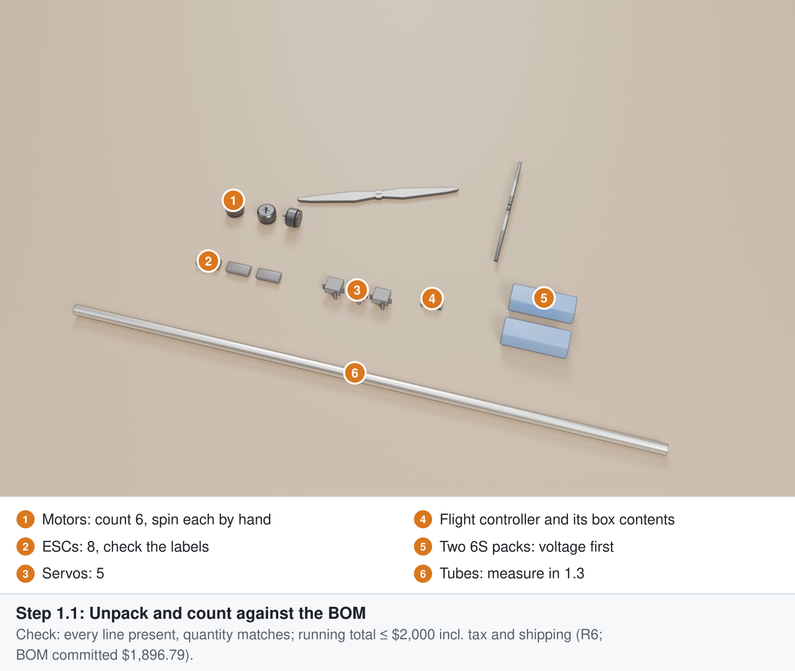

**1.2 Photograph and label.**
- Parts: motors, ESCs, servos, packs.
- Tools: phone, masking tape, marker.
- Procedure: label motors M1–M4, P (pusher), S (spare); ESCs 1–5 and spares; servos AL, AR, E, RL, RR; packs A/B.
- Check: every item labelled; photos filed.
- Time: 1 × 0.3 h.

**1.3 Measure the tubes (hardware-spec M1).**
- Parts: 2 × 1.000 × 0.035 in × 72 in, 1 × 1.000 × 0.058 in × 96 in, 1 × 0.875 × 0.058 in × 36 in.
- Tools: calipers, kitchen scale, 1 m rule.
- Procedure: OD at 3 points per tube; wall at both ends; weigh; roll on the flat table.
- Check: OD 25.40 ± 0.10 (1.000 in) and 22.23 ± 0.10 (0.875 in); wall 0.89 ± 0.05 (0.035 in), 1.47 ± 0.05 (0.058 in) (hardware-spec §5a); mass within +10 % of 185 / 299 / 259 g/m (budget-airframe §1a); no gap > 1 mm over 1 m. Reject outside these.
- Time: 1 × 0.5 h.

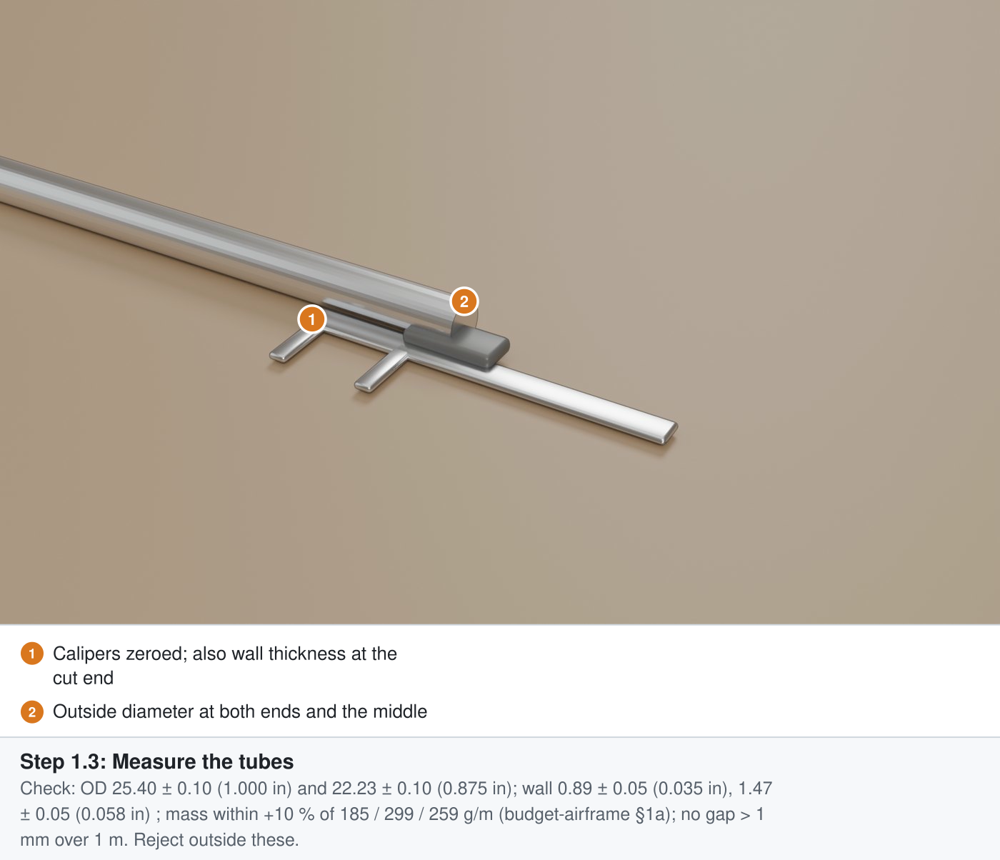

**1.4 Joiner fit FT01 / FT06 (slip fit).**
- Parts: joiner tube, 96 in socket tube (uncut).
- Tools: hands, 0.1 mm tape for shimming.
- Procedure: slide the joiner 300 mm into the socket tube by hand; waggle the tip.
- Check: enters by hand; tip movement at 1 m from the socket end ≤ 5 mm (budget-airframe M4). Tight → note "lap" (WP3 3.6). Loose → note "one wrap of packing tape" (hardware-spec FT01). The same band applies to the saddle bores (FT06 rev B).
- Time: 1 × 0.2 h.

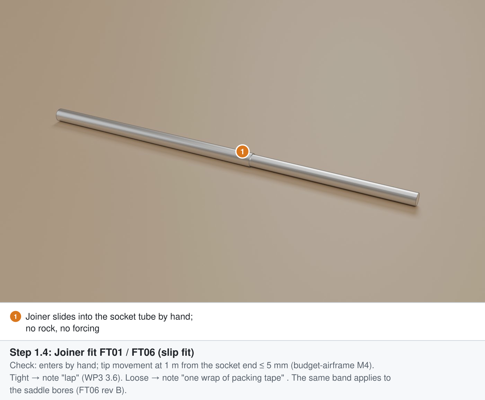

**1.5 Motors.**
- Parts: 6 × SunnySky X4110S 400KV (4 lift, pusher, spare).
- Tools: calipers, scale, multimeter.
- Procedure: weigh; slide a 1755 prop on the shaft; measure the base and hub patterns; spin the bell; measure phase resistances; list and measure the box contents (prop plates, M6 adapter, washer, bullet nut, screws: lengths of the 4 adapter screws = F13, CAD assumes 8 mm EST).
- Check: mass 165 ± 10 g (sunnyskyusa.com X4110S page, checked 2026-10-21); shaft Ø4.00 (0/−0.03), prop slides by hand (FT09); base 4 × M3 on Ø25 ± 0.2, hub 4 × M3 on Ø12; bell free; phase resistances equal within 10 %; adapter + washer + bullet nut present (N04).
- Time: 1 × 0.5 h.

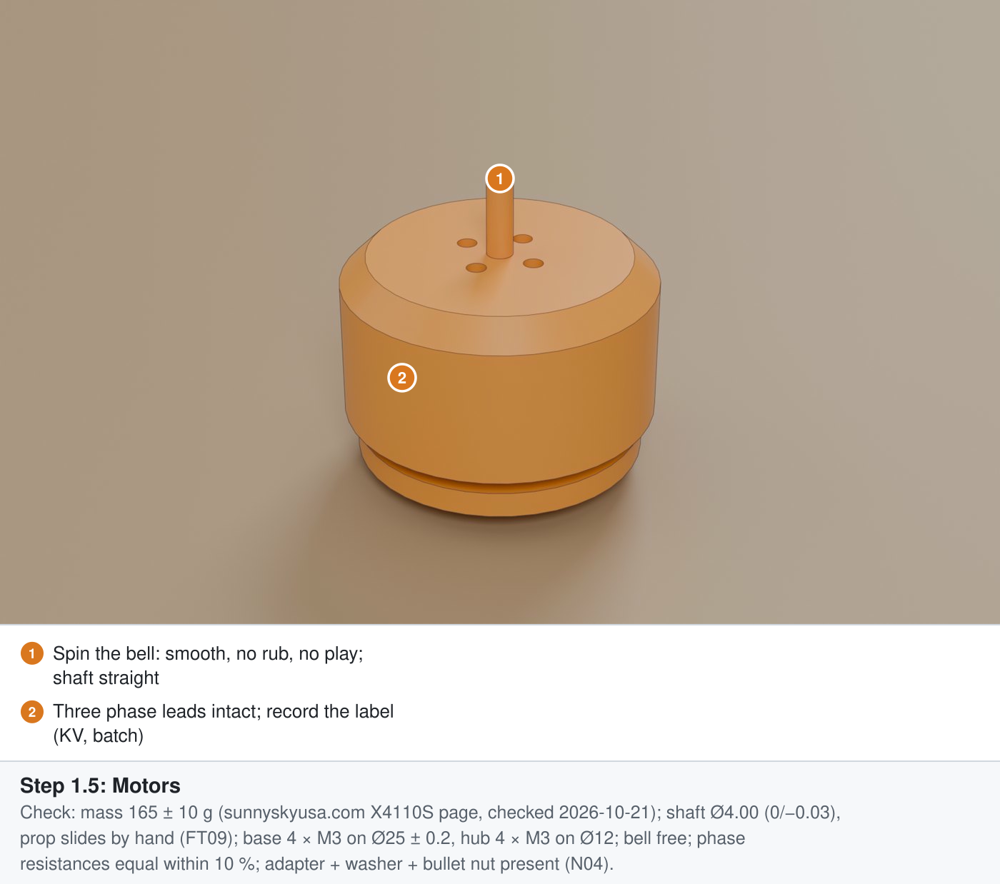

**1.6 Props (M5).**
- Parts: 3 pairs JeeFly 1755, 3 × APC 14 × 8.5EP.
- Tools: calipers, scale.
- Procedure: measure the 1755 hub thickness t and holes; weigh each blade; measure the APC hub and pick the adapter ring for Ø6.
- Check: F12 length = 2.5 + t + 5.0 rounded to 12/16/20, engagement 4.5–8.0 mm (hardware-spec M5); 1755 centre Ø4.0 and 2 × Ø3 on 12 mm; blade pairs within 2 g; APC hub 11.2 mm, Ø20.3, bore 6.35, LPAR06E rings included (apcprop.com, checked 2026-10-21).
- Time: 1 × 0.3 h.

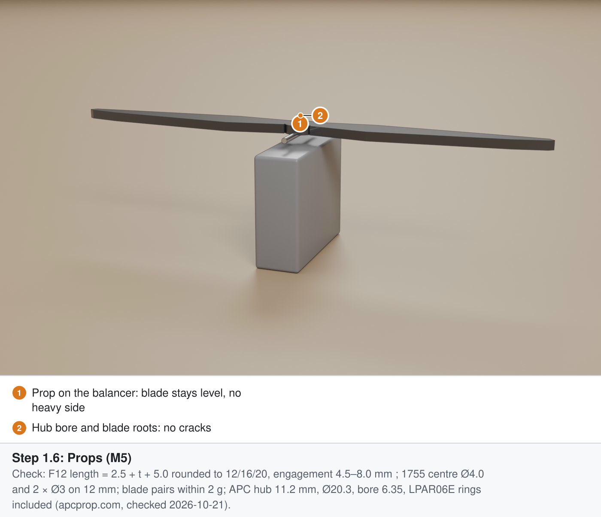

**1.7 ESCs, servos, avionics (M6, M9, M10).**
- Parts: 8 × SoloGood 45A, 5 × ES3005HV, CoreWing F405 Wing V2 (+ its 470 µF capacitor and BLE/WiFi module), HGLRC M100-5883, BeeID, RP3 V2, Holybro MS5525DSO + PT40 kit, Pocket Crush.
- Tools: calipers, scale, phone camera.
- Procedure: record ESC size and mass (—); servo tab hole Ø and spacing (CAD 46 × 10 EST) and whether screws are supplied; CoreWing hole pattern (RMRC "30 × 30, custom", checked 2026-10-21; CAD 45 × 25 EST) and photograph both board faces; PT40 OD and length, tubing length; **find the MS5525DSO CSB pin / jumper on the Holybro board and photograph it** (`firmware/README.md` §4.3); pack dimensions and mass (CAD 155 × 50 × 48 EST; 820 g per Amazon).
- Check: values recorded on the traveler; they go into P17, P18, P19, P21 before printing.
- Time: 2 × 1 h.

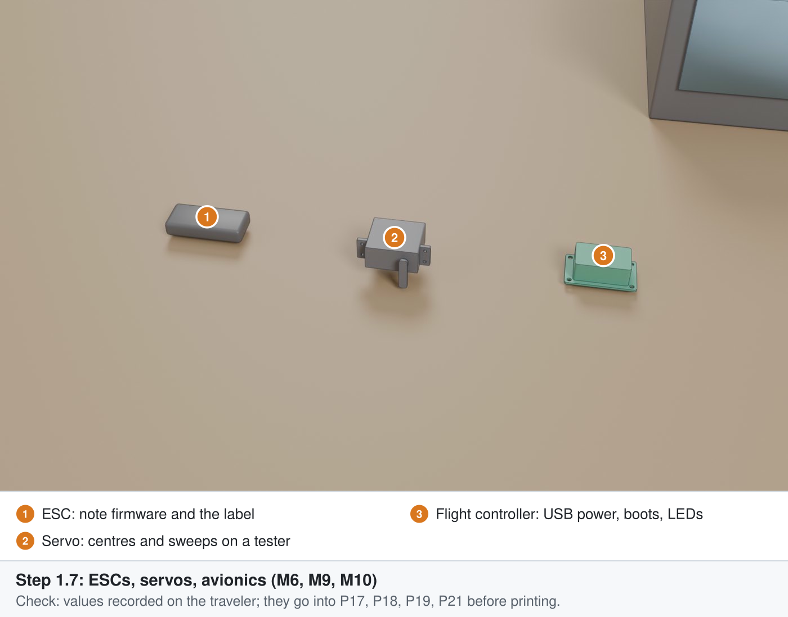

**1.8 Battery intake.**
- Parts: 2 × Ovonic 6S 6500.
- Tools: charger, multimeter.
- Procedure: read every cell; inspect; set storage charge; log.
- Check: cells 3.75–3.90 V, spread ≤ 0.05 V; no swelling; EC5 connector present (re-terminated in WP9).
- Time: 1 × 0.5 h + charger time.

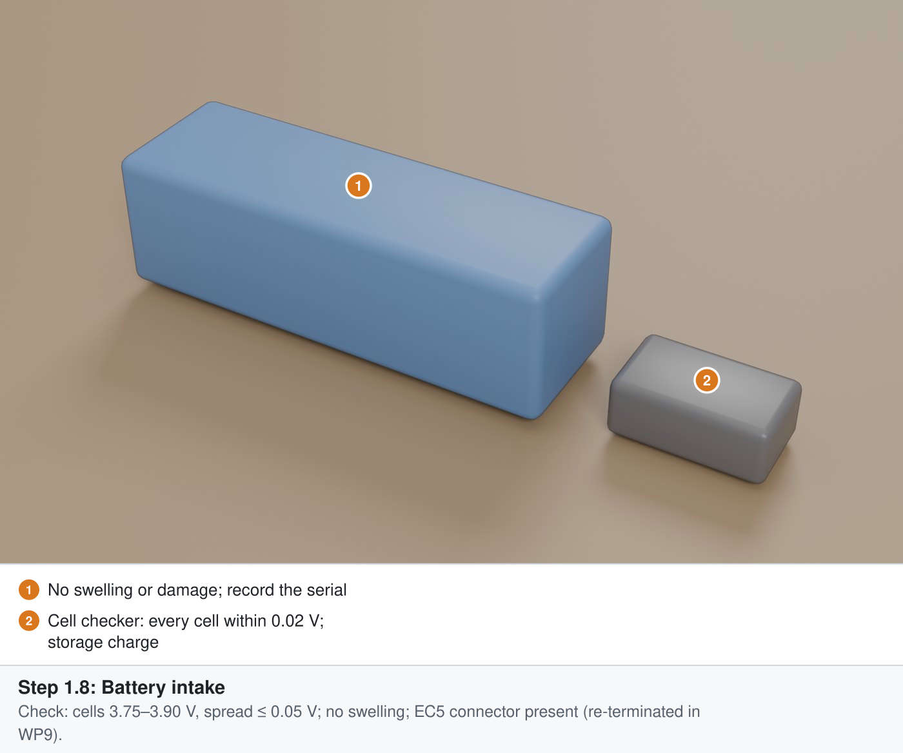

**1.9 Foam and tape.**
- Procedure: inspect every sheet and roll; measure the sheet thickness at four corners.
- Check: FOAMULAR sheets flat, thickness 50.8 ± 1.5 and 25.4 ± 1.0 mm; tape 6 × 1.88 in × 54.6 yd (Amazon B000087KUA, checked 2026-10-21).
- Time: 1 × 0.2 h.

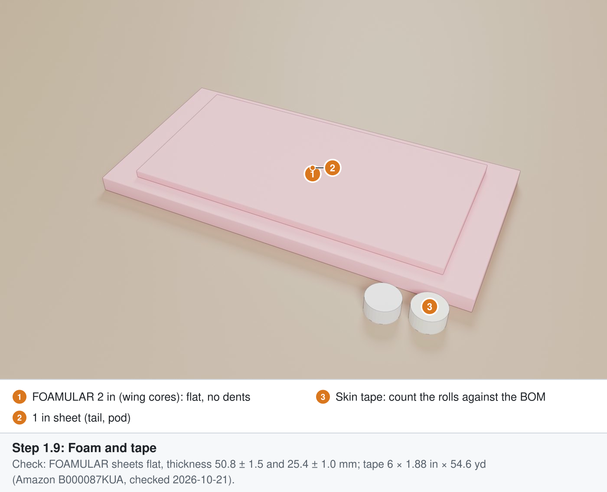

**WP1 traveler**

| # | Step | Result / value | Pass | Done by | Checked by | Date |
|---|---|---|---|---|---|---|
| 1.1 | BOM count; 139 screws / 40 nuts / 28 washers / 67 inserts; spend $ ___ ≤ 2,000 | | ☐ | | | |
| 1.3 | Tube OD / wall / g·m⁻¹ (4 tubes) | | ☐ | | | |
| 1.4 | Joiner play ___ mm at 1 m (≤ 5) | | ☐ | | | |
| 1.5 | Motor mass ___ g, PCD ___ mm, shaft fit; F13 length ___ | | ☐ | | | |
| 1.6 | 1755 hub t ___ mm → F12 length ___ ; APC ring ___ | | ☐ | | | |
| 1.7 | Servo tabs ___ ; FC pattern ___ ; PT40 OD ___ ; tubing ___ m; CSB pin found ☐; pack ___ × ___ × ___ mm, ___ g | | ☐ | | | |
| 1.8 | Pack cell voltages, storage set | | ☐ | | | |
| 1.9 | Foam / tape | | ☐ | | | |
| — | Safety section read and initialled by all four | | ☐ | | | |

---

### WP2 — 3D printing

Owner: print lead. Full list: `docs/build/print-list.csv` (29 part types, 75 printed pieces + optional template backs). Drawing sheets 5 (motor mount, splice plug), 6 (clamps), 7 (fairing), 9 (hardpoints, trays). Settings:

| Material | Nozzle | Hot end °C | Bed °C | Fan | Layer | Walls | Infill | Drying | Post | Source |
|---|---|---|---|---|---|---|---|---|---|---|
| ELEGOO PETG (BOM) | 0.4 brass | 250 ± 10 | 80 ± 10 | 50 % | 0.2 | 4 (clamps); 100 % walls (small hardpoints, pillars, tongues, stops) | 40 % gyroid clamps; 100 % hardpoints; **vase mode** fairings | 65 °C / 4 h if stringing (EST) | none | Prusament PETG TDS v1.1 as the PETG reference (ELEGOO publishes no TDS): nozzle 250 ± 10, bed 80 ± 10, fan 50 %, density 1.27, HDT 68 °C; PDF read 2026-10-21 |
| Polymaker Fiberon PA6-CF20 (BOM) | 0.4 **hardened steel** | 280–300 | 40–50 | **off** | 0.2 | 5 | 100 % | **100 °C / 10 h, RH < 20 %** | **anneal 100 °C / 16 h** | Fiberon PA6-CF20 TDS v1.1 (read 2026-10-21): density 1.17, HDT 173 °C at 1.8 MPa, up to 300 mm/s, brass nozzle life ≈ 9 h |

Mass EST = CAD volume (`cad/verification.txt`, PETG 1.27 / PA6-CF 1.23 g/cm³) × fill factor; print time EST = volume ÷ 10 cm³/h (PETG) or ÷ 7 cm³/h (PA6-CF) — rates EST for a 0.4 mm nozzle at 0.2 mm layers. Totals EST: PETG ≈ 1.0 kg / 98 h; PA6-CF ≈ 0.40 kg / 47 h + 26 h dry/anneal.

**2.1 Printer check (M8).**
- Tools: printer, thermometer.
- Procedure: hold 295 °C for 10 min; bed to 80 °C; measure the usable bed; fit the hardened nozzle for PA6-CF runs and log its hours.
- Check: no thermal-runaway fault; usable bed recorded; P13 plan chosen: flat (bed ≥ 286 × 200 mm), diagonal (bed ≥ 250 × 250 mm) or the K1 two-halves 20 mm lap-joint split; P25 standing (≥ 170 mm height) or on its side.
- Time: 1 × 1 h.

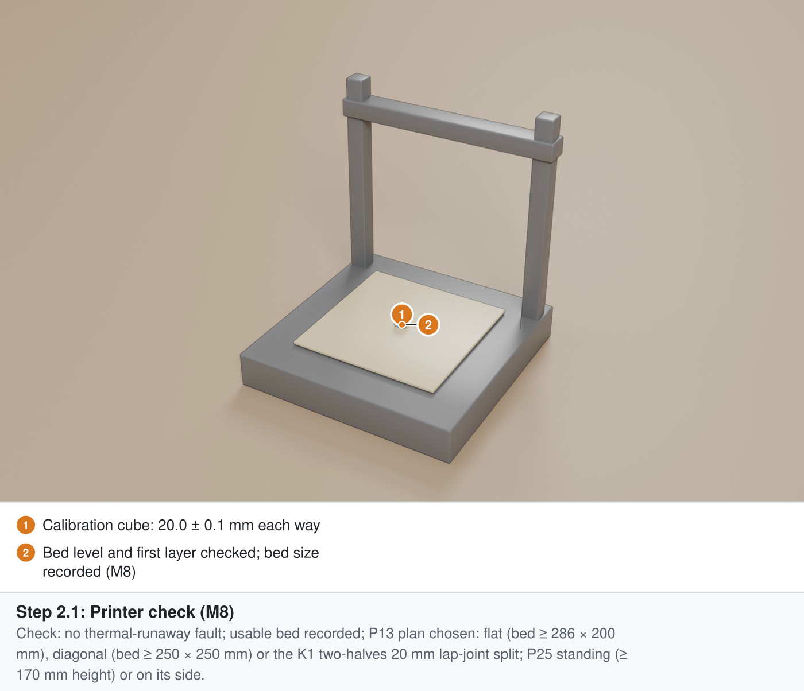

**2.2 Coupons P27 — first article (hardware-spec M2).**
- Parts: P27 in PETG, then in PA6-CF.
- Tools: calipers, an M3 screw shank and an insert as pins, a 25.4 tube offcut.
- Procedure: print; measure every hole and ring; choose the modelled values that give the target as-printed sizes; record the offset per material; apply it to every file before slicing.
- Check: as-printed M3 clearance 3.4 ± 0.1, insert hole 4.0 ± 0.1, bore 25.6 ± 0.1 (FT07, FT08, FT02).
- Time: 1 × 1.5 h + 3 h machine.

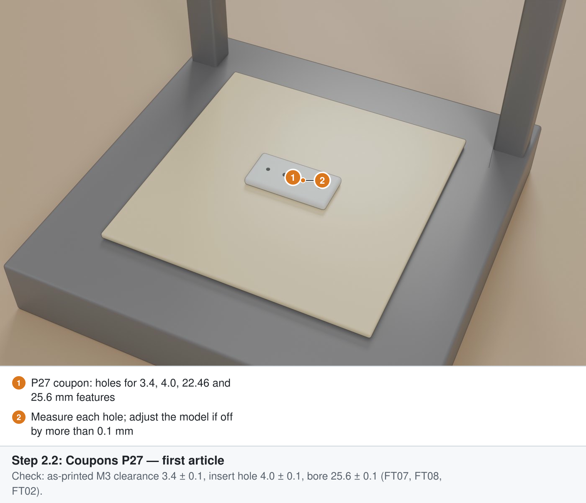

**2.3 Insert and crush test (M3).**
- Parts: 3 × I01 per material in P27; M3 × 8 + W01; a 4.5 mm PA6-CF pad over an aluminium nut on the tube offcut.
- Tools: soldering iron with conical tip at print temperature + 10–20 °C (CNC Kitchen, https://cnckitchen.com/blog/how-to-use-our-threaded-insert-removal-tool, checked 2026-10-21): PETG ≈ 260–270 °C, PA6-CF ≈ 300 °C (EST); hanging-mass torque rig.
- Procedure: push each insert in square until 0.1–0.3 mm below the surface; hold 3 s; lift out; cool 60 s; torque each to spin-out; torque the M3 × 8 through the floor pad to 0.6 N·m; re-check after 24 h.
- Check: torque-out ≥ 1.0 N·m on all three per material (2 × the 0.5 N·m working torque); floor screw turns ≤ 30° on re-torque. Fail → halve the working torque or use the longer ruthex insert (§6 G4).
- Time: 1 × 1 h + 24 h wait.

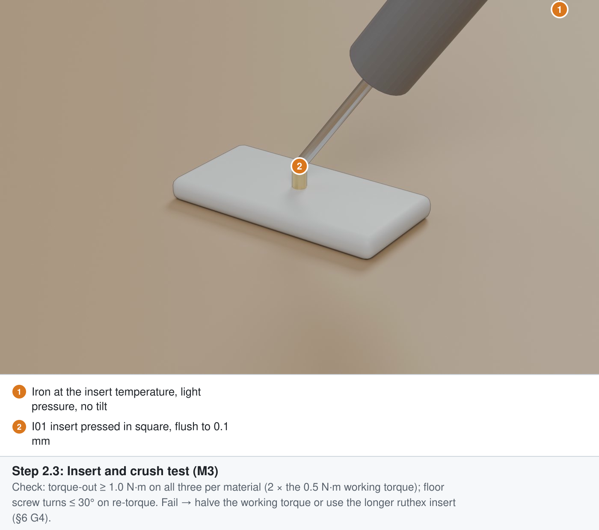

**2.4 Print the jigs and caps first.**
- Parts: P28 drill guide; P02 × 4 (rear caps carry the splice grooves); P07 × 4.
- Tools: calipers, tube offcut.
- Procedure: print; test every bore on the offcut; measure counterbore depths.
- Check: bores 25.6 ± 0.1 (slip, no rock); counterbores per print-list ± 0.2 (gear clamp: Ø6.5 × 15.3, F05 Ø7.5 × 4.0 and nut pocket 5.7 AF × 4.3).
- Time: 0.5 h labour; machine P28 1.8 h, P02 16 h, P07 16 h.

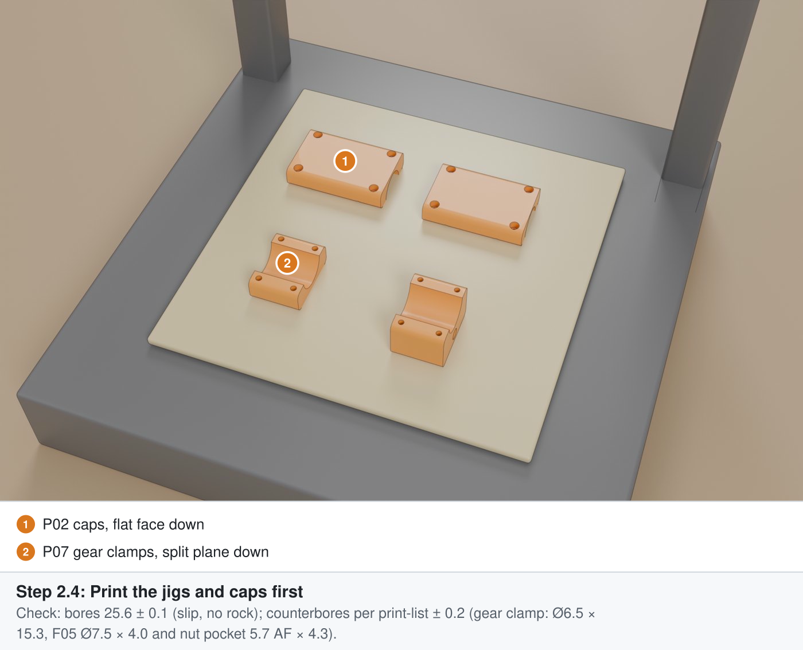

**2.5 PA6-CF batch: P01 × 4, P03 × 1.**
- Parts: Fiberon PA6-CF20, dried.
- Tools: dryer/oven, hardened nozzle, calipers.
- Procedure: dry 100 °C/10 h; print one P01 and stop if the floor or bore is out; print the rest; anneal all together 100 °C/16 h (TDS); re-measure after annealing (TDS shrinkage ≈ 0.2–0.3 %: a 25.60 bore becomes ≈ 25.53 *(calc)* — set the model so the **post-anneal** bore is 25.6 ± 0.1).
- Check: floor 4.50 ± 0.15 (`cad/hardware.json` general_tolerances motor_floor_thickness 4.35–4.65); bore 25.6 ± 0.1 post-anneal; no layer gaps on the floor.
- Time: 2 h labour; machine 30 h print + 26 h dry/anneal.

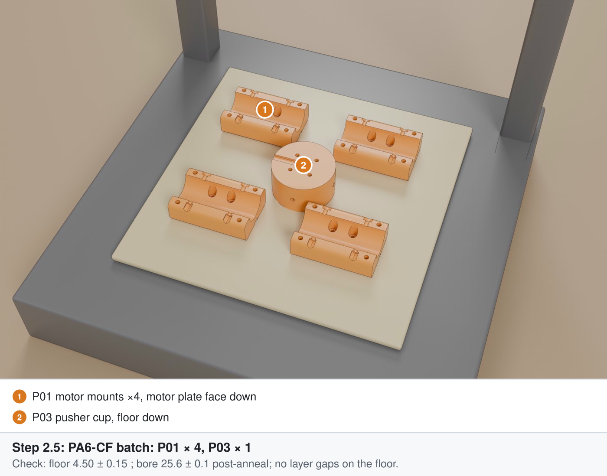

**2.6 PETG batch.**
- Parts: everything else in print-list order of need: P04, P05, P06, P08, P09, P10, P11, P12, P13, P14, P15, P16, P26, P25 (fairings, vase mode, standing), P20–P24; P17/P18/P19 **only after M6/M10 are measured**.
- Procedure: slice with the coupon offset; print; measure the critical features; log.
- Check: controlled bores/insert holes ± 0.1, clearance holes ± 0.2, uncontrolled ± 0.5 % / ± 0.5 mm (hardware-spec 5c; every drawing sheet carries the same block); fairing P25: inner cavity slides over the Ø25.4 leg by hand with ≤ 0.5 mm play, wall 0.8 ± 0.2, no holes in the vase wall.
- Time: 4 h labour over the run; machine ≈ 80 h.

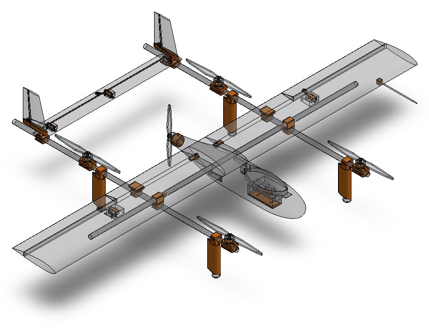

**2.7 Drill the motor patterns and counterbores.**
- Parts: P01 × 4, P03.
- Tools: drill press, Ø3.4 bit, Ø7.5 counterbore or end mill, a motor as the jig (PCD Ø25, position Ø0.2 to the bore axis).
- Procedure: print the four holes at Ø2.8 as pilots; set the motor on the plate with its shaft through the centre relief; mark through the base holes with a transfer punch; drill Ø3.4 from the plate side; counterbore **Ø7.5** from the bore side to leave exactly the 4.5 mm floor (rev B: the Ø7.0 W01 washer needs Ø7.5, hardware-spec CAD notes J01).
- Check: M3 × 8 + W01 drops through each hole and the washer sits flat in the counterbore; screw tip stands **2.8–3.2 mm** proud of the floor (M4).
- P03: no slots at build (2026-10-25, `docs/research/thermal.md` §6.3–6.4 item 6). The cup sits fully inside the Ø56 × 30 tail-ring bore, so wall slots would vent into foam, and the thermal model already credits the can with the free-stream film on every exposed face, so venting cannot lower the 80 °C hot-day prediction after 600 s of cruise (2026-10-27 run at 18 m/s; 91 °C in the 2026-10-25 run at 20 m/s), which sits on the 80 °C EST limit; that number is set by the estimated 29.5 W loss. Measure first (TEST-PLAN G03 tied-down 3 min at cruise throttle and the IR check after F08): if the can rises 25 K or more above ambient after a 120 s leg (≥ 45 °C on a 20 °C day; the model's rise), reduce the loss (prop/throttle match, ESC timing) and fit an aluminium spider floor as a conduction path; at a rise of 17 K or less (≤ 37 °C on a 20 °C day, loss ≤ 20 W EST), leave the cup closed.
- Time: 1 × 1.5 h (+ 0.5 h for the P03 slots).

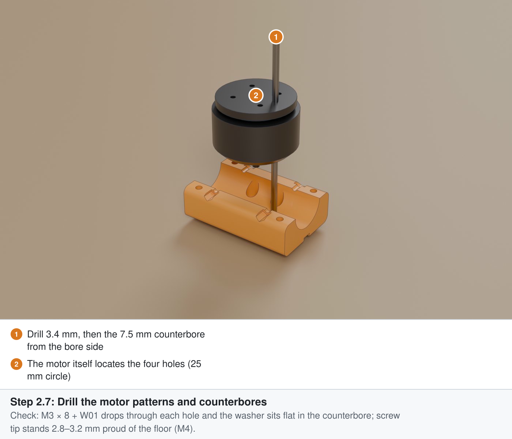

**2.8 Install all 67 inserts (I01).**
- Parts: per print-list "inserts_I01_each": motor mounts 16, tail clamps 12 (4 split + 2 top per side), gear clamps 16, spar collars 4, rear hardpoints 4, pusher cup 4, pod rails 6 (4 saddle tabs + 2 hatch), pitot clamp 1, FC tray 4 = 67 (`cad/hardware.json` inserts qty_breakdown).
- Tools: iron per 2.3, heat-proof mat, flat block.
- Procedure: install; press flush; cool; run an M3 screw through each.
- Check: each insert flush to −0.3 mm; square (an M3 × 16 screwed in leans ≤ 1 mm at 16 mm); no melted plastic in the thread.
- Time: 2 × 2 h.

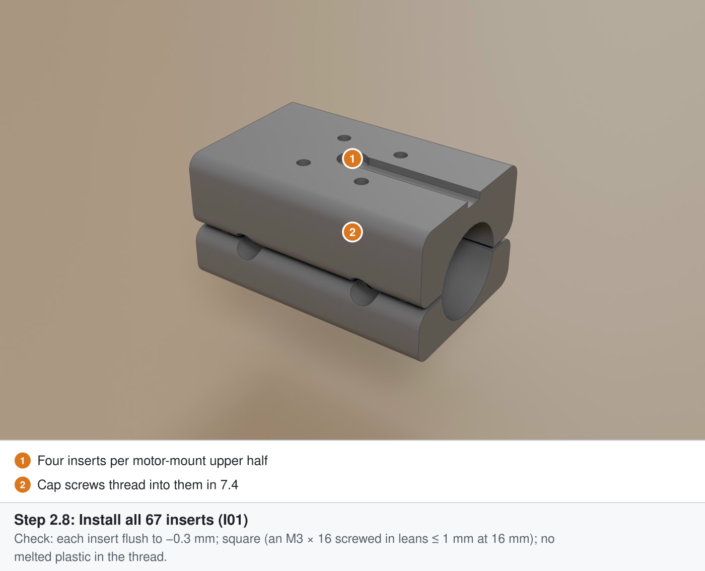

**2.9 Print log.**
- Procedure: record per part the date, material lot, dryer hours, nozzle, measured critical dimensions, offset used.
- Check: every printed piece has a log line before it leaves the print bench.
- Time: continuous.

**WP2 traveler**

| # | Step | Value | Pass | Done | Checked | Date |
|---|---|---|---|---|---|---|
| 2.1 | Hot end 295 °C / bed size ___ / hardened nozzle | | ☐ | | | |
| 2.2 | Offsets: PETG M3 ___ / insert ___ / bore ___ ; PA6-CF ___ / ___ / ___ | | ☐ | | | |
| 2.3 | Torque-out PETG ___ ___ ___ ; PA6-CF ___ ___ ___ N·m (≥ 1.0); crush ___° (≤ 30) | | ☐ | | | |
| 2.5 | P01 floors ___ ___ ___ ___ (4.35–4.65); bores post-anneal ___ | | ☐ | | | |
| 2.6 | Fairings ×4 slide on the leg; wall 0.8 ± 0.2 | | ☐ | | | |
| 2.7 | Screw tip proud ___ mm × 20 (2.8–3.2); washers seat in Ø7.5 | | ☐ | | | |
| 2.8 | 67 inserts flush and square | | ☐ | | | |
| — | PA6-CF used ___ g of 500; PETG used ___ g of 2000 | | ☐ | | | |

---

### WP3 — Tube cutting and drilling

Owner: structures lead. Cut list: `docs/build/cut-list.csv` (T01–T05); drawing sheet 7. Tolerances: length ± 0.8 mm (400–1000 mm) and ± 0.5 mm (legs), end squareness 0.5 mm, cross-hole position ± 0.3 mm (ISO 2768-m, hardware-spec 5c).

**3.1 Lay out the 72 in boom tubes.**
- Parts: 2 × 1.000 × 0.035 in × 72 in.
- Tools: 1 m rule, square, scriber, masking tape.
- Procedure: square and deburr one end; mark 991.0 (front boom), 1.5 kerf, 485.9 (stub) → 1478.4 total; 350.4 mm remains per tube *(calc: 1828.8 − 1478.4)* as coupon stock (review M[structures].5 boom deflection; thrust-stand arm).
- Check: marks ± 0.3 mm; both tubes identical to ± 0.5.
- Time: 1 × 0.3 h.

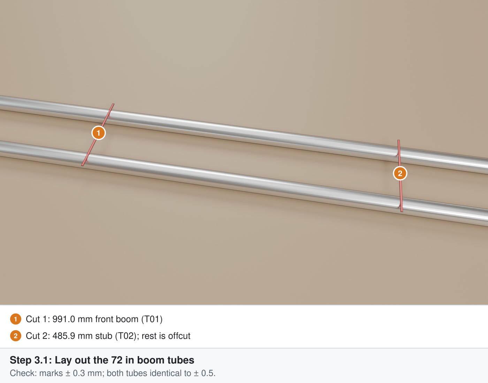

**3.2 Cut T01 and T02 (4 cuts).**
- Tools: hacksaw 32 TPI in the mitre box (K7) or tube cutter; file; deburring tool.
- Procedure: rotate the tube a quarter turn every 10 strokes; file the end flat; deburr inside and out; wipe.
- Check: 991.0 ± 0.8 and 485.9 ± 0.8; squareness gap ≤ 0.5 mm against the square; the splice plug P04 enters each butt end by hand.
- Time: 1 × 1 h.

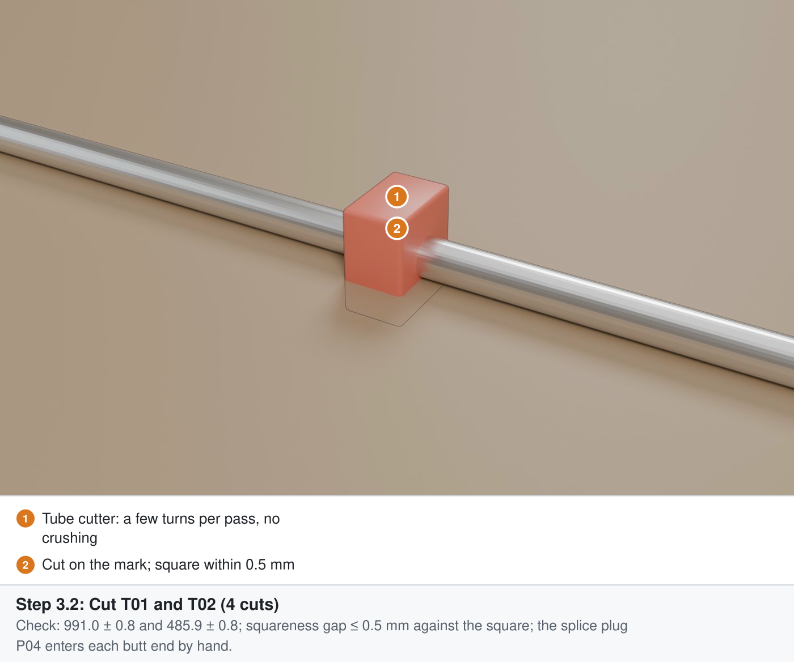

**3.3 Cut the 96 in socket tube: T03 × 2 then T04 × 4.**
- Procedure: cut 800, 800, then 205 × 4, each from the fresh end; only 11 mm of slack *(calc)* so re-square no more than 0.5 mm.
- Check: 800 ± 0.8; 205 ± 0.5; total consumed ≤ 2438 mm.
- Time: 1 × 1.2 h.

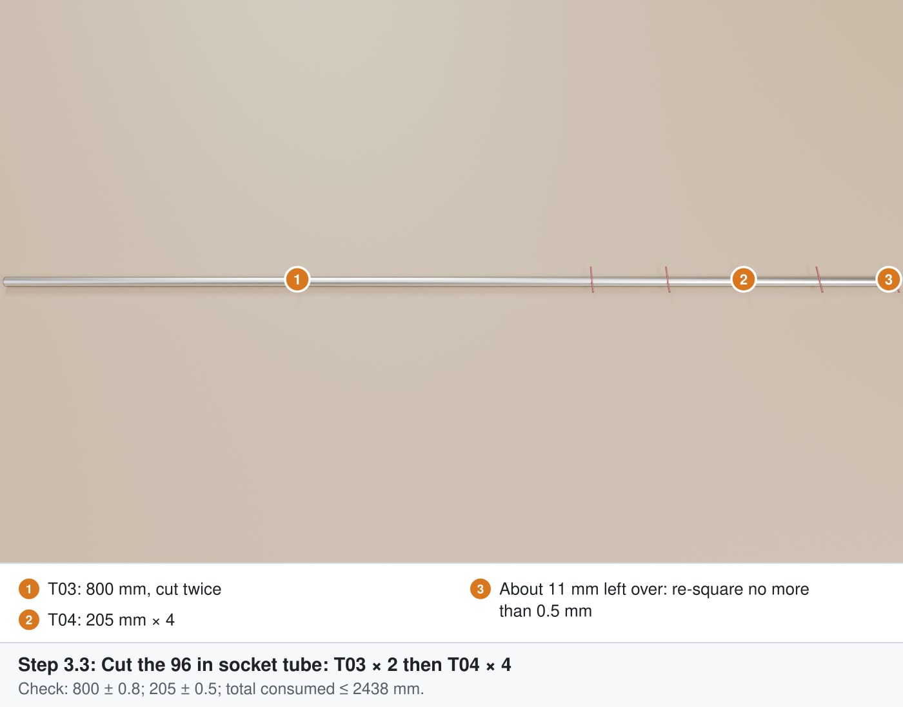

**3.4 Cut T05 joiner 760 mm.**
- Procedure: cut; chamfer both ends 1 × 45° with a file; keep the 154 mm offcut as the FT01 coupon.
- Check: 760 ± 0.8; enters a socket by hand (slip fit; it is never bonded).
- Time: 1 × 0.3 h.

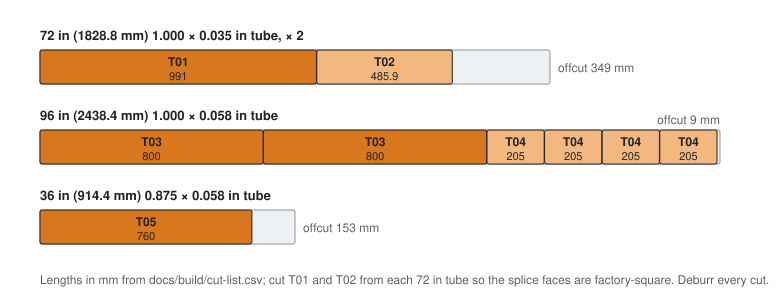

**3.5 Mark the station lines on both front booms and stubs (permanent).**
- Parts: 2 front booms, 2 stubs.
- Tools: rule, scriber, paint pen, two V-blocks.
- Procedure: from the **front** end of each front boom (x = +0.44094 m, `analysis/results.json` geo booms x1) scribe: front motor-mount centre **50.0** (xFront 0.39094); front gear clamp **140.0** (xFront − 0.09, `cad/params.mjs`); front wing clamp **526.2** (x −0.08525, `cad/params.txt` sparX); rear wing clamp **668.3** (x −0.22734 = −0.8 c); rear gear clamp **901.0** (x −0.46008 = xRear + 0.09); aft end 991.0 = rear motor centre / splice. On each stub from its **forward** (butt) end: tail clamp centre **299.8** (x −0.84988, `cad/params.txt` xTC), fin LE 265.9 (xFinLE −0.81598), aft end 485.9. Scribe a straight **top** generator line along each tube (tube in the V-blocks, rule along it): the clocking reference for every clamp.
- Check: stations ± 0.5 mm; clamp spacing 668.3 − 526.2 = 142.1 = 0.5 c *(calc)*; top line straight within 0.5 mm.
- Time: 1 × 0.8 h.

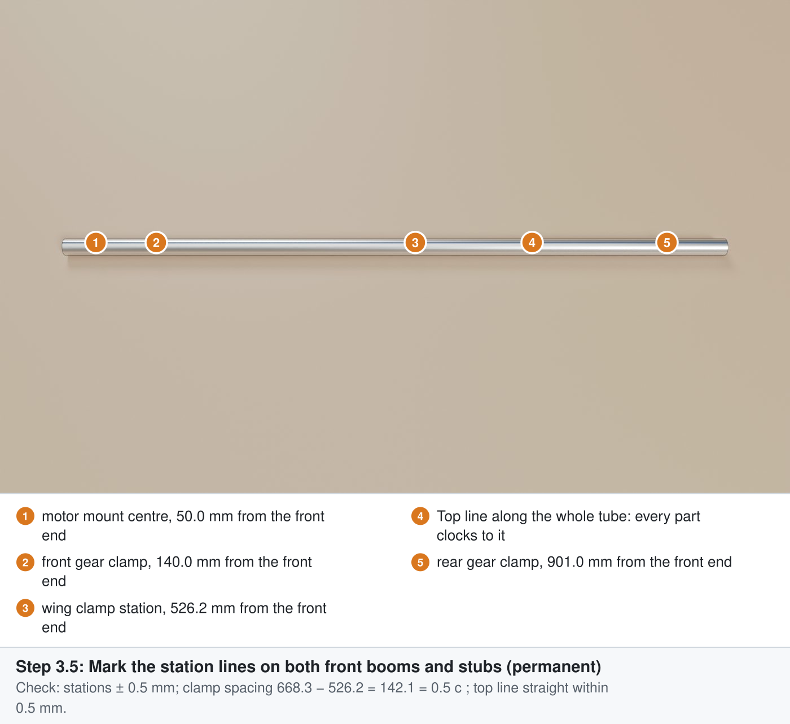

**3.6 Lap the joiner if 1.4 was tight.**
- Tools: 400 grit wrapped on the joiner.
- Procedure: rotate in the socket; wipe; re-test.
- Check: enters 300 mm by hand; tip play ≤ 5 mm at 1 m (FT01).
- Time: 1 × 0.5 h if needed.

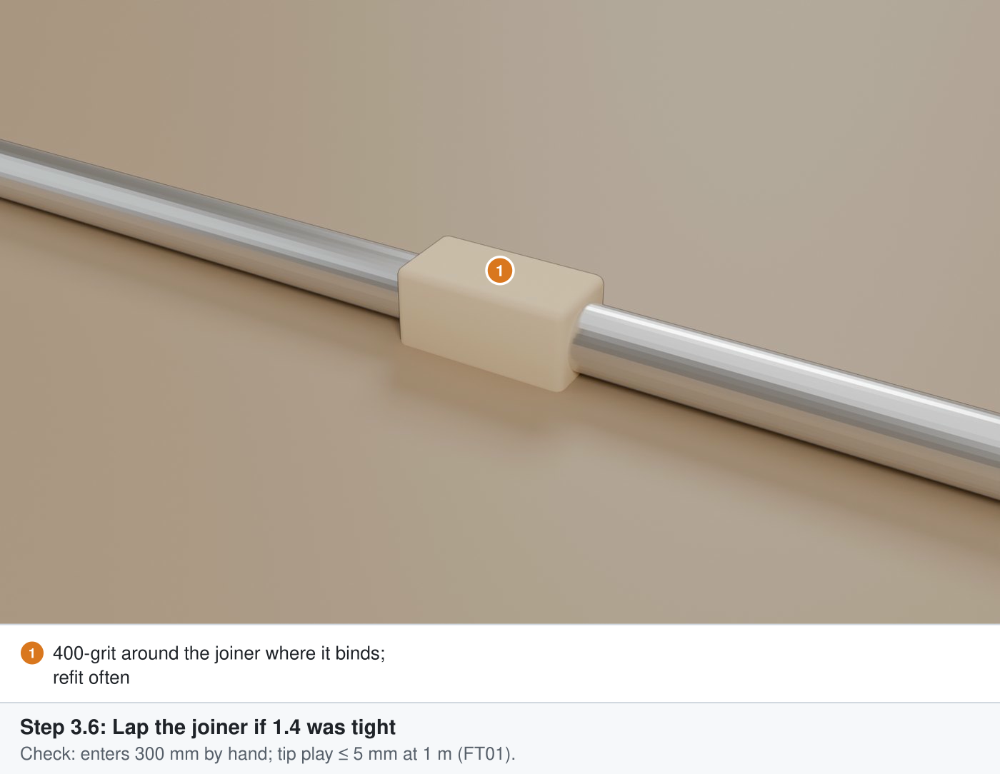

**3.7 Splice cross-holes Ø3.4 (F04) — drilled in situ in WP7 7.6.**
- Procedure: only if the rear cap is not printed yet: use P28 with its 18.0 mm stop on the front boom aft end and the stub forward end, horizontal plane relative to the top line, through both walls.
- Check: 18.0 ± 0.3 from the end; on the horizontal centreline ± 0.3 (drill shank through the tube lies parallel to the table with the top line up).
- Time: 1 × 0.5 h.

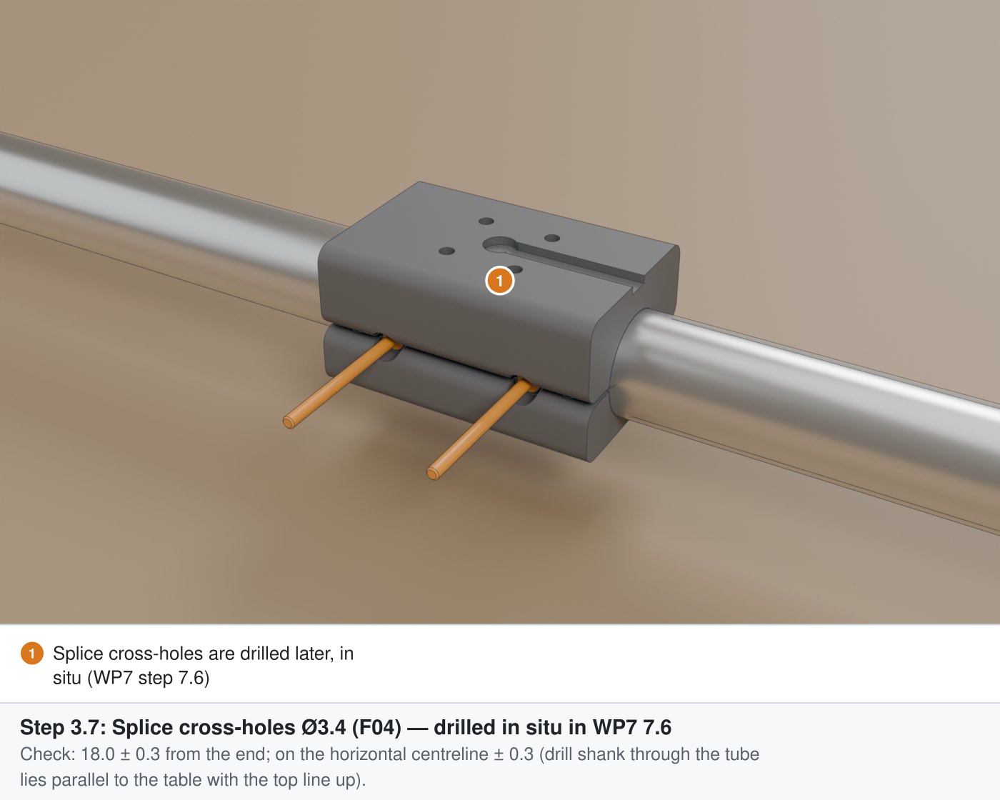

**3.8 Leg cross-holes Ø3.4 (F05) × 4 — drilled in WP8 8.7 through the gear clamp as the jig.**
- Procedure: if drilled now: P28 second guide at the sheet-7 distance (7.0 mm from the top end *(calc, hardware-spec J07)*; confirm on the sheet).
- Check: ± 0.3 from the top end; square to the axis.
- Time: 1 × 0.4 h.

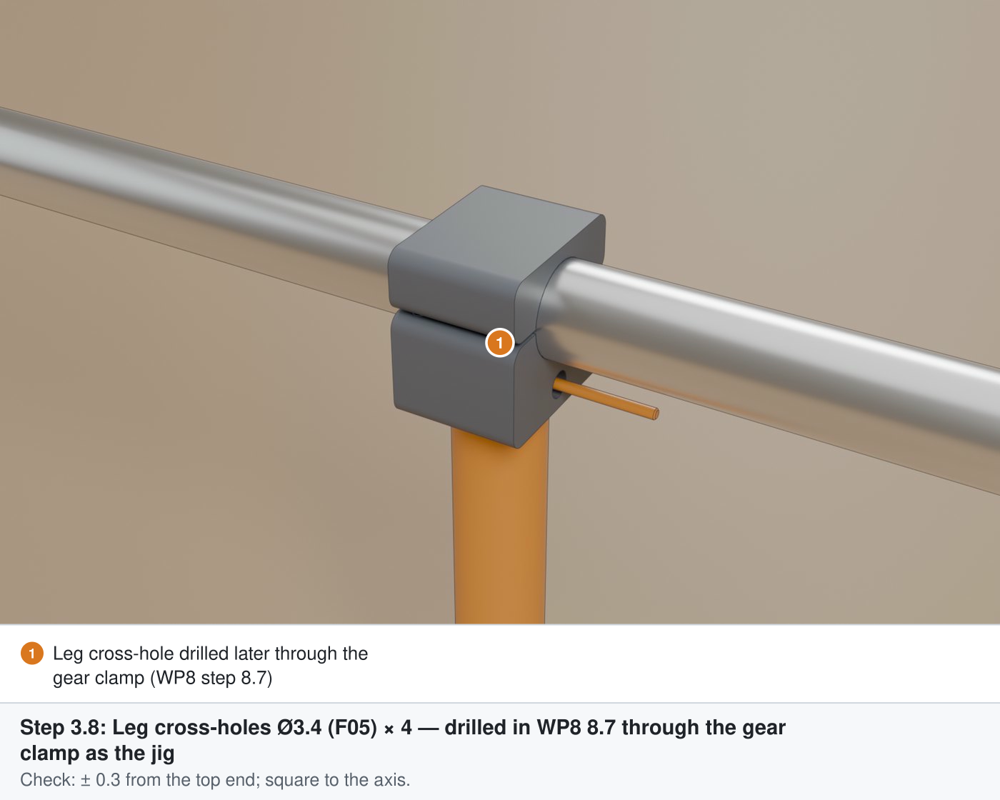

**3.9 Deburr, clean, weigh.**
- Procedure: deburr; wipe with isopropyl; weigh.
- Check: no burr catches a fingernail; masses logged for the W&B (expected *(calc 185/299/259 g·m⁻¹)*: front boom 183.3 g (`cad/verification.txt` 183.1), stub 89.9, socket 239, leg 61, joiner 197).
- Time: 1 × 0.3 h.

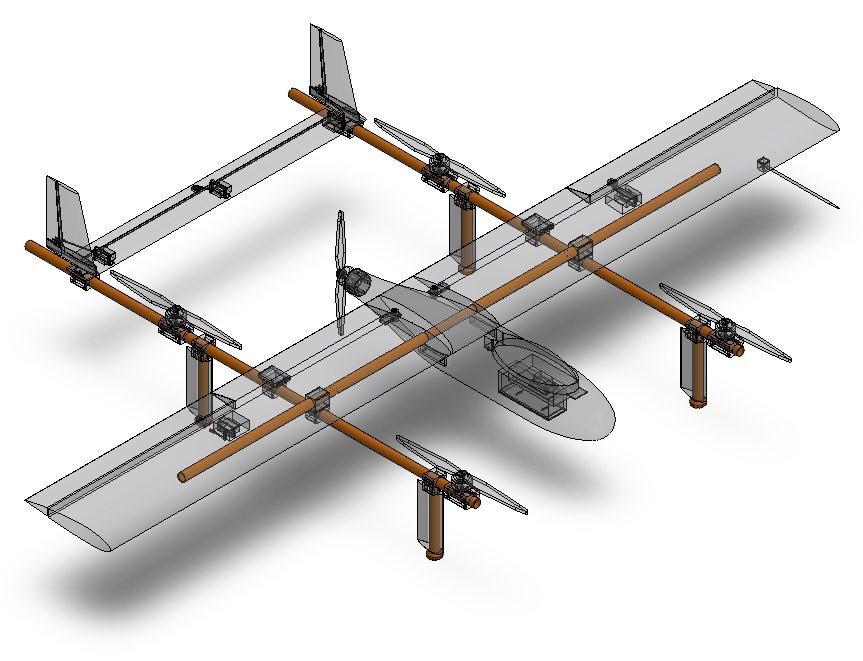

**WP3 traveler**

| # | Item | Measured | Spec | Pass | Done | Checked | Date |
|---|---|---|---|---|---|---|---|
| 3.2 | Front boom L/R | | 991.0 ± 0.8 | ☐ | | | |
| 3.2 | Stub L/R | | 485.9 ± 0.8 | ☐ | | | |
| 3.3 | Sockets ×2 | | 800 ± 0.8 | ☐ | | | |
| 3.3 | Legs ×4 | | 205 ± 0.5 | ☐ | | | |
| 3.4 | Joiner | | 760 ± 0.8 | ☐ | | | |
| 3.5 | Stations and top line scribed; clamp spacing | | ± 0.5; 142.1 | ☐ | | | |
| 3.9 | Masses g: boom __ __ stub __ __ socket __ __ leg __ __ __ __ joiner __ | | | ☐ | | | |

---

### WP4 — Foam wing cores, spar sockets, joiner stops, hardpoint pockets

Owner: structures lead, 2 people at the bow. Section NACA 2415, **chord 284.176 mm**, panel 1120 mm, constant chord (`cad/params.txt`); spar socket Ø25.4 × 800 bored from the root at 30 % c on the camber line (sparX 85.25 mm aft of the LE, sparY +5.33 mm), leaving ≈ 8.6 mm of foam above and below *(calc: upper +26.65, lower −15.99 at 30 % c from `cad/params.txt` yL30 + thick30; tube ± 12.7 about +5.33)*. Drawing sheet 4.

**4.1 Make the templates.**
- Parts: `docs/build/templates/wing_root_naca2415.svg`, `wing_tip_naca2415.svg` (generated from `cad/params.txt`; sheets are 300 mm wide, so print the `_A` and `_B` half sheets on Letter/A4 at 100 % and join at the red crosses, or the full sheet on Tabloid/Legal), backing (3 mm ply / 1.5 mm Al, §6 G1, or printed P29).
- Tools: printer, rule, knife, 240/400 grit, candle wax.
- Procedure: print at 100 % (no "fit to page"); measure the check line; glue to the backing; cut to the black line; sand; wax; make two root and two tip templates.
- Check: 100 mm check line 100.0 ± 0.3 and the 10 mm bar 10.0 ± 0.1; profile within 0.3 mm of the printed line; LE radius smooth.
- Time: 2 × 2 h.

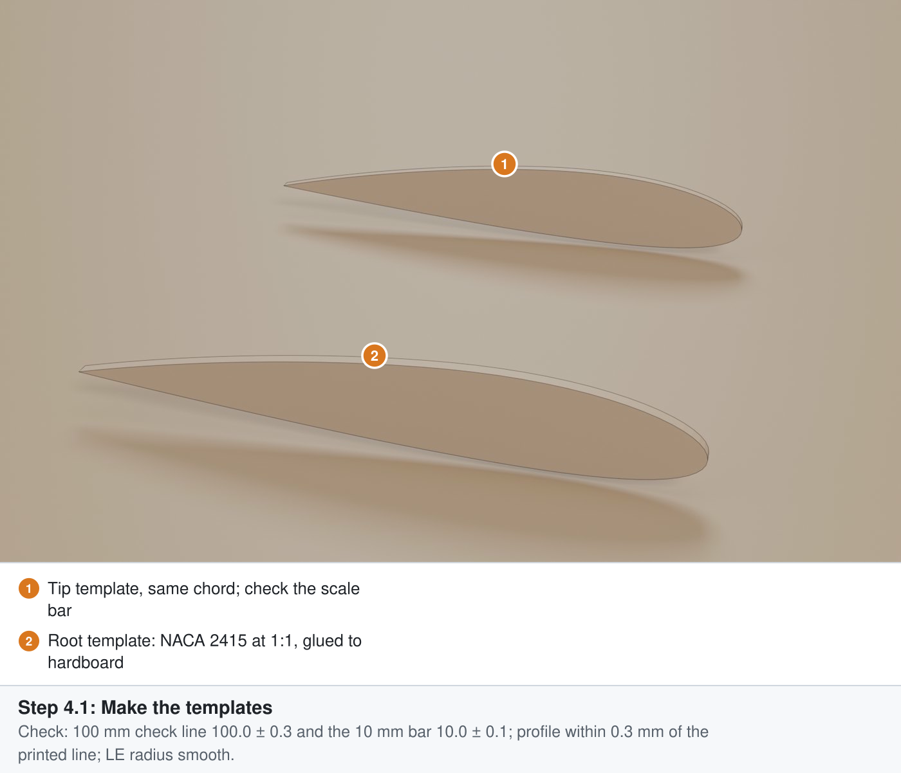

**4.2 Set up the bow.**
- Parts: 1.3 m bow, 0.4–0.5 mm nichrome, bench supply (K13).
- Procedure: tension the wire; start at 1.0 A and raise in 0.2 A steps on scrap until it cuts at ≈ 5 mm/s with no drag (typical 1.5–2.5 A on 0.5 mm wire EST; the WebSearch of 2026-10-21 found only the "minimum heat that cuts, constant feed" rule, Harvard SOP).
- Check: wire sag < 2 mm at temperature over 1.3 m; kerf on scrap measured (expect 0.5–1.0 mm EST).
- Time: 2 × 1 h.

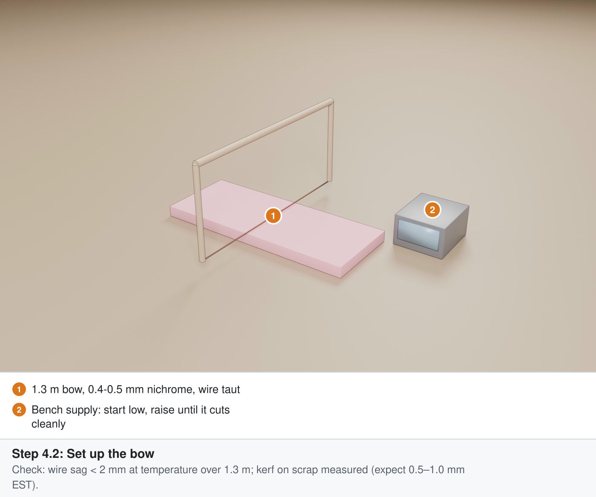

**4.3 Test cut and kerf.**
- Parts: 300 mm scrap of the 2 in sheet.
- Procedure: cut a 100 mm square against the template's check line; measure.
- Check: if the core comes out > 0.3 mm under, re-run `make_templates.py --kerf <measured/2>` and re-make the templates, or accept (0.5 mm on a 42.6 mm section is 1.2 %).
- Time: 2 × 0.5 h.

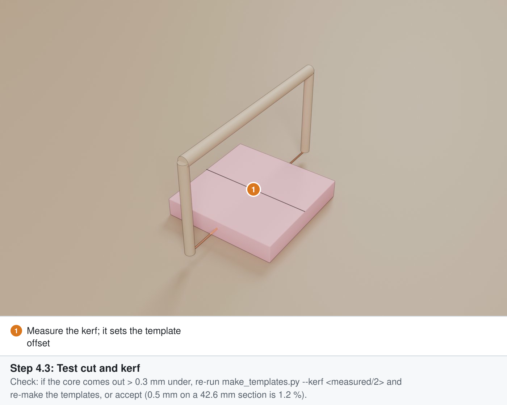

**4.4 Cut the core blocks F01 × 2 and F02 × 1.**
- Parts: FOAMULAR NGX F-250 2 in sheet (Home Depot 52DDNGX).
- Tools: straight edge, hand saw or long knife.
- Procedure: on the 2438 × 1219 sheet cut two 1140 × 304.2 × 50.8 panel blocks end to end along the length (2280, 158 spare) in one 304.2 mm strip (304.2 = chord 284.2 + 2 × 10 lead-in *(calc, cut-list F01)*); the 160 × 304.2 saddle block and test scrap from a second strip (4 strips × 304.2 = 1216.8 < 1219 ✓, only 2.2 mm to spare *(calc)*: measure the sheet width first (1.9) and cut the strips with the knife, not a saw); mark the extrusion skin so both panels are cut in the same orientation.
- Check: block faces square ± 1 mm.
- Time: 1 × 0.5 h.

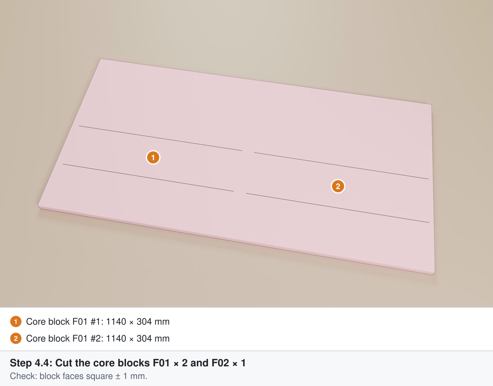

**4.5 Pin the templates and cut the panels (2 people).**
- Parts: F01 blocks, templates.
- Procedure: pin root and tip templates on the block ends with the chord lines parallel to the block edge and the LE circles both 20 mm from the block front face (0° twist: the panel is a straight extrusion, `cad/params.mjs`); enter at the TE lead-in; trace lower surface → LE → upper surface → TE lead-out, both operators calling stations 0…10; feed ≈ 5 mm/s EST, never stop inside the foam; then cut the **72 %** line (fixed panel) and the aileron blank along 74–100 % (2 % = 5.7 mm hinge gap *(calc: 0.02 × 284.2)*, `cad/BuildVtol.cs` Aileron).
- Check: chord 284.2 ± 1.0 root and tip; thickness at 30 % c 42.6 ± 0.7; span 1120 ± 2 after trimming; twist ≤ 1 mm tip-TE rise on the table; no steps > 0.3 mm (sand with the 600 mm board, 240 grit, chordwise only).
- Time: 2 × 2 h for both panels and the saddle block.

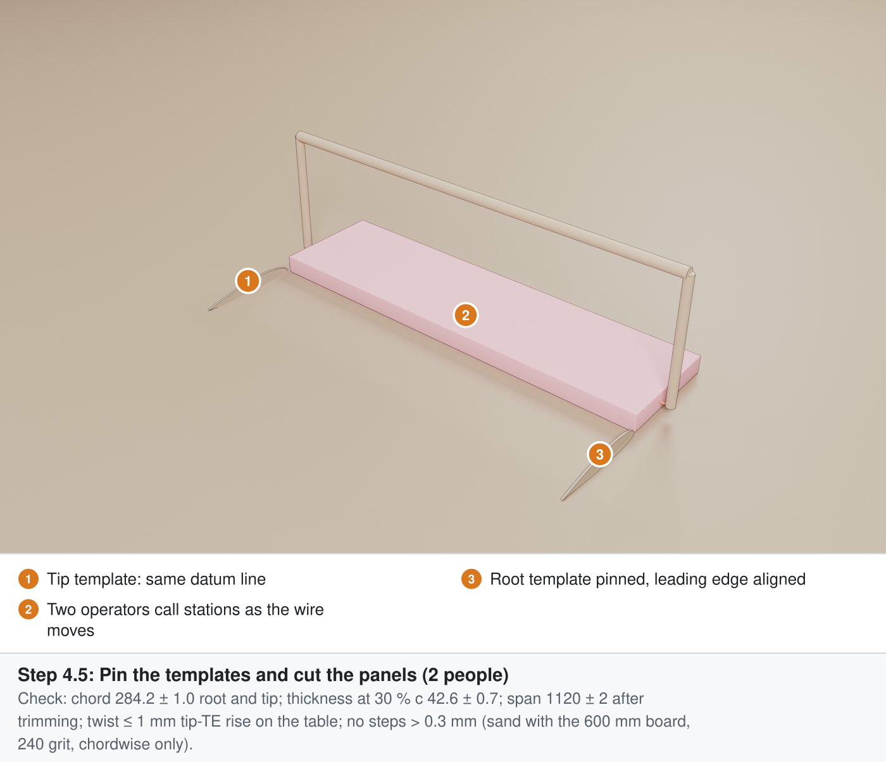

**4.6 Cut the spar channel (FT05, Ø26.0 ± 0.5 × 800 from the root).**
- Parts: 600 mm of 1.000 in tube offcut (not a flight tube) or a Ø26 nichrome loop.
- Tools: heat gun, template circle as the guide.
- Procedure: heat the tube offcut to ≈ 150 °C EST; push in from the root along the camber line at 30 % c in 100 mm bites, re-heating; or run a Ø26 wire loop on the bow from the root face to 800 mm, exiting through a slit (CAD README: "socket channel cut with a heated tube").
- Check: Ø26.0 ± 0.5 (the flight socket slides in by hand with ≤ 0.5 mm radial play, no force); centred 85.3 ± 1.0 mm aft of the LE and 5.3 ± 1.0 above the chord line at both ends; depth 800 ± 3; blind end.
- Time: 2 × 1.5 h for both panels.

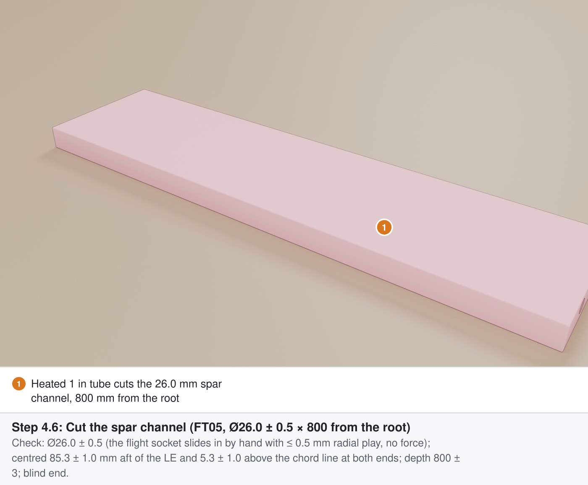

**4.7 Bond the joiner stops P26 and the spar sockets T03 (J20, J11/FT06 rev B).**
- Parts: 2 × T03 sockets, 2 × P26 stop discs (Ø22.4 × 10 PETG), foam-safe glue, 5-min epoxy.
- Tools: 300 mm rule, a 1.000 in offcut as a pusher.
- Procedure: abrade the socket OD and the inside of the socket at 300 mm; **bond a P26 disc inside each socket with its root-facing face exactly 300 mm from the socket's root end** (epoxy, pushed to a 300 mm mark on the offcut; this face is what the slip-fit joiner butts against, hardware-spec CAD notes J11); cure; then coat the socket OD and the channel with foam-safe glue; push the socket home with a twist, root end flush with the root face; wipe; weight the panel flat on its lower surface; cure 24 h (glue label —).
- Check: stop face 300 ± 1 mm from the root face (depth gauge); joiner enters 300 mm and bottoms on the stop; socket flush with the root face ± 0.5; panel flat (≤ 1 mm tip rise).
- Time: 2 × 1 h + 24 h cure.


**4.8 Spar collar P11 and rear hardpoint P12 (C5; sheet 9).**
- Parts: P11 × 2, P12 × 2, foam-safe glue, epoxy (tube side only).
- Tools: knife, scriber, calipers.
- Procedure: at the boom station **353.7 mm** from the panel root face *(calc: yIn 0.4337 − fusR 0.08; params zBoomPanel)* cut the lower-surface foam away over the socket, 46 mm wide along the span, down to the tube; bond P11 around the socket (epoxy on the abraded tube, foam-safe glue on the foam) with its two insert bosses on the **diagonal** beside the tube (rev B: never over the tube) flush with the lower surface; cut a 60 × 46 × 10 pocket flush in the lower surface centred at 80 % c (227.3 mm aft of the LE) at the same station and bond P12 flush with its inserts on the matching diagonal.
- Check: insert faces flush with the lower surface ± 0.3; the clamp uppers P05/P06 seat without rock; boss pairs 142.1 ± 0.5 mm apart along the chord *(calc: 0.5 c)*; a boom laid on both clamp tops is parallel to the root face ± 0.5 over 300 mm.
- Time: 2 × 1.5 h for both panels + cure.


**4.9 Root tongue P15, servo pocket, horn pocket, harness channel, (left) pitot pocket.**
- Parts: P15 × 2, foam-safe glue.
- Procedure: cut a 20 × 6.4 × 25 pocket in the root face at 70 % c (198.92 mm aft of the LE, `cad/params.txt` boltX) centred on the section mid-height (13.0 mm below the upper surface *(calc: upper +17.3, lower −8.8, mid +4.3; `cad/params.txt` yU70, yL70, yMid70)*); bond P15 so 25 mm projects inboard; cut the aileron-servo pocket in the lower surface at 55 % c (156.3 mm aft of the LE), **556.5 mm** from the root face (params zServoPanel), sized for the P17 L-tray with the servo on its side and the arm through the lower surface; cut the horn-hardpoint pocket 20 × 12 × 10 in the aileron lower surface at 596.4 mm from the root (zHornPanel) at 75–83 % c (hornHpX 213.1 mm aft of the LE); cut the 6 × 6 harness channel in the lower surface from the root face to the boom station, and a 10 × 6 XT60H pocket at the root; left panel only: the pitot-clamp pocket 20 × 20 × 21.5 at 50 mm aft of the LE at the tip (params pitotX; tube centre 9.5 mm below the lower surface).
- Check: tongue hole at 70 % c ± 0.5, perpendicular to the root face; pockets positioned ± 1 mm; the M5 × 20 passes through the tongue freely.
- Time: 1 × 1.5 h.


**WP4 traveler**

| # | Item | L panel | R panel | Spec | Pass | Done | Checked | Date |
|---|---|---|---|---|---|---|---|---|
| 4.1 | Template 100 mm line | | | 100.0 ± 0.3 | ☐ | | | |
| 4.3 | Kerf ___ mm; templates offset ___ | | | — | ☐ | | | |
| 4.5 | Chord root / tip | | | 284.2 ± 1.0 | ☐ | | | |
| 4.5 | Thickness at 30 % c | | | 42.6 ± 0.7 | ☐ | | | |
| 4.5 | Span / twist | | | 1120 ± 2 / ≤ 1 mm | ☐ | | | |
| 4.6 | Channel aft of LE / above chord | | | 85.3 ± 1 / 5.3 ± 1 | ☐ | | | |
| 4.7 | Stop face from root; socket flush; joiner bottoms on the stop | | | 300 ± 1; ± 0.5; yes | ☐ | | | |
| 4.8 | Hardpoint spacing | | | 142.1 ± 0.5 | ☐ | | | |
| 4.9 | Tongue at 70 % c; pockets | | | 198.9 ± 0.5; ± 1 | ☐ | | | |
| — | Core mass bare g (expect 32 kg/m³ × 8.08 L = 259 g *(calc: `cad/verification.txt` Wing_Panel_L 8,084 cm³, 258.7 g)*) | | | log | ☐ | | | |

---

### WP5 — Wing skin, ailerons, servos, saddle, wing bolts, pitot clamp

Owner: structures lead. Skin: Scotch heavy-duty packing tape, chordwise strips at 25 % overlap (budget-airframe §2a). **Hinges are the tape skin itself** (BOM v0.4 dropped the hinge tape; hardware-spec §7).

**5.1 Prepare the surface.**
- Parts: panels, foam-safe glue + foam dust as filler (G6, $0).
- Procedure: fill dents; sand 240 chordwise; vacuum; wipe.
- Check: no step > 0.3 mm.
- Time: 1 × 0.5 h per panel.

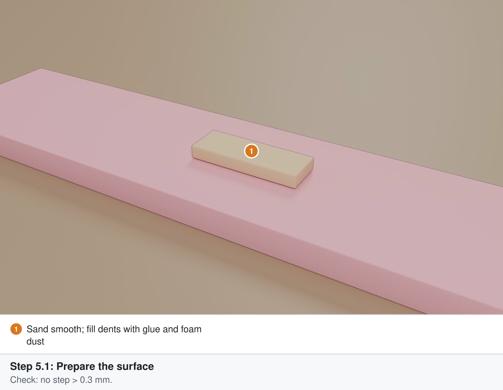

**5.2 Tape-skin test panel (review M[structures].4, budget-airframe M2).**
- Parts: 0.25 × 0.25 m scrap, tape.
- Procedure: weigh bare; skin both faces at 25 % overlap; weigh.
- Check: added mass ≤ 0.1 kg/m² per side; > 0.15 kg/m² total → re-run the sizing (R2, R10). Record.
- Time: 1 × 0.5 h.

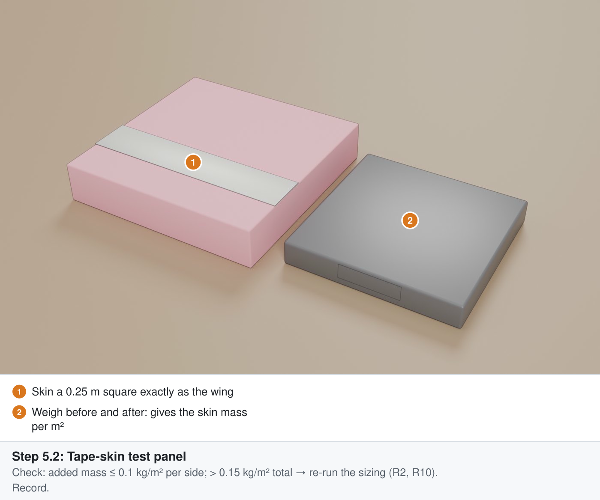

**5.3 Skin the panels.**
- Parts: tape, plastic card, heat gun.
- Procedure: per face, start at the TE; lay each 47.8 mm strip chordwise TE → LE and 30 mm onto the other face, 25 % overlap (12 mm), taut not stretched; rub down; upper face first, then lower so the lower strips' LE wrap lies on top; close with one spanwise strip along the TE and one along the LE; warm with the heat gun (hand-warm, moving) to shrink wrinkles; mask the hardpoints, root face and tongue, pockets, channel and the aileron hinge line.
- Check: no wrinkle > 1 mm; no bubble > 10 mm; no lifted LE edge; chord/thickness unchanged within +0.5 mm; mass per panel logged.
- Time: 2 × 2 h per panel.

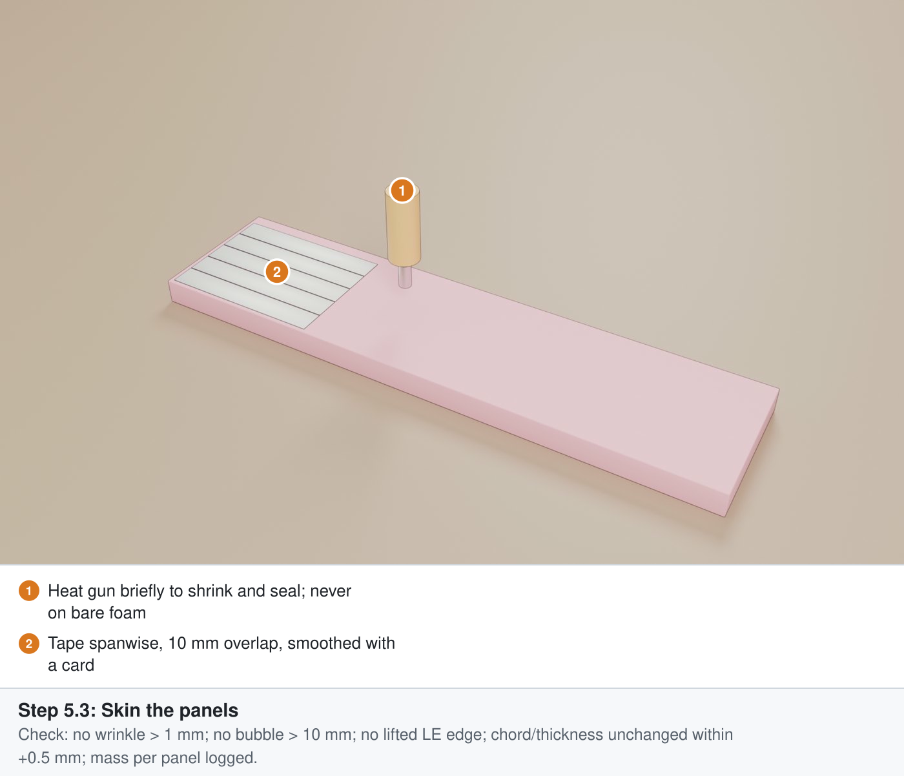

**5.4 Ailerons with tape hinges (J17).**
- Parts: aileron blanks (74–100 % c, chord 73.9 *(calc: 0.26 × 284.2)*, 612 mm long, 4 mm tip clearance, `cad/BuildVtol.cs` Aileron), P16 horn hardpoints, 2 horn sets (kit item 7).
- Fasteners: F11 M2 × 14 × 2 per horn into N03 nuts captive in the P16 pockets, 0.15 N·m EST (snug).
- Tools: knife, tape, straight edge.
- Procedure: bond P16 flush into the aileron lower surface pocket (4.9) so the horn's first hole is over the hinge line; skin the aileron as 5.3 but leave the hinge-side edges bare; **hinge:** lay the aileron against the panel's 72 % cut face with the 5.7 mm gap (2 % c) set by a spacer, upper surfaces flush; run one continuous strip of packing tape along the upper surface across the gap, 20 mm onto each part, rubbed down hard; fold the aileron fully down (upper surfaces touching) and run the second strip along the lower surface across the gap so the two strips pull against each other; cut the tape at the tip and root; fit the horn.
- Check: aileron moves ± 25° EST (end points set in WP11) with no binding and returns from both stops; hinge line straight (aileron edge parallel to the panel TE ± 1 mm); gap 5.7 ± 1 mm along the span; horn perpendicular ± 2°; the hinge tape has no wrinkle along the fold.
- Time: 2 × 1.5 h for both.


**5.5 Aileron servos (J14).**
- Parts: 2 × ES3005HV (AL, AR), 2 × P17 trays (printed after M6), 2 × Du-Bro 230 pushrods.
- Fasteners: F10 ISO 4762 M2 × 10 × 4 + N03 × 4 per servo, 0.15 N·m EST; servo-arm screw (supplied).
- Tools: 1.5 mm hex, Z-bend pliers, side cutters.
- Procedure: bond the tray foot into the 55 % c pocket (556.5 mm from the root) with the servo on its side and the arm through the lower surface; screw the servo in; cut the pushrod to **48 mm** overall (`cad/mesh/meta.json` Pushrod_Aileron 48; `cad/params.txt` rodAileron 48.4; pivot-to-pivot —; `cad/README.md` controls still says 45, §8.2 item 4), Kwik-Link at the horn, Z-bend at the arm; centre the servo electrically before fitting the arm.
- Check: pushrod perpendicular to the horn and the arm at neutral ± 5°; servo neutral = aileron neutral ± 1 mm at the TE; no buzz at the stops; servo lead reaches the root channel with 50 mm slack.
- Time: 2 × 1 h for both.


**5.6 Centre-section saddle (Wing_Saddle, J10/J11, FT06 slip fit; sheet 4).**
- Parts: F02 saddle block, 2 × P13 root plates with the 6 mm side tabs, 2 × P14 bolt pillars, joiner T05, foam-safe glue.
- Tools: Ø22.6 drill (step bit), rule, flat table.
- Procedure: drill the saddle block Ø22.5 through at the spar station using the P13 bores as guides from both faces; bond P13 to each face with the profiles aligned on the flat table (LE marks on a straight edge, lower surfaces down); cut two Ø16.2 pillar bores at 70 % c, z ± 65 (params boltZ) and bond P14 with the slots facing outboard; cut the tongue slots; tape-skin the block; **do not bond the joiner**: slide it through and dry-assemble both panels; lap or shim the saddle bores so the joiner is a hand-push slip fit (FT06, same band as FT01: drill 22.6 if tight).
- Check: with both panels on and the joiner through, root faces touch the saddle faces with ≤ 0.5 mm gap; dihedral 0 ± 0.5° (tips at equal height ± 5 mm over 2.4 m on the table); incidence equal within 0.5°; M5 × 20 passes freely through pillar and tongue; the joiner slides out by hand with the wing bolts removed and cannot be pulled out with them fitted (captured between the stops, 300 + 160 + 300 = 760 *(calc)*).
- Time: 2 × 2.5 h + cure.


**5.7 Wing bolts (J10).**
- Fasteners: F09 ISO 7380 M5 × 20 button + N02 M5 nylock, 1 per side, **1.0 N·m EST**.
- Tools: 3 mm hex, 8 mm spinner.
- Procedure: fit; torque; paint witness.
- Check: head seats in the Ø10.3 × **2.0** spot-face (`cad/params.txt` pillarSpot 0.002; the 2.75 mm button head stands 0.75 mm proud, near-flush *(calc)*); nut in the 8.2 AF × **9.6** pocket from the lower surface (`cad/params.txt` pillarNutDepth 0.0096); screw end ≈ 0.6 mm past the nut, so the nylon insert is engaged, and 4.0 mm inside the lower surface *(calc: pillar 26.0 (pillarH) − 2.0 − 20 = 4.0; nut outer face 26.0 − 9.6 + 5.0 = 21.4 below the top vs screw end 22.0; hardware-spec CAD notes, stall-target re-base)*; nylock drags ≥ 1 turn before seating (replace after 5 cycles EST).
- Time: 1 × 0.2 h.

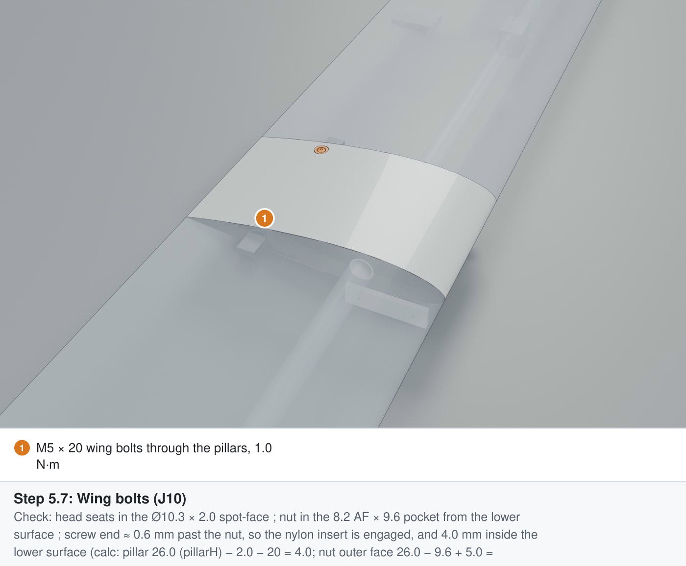

**5.8 Pitot clamp P19 (J16) — after M10.**
- Parts: P19, PT40.
- Fasteners: F07 ISO 7380 M3 × 8 pinch screw into I01, 0.4 N·m EST.
- Procedure: bond P19 into the left-tip pocket (50 mm aft of the LE, tube centre 9.5 below the lower surface); PT40 forward, tubing into the channel with a disconnect loop at the root.
- Check: tube parallel to the chord line ± 1° both planes; tip ≥ 1 chord ahead of the LE EST (pitotL 0.25).
- Time: 1 × 0.5 h.


**WP5 traveler**

| # | Item | L | R | Spec | Pass | Done | Checked | Date |
|---|---|---|---|---|---|---|---|---|
| 5.2 | Skin areal mass | | | ≤ 0.1 kg/m² per side | ☐ | | | |
| 5.3 | Skinned panel mass g | | | log | ☐ | | | |
| 5.4 | Aileron travel / gap / binding | | | ± 25° / 5.7 ± 1 / free | ☐ | | | |
| 5.5 | Servo neutral = aileron neutral | | | ± 1 mm | ☐ | | | |
| 5.6 | Dihedral; root gap; joiner captured with bolts, free without | | | ≤ 5 mm; ≤ 0.5; yes | ☐ | | | |
| 5.7 | M5 torque 1.0; witness | | | yes | ☐ | | | |
| 5.8 | Pitot alignment | | | ± 1° | ☐ | | | |

---

### WP6 — Tail: stabiliser, elevator, fins, rudders, shoes, tail servos

Owner: structures lead. Stabiliser NACA 0009, chord **101.52**, span **917.4** (boom spacing + 50 mm for the shoe flanges), 9.1 thick (`cad/params.txt` tailT); elevator 70–100 % c (30.5), span 845.8 (4 mm from each fin); fins NACA 0009 root **159.68** / tip **103.79**, height **199.6**; rudders 30 % of the local chord from 22 mm above the fin root to the tip, 2 % gap (`cad/params.txt`; `cad/mesh/meta.json`; hardware-spec CAD notes). Templates `tail_naca0009.svg`, `fin_root_naca0009.svg`, `fin_tip_naca0009.svg`. Sheets 6 (tail clamp), 9 (fin shoe).

**6.1 Templates.**
- Procedure: as 4.1 (these sheets fit Letter directly).
- Check: 100 mm line 100.0 ± 0.3.
- Time: 1 × 1.5 h.

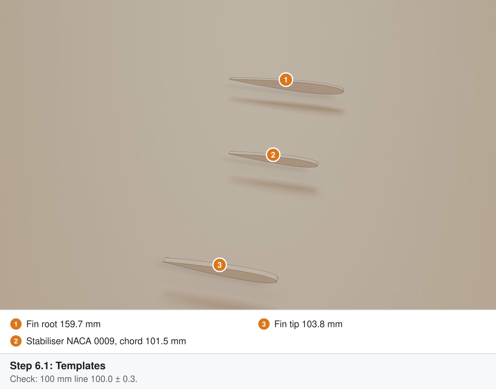

**6.2 Cut the stabiliser and elevator from F-150 1 in.**
- Parts: block 935 × 122 × 25.4 *(calc: chord 101.5 + 2 × 10 = 121.5 lead-in)*.
- Procedure: cut the full section at the lowest heat that cuts, ≈ 3 mm/s EST (9.1 mm section, `cad/params.txt` tailT); split at 68 % (stab) and 70 % (elevator); drill the 4 × Ø7.2 crush-sleeve holes at z ± 416.2 and ± 451.2, 33.9 mm aft of the stabiliser LE (comp Crush_Sleeve x −0.84988 vs stab LE −0.81598 *(calc)*).
- Check: chord 101.5 ± 0.5; thickness 9.1 ± 0.3; stab span 917.4 ± 1; elevator span 845.8 ± 1; TE straight ± 0.5; sleeve holes ± 0.5.
- Time: 2 × 1 h.


**6.3 Cut the fins and rudders.**
- Parts: 2 blocks 210 × 170 × 25.4.
- Procedure: pin the root template on one end and the tip template on the other with the tip LE **55.9 mm** aft of the root LE *(calc: 0.35 × 159.68)* and the TEs on one line (swept LE, straight TE, `cad/BuildVtol.cs` Fin); both operators count stations as the wire tilts; split each fin at the 68 % line → rudder (70–100 %), and cut the rudder root 22 mm above the fin root so it clears the shoe wall.
- Check: root 159.7 ± 0.5, tip 103.8 ± 0.5, height 199.6 ± 1; rudder height 177.6 ± 1 *(calc: 199.6 − 22)*, root chord 46.1 ± 0.5 *(calc: 0.3 × local chord 153.5 at 22 mm)*.
- Time: 2 × 1.5 h.


**6.4 Skin.**
- Procedure: tape as 5.3 (stabiliser spanwise strips, fins chordwise); mask hinge lines and the shoe root.
- Check: no wrinkle > 1 mm; tail mass logged (sizing m_tail 0.141 kg incl. servos and shoes, `analysis/results.json`).
- Time: 2 × 1.5 h.

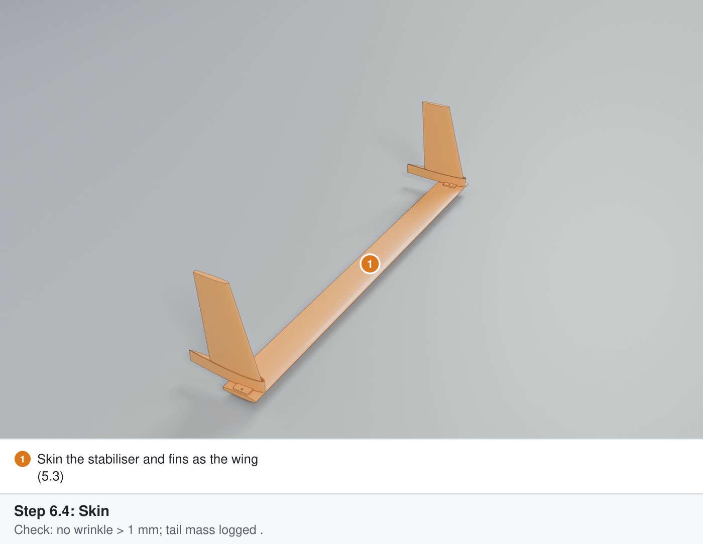

**6.5 Tape-hinge the elevator and rudders.**
- Procedure: as 5.4 with a 2.0 mm gap (2 % of 101.5) for the elevator and 2 % of the local chord (3.1 root → 2.1 tip) for the rudders: upper/outboard strip first, surface folded fully, then the opposing strip.
- Check: elevator ± 25°, rudders ± 25° free (EST travel), spring back, no binding at the shoe wall or the fins.
- Time: 1 × 1 h.

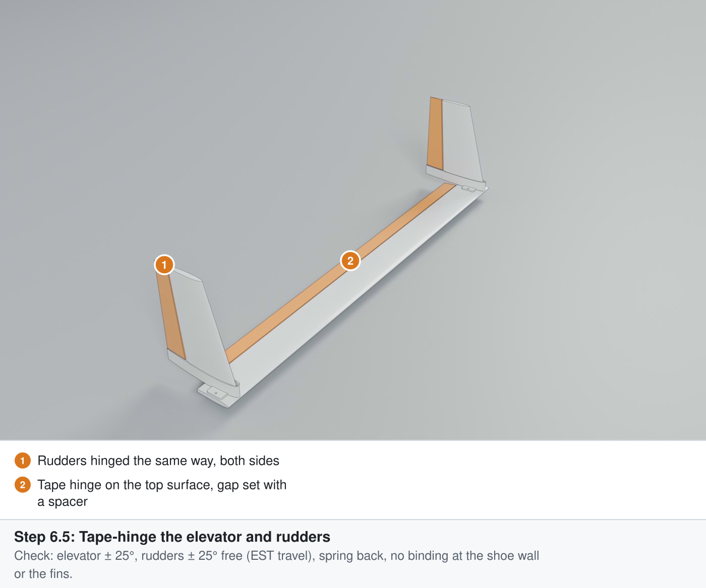

**6.6 Horns (J17).**
- Parts: 3 horns + kit backplates (20 × 11 × 1.5 EST).
- Fasteners: F11 M2 × 14 × 2 per horn + N03 × 2, 0.15 N·m EST.
- Procedure: elevator horn on the **top** surface at z +21 mm (comp Control_Horn x −0.8880, z 0.0211), through-bolted to the backplate below (5.6 mm section *(calc: NACA 0009 at 70 % c × 101.5)*); rudder horns on the inboard face of each rudder 29 mm above the fin root (comp y +0.0267 vs fin root −0.0022 *(calc)*), through-bolted to the backplate outboard.
- Check: horns perpendicular ± 2°; first hole over the hinge line ± 1 mm.
- Time: 1 × 1 h.

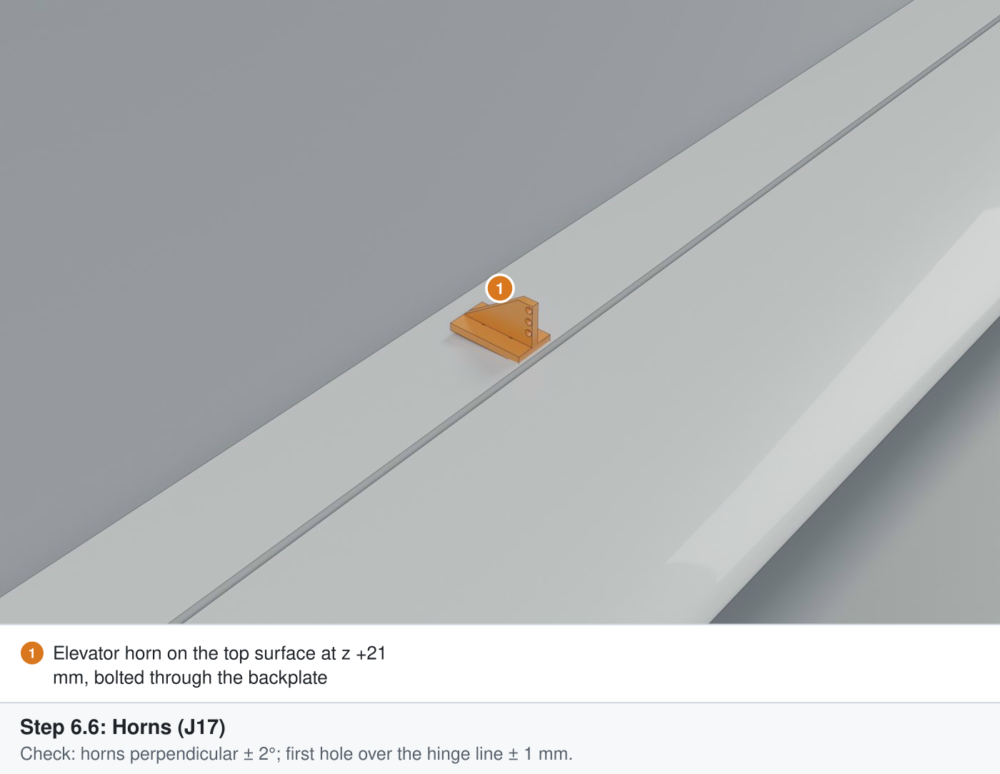

**6.7 Fin root shoes P09 (J09).**
- Parts: 2 fins, 2 × P09, foam-safe glue.
- Procedure: bond each fin root 21 mm deep into the shoe pocket, LE forward, square to the flange; the flange (32 × 46) is centred **33.9 mm behind the fin LE** (22.5 % c) over the tail clamp.
- Check: fin to flange 90 ± 0.5°; shoes mirror each other.
- Time: 1 × 1 h + cure.

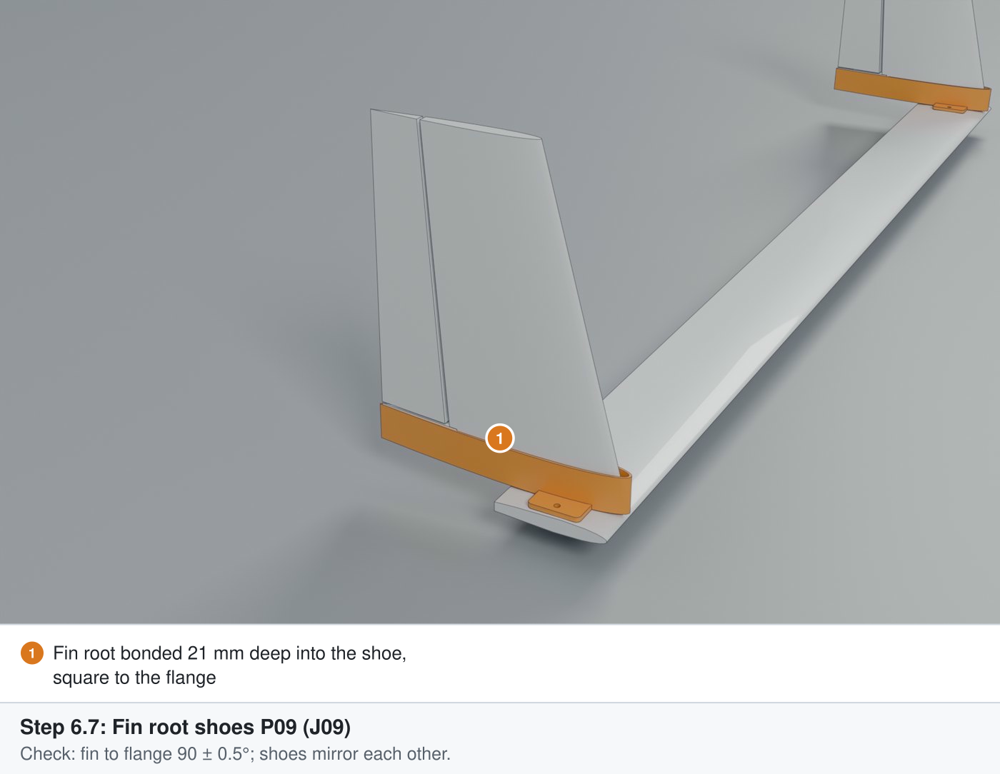

**6.8 Tail servos (E, RL, RR) on the stabiliser top.**
- Parts: 3 × ES3005HV, 3 × P17 trays, 3 × Du-Bro 230 pushrods (the last three of the five: **no spares**).
- Fasteners: F10 M2 × 10 × 4 + N03 × 4 per servo, 0.15 N·m EST.
- Procedure: bond the tray feet on the stabiliser top, foot down, arm up: elevator servo at z −21 mm, rudder servos at z ± 361 mm (comp Servo x −0.842); cut the elevator rod to **40 mm** overall (inclined ≈ 18° at rev B, hardware-spec J14; not re-checked) and the rudder rods to **102 mm** (`cad/mesh/meta.json` 40 / 102; `cad/params.txt` rodElevator 39.6 / rodRudder 102.4; pivot-to-pivot —); Kwik-Links at the horns, Z-bends at the arms.
- Check: as 5.5 (perpendicular ± 5°, neutral ± 1 mm at the TE); the elevator rod clears the stabiliser skin by ≥ 2 mm through its travel.
- Time: 2 × 1.5 h.


**6.9 Dry-fit on the tail clamps P08 and the stubs.**
- Parts: 2 × P08 sets, stabiliser, fins, 4 × P10 crush sleeves.
- Fasteners: F02 ISO 4762 M3 × 16 × 4 per clamp (0.5 N·m EST) and F02 × 2 per side through shoe → sleeve → stab → tail-clamp top inserts (e = 16 − 9.8 = 6.2, hardware-spec J09), 0.5 N·m EST.
- Procedure: clamp P08 on each stub at 299.8 mm from the butt, flat top up (clocked to the top line); sleeves in the stabiliser; stabiliser on the clamp tops; shoes on; screws.
- Check: stabiliser perpendicular to the stubs ± 0.5° (equal diagonals from the butt ends to the tips ± 2 mm); fins parallel ± 0.5°; elevator clears each fin 4 ± 1.5 mm; the whole tail unit comes off with these 4 screws (R4).
- Time: 2 × 1 h.


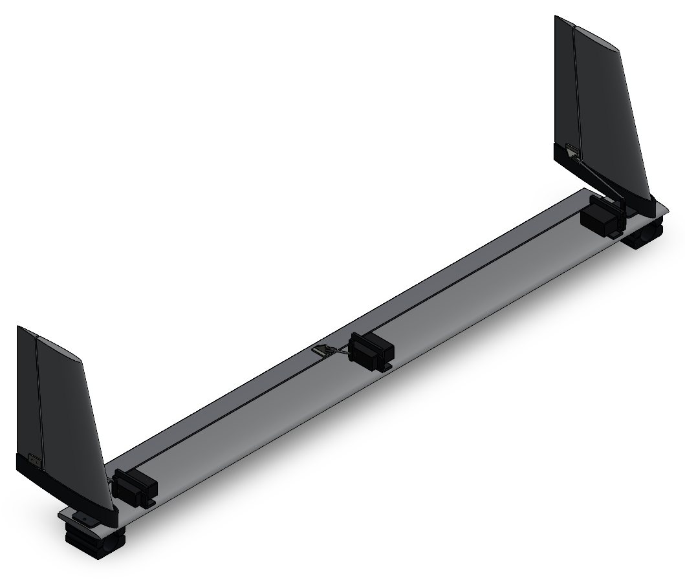

**WP6 traveler**

| # | Item | Measured | Spec | Pass | Done | Checked | Date |
|---|---|---|---|---|---|---|---|
| 6.2 | Stab chord / thickness / span; sleeve holes | | 101.5 ± 0.5 / 9.1 ± 0.3 / 917.4 ± 1; ± 0.5 | ☐ | | | |
| 6.3 | Fin root / tip / height ×2; rudder height | | 159.7 / 103.8 ± 0.5 / 199.6 ± 1; 177.6 ± 1 | ☐ | | | |
| 6.5 | Surface travel, free | | ± 25° | ☐ | | | |
| 6.7 | Fin squareness ×2 | | 90 ± 0.5° | ☐ | | | |
| 6.9 | Diagonals; elevator-fin gap | | ± 2 mm; 4 ± 1.5 | ☐ | | | |
| — | Tail unit mass g (incl. 3 servos, shoes) | | log (sizing 141) | ☐ | | | |

---

### WP7 — Booms, motor mounts, lift motors, props, gear clamps, splice

Owner: structures lead + electrical lead (ESC placement). Joints J01–J04, J06; sheets 5 and 6.

**7.1 Fit the motors to the upper mount halves (J01).**
- Parts: 4 × P01 (annealed, drilled), 4 × X4110S.
- Fasteners: F01 ISO 4762 M3 × 8 × 4 + W01 washer × 4 per motor, from inside the bore (Ø7.5 counterbores, C1), **0.6 N·m EST**, one drop of Loctite 242 on the last 2–3 threads, kept off the PA6-CF.
- Tools: 2.5 mm long-arm hex, torque driver or hanging mass (1.02 kg at 60 mm), 0.05 mm feeler.
- Procedure: orient the wire exit on the 45° line toward the wire slot; insert the four screws + washers from the bore side; hand-start all; torque in a cross pattern; paint witness marks.
- Check: (M4) before Loctite, screw tip 2.8–3.2 mm proud of the floor with the motor off; after torque, 0.05 mm feeler does not enter under the base; bell free; wires not pinched.
- Time: 1 × 0.5 h per motor (2 h).


**7.2 Prop plates and props (J03) — dry fit now, final fit at WP13.**
- Parts: 4 × prop plates (motor box), 4 × JeeFly 1755.
- Fasteners: F12 (length from M5: M3 × 12 or 16 from the F08/F02 stock, or the motor-supplied screws if they fit), 2 per prop on the Ø12 hub circle, **0.8 N·m**, Loctite 242 on the tip.
- Procedure: CCW props on M1 (front-right) and M2 (rear-left), CW on M3 (front-left) and M4 (rear-right) (ArduPilot Quad X, https://ardupilot.org/plane/docs/quadplane-frame-setup.html, checked 2026-10-21; `firmware/README.md` §7); balance each pair on a shaft between two glasses, tape to the light blade.
- Check: engagement 4.5–8.0 mm *(calc from M5)*; tip runout ≤ 2 mm spun by hand; no preferred rest position.
- Time: 1 × 1 h for four.


**7.3 Gear clamps P07 on the booms (J06).**
- Parts: 4 × P07 sets.
- Fasteners: F03 ISO 4762 M3 × 20 × 4 per clamp into I01, **0.5 N·m EST**, cross pattern, witness.
- Procedure: front at 140.0 and rear at 901.0 mm from the front end (3.5), socket down, clocked to the top line.
- Check: split gap 0.4–0.8 mm each side (1.2 total, FT02); cannot be rotated by hand; socket axis vertical ± 1°.
- Time: 1 × 0.3 h per clamp (1.2 h).


**7.4 Front motor mounts on the front booms (J02).**
- Parts: 2 × P01 (with motors) + 2 × P02.
- Fasteners: F02 ISO 4762 M3 × 16 × 4 per mount from the cap into the upper-half inserts, **0.5 N·m EST**, witness.
- Procedure: mount centre at 50.0 mm from the front end, motor up, shaft vertical (clocked to the top line).
- Check: gap 0.4–0.8 each side; shaft vertical ± 0.5°; no rotation under 2 kg on a 0.25 m lever (M7, 4.9 N·m); witness unbroken.
- Time: 1 × 0.4 h per side.


**7.5 Rear motor mounts and the splice (J02/J04).**
- Parts: 2 × P01 + P02 (rear), 2 × P04 splice plugs, front booms, stubs.
- Fasteners: F02 × 4 per mount, 0.5 N·m EST.
- Procedure: slide the plug 40 mm into the front boom's aft end (mark its mid-line); slide the stub on until the tubes **butt**; align both top lines; set the upper mount over the joint centred on the butt (35 mm each side); fit the cap.
- Check: butt gap ≤ 0.3 mm (feeler); top lines aligned ± 0.5; the tail-clamp station lands at 991.0 + 299.8 = **1290.8 mm** from the front end ± 1 *(calc)*.
- Time: 2 × 0.5 h per side.

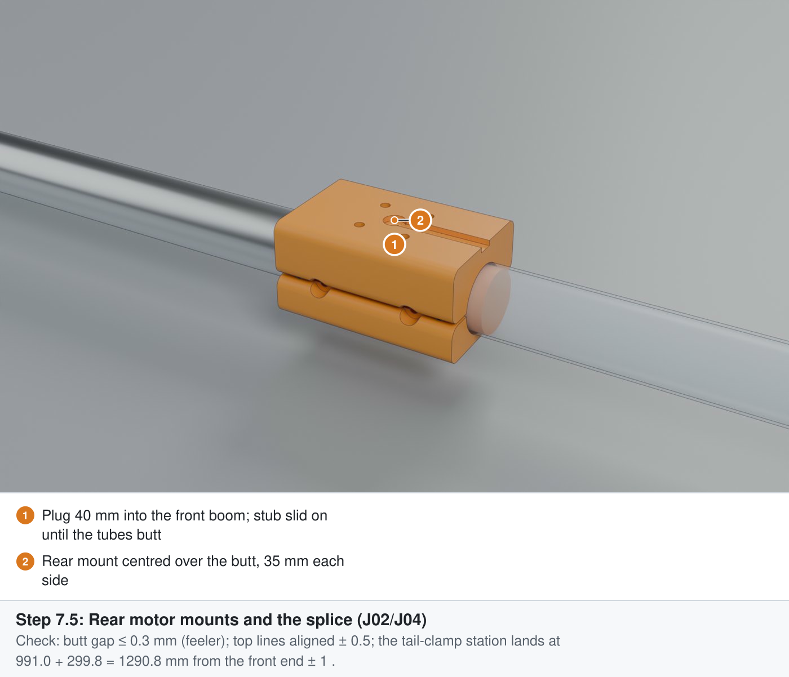

**7.6 Drill and fit the splice cross-bolts (F04).**
- Parts: assembled rear mounts.
- Fasteners: F04 ISO 4762 M3 × 40 + W01 under the head + N01 nylock in the 5.7 AF × 8.0 pocket, 2 per mount (x ± 18 from the butt), **0.5 N·m EST**; screw end 3.5 mm past the nut, 0.5 mm inside the block face *(calc, J04)*.
- Tools: drill press or hand drill, Ø3.4 bit, the mount's half-grooves as the jig (split plane = boom neutral axis).
- Procedure: drill in one pass through cap → boom wall → plug → boom wall → upper half from the counterbore side; one hole 18 mm forward of the butt (front boom), one 18 mm aft (stub); fit the bolts.
- Check: holes 18.0 ± 0.3 from the butt; no slip under the M7 test at the mount and at the tail clamp; nylock did not turn by hand before torque (else replace).
- Time: 1 × 0.5 h per side.


**7.7 Boom natural frequency (review M[structures].2).**
- Tools: vice, P05 pair, phone spectrum app.
- Procedure: clamp at the front wing-clamp station (526.2); tap the front motor; record.
- Check: first bending mode within ± 25 % of the hand calc **32.3 Hz** (`cad/params.txt` feaHandFn; FEA 34.4 Hz, `cad/sim/results.txt` boom_f1) and not within ± 15 % of the hover rotor frequency (EST 70–90 Hz; set after T2) or twice it.
- Time: 1 × 0.5 h.

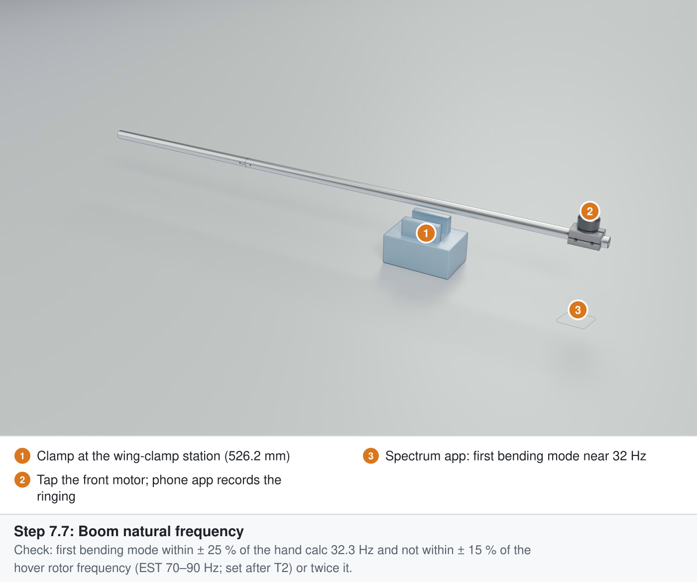

**7.8 ESC placement and foam pads (J15).**
- Parts: 4 × SoloGood 45A (heat-shrunk), 3 mm foam pads (F-150 offcut), 2 zip ties each (kit item 11).
- Procedure: ESCs go **in the prop wash on the boom side or top face**, not the underside (`docs/research/thermal.md` §6.4 item 4: the model's 43 W/m²K prop-wash film assumes the ESC sees the wash; under the boom it sits in the boom's wake). Front ESC on the outboard side (or top) face between the front gear clamp and the front wing clamp, 180–240 mm from the tip, inside the 216 mm disc radius of the front rotor *(calc: liftProp 431.8 / 2; rotor at 50.0)*; rear ESC likewise between the rear wing clamp and the rear gear clamp, 780–840 mm (rear rotor at 991.0, disc from 775 mm *(calc)*); heat-shrink face to the flow, on its 3 mm foam pad (the pad isolates it from the warm mount; the boom stays near ambient, thermal.md §6.1); label FR/RL/FL/RR; extend the motor leads with 14 AWG if the supplied leads (length —) do not reach.
- Check: ESC on the side/top face inside the disc radius and not in the wake of a clamp or mount; not touching a clamp or mount; leads not in tension; zip ties over the shrink. Expected in service (thermal.md §6.1, 35 °C day, 4 % loss EST): 56 °C after a 60 s hover, 65 °C at the end of hover + transition, limit 70 °C EST.
- Time: 1 × 0.5 h.

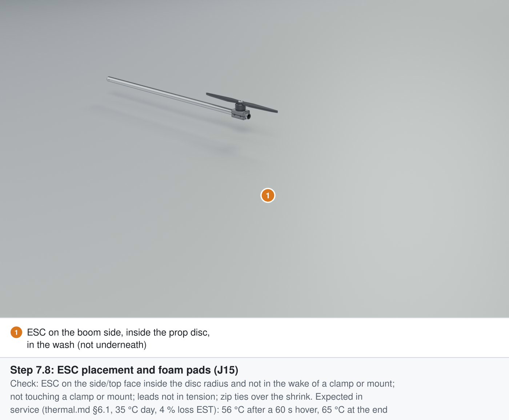

**7.9 Weigh each boom assembly.**
- Procedure: weigh each complete boom unit on the kitchen scale; log.
- Check: within +10 % of the sum of its parts (EST 2 × 165 motors + 2 × 88.7 mounts + 183.1 + 89.8 tubes + 2 × 52.4 gear clamps + 42.4 plug + 2 × 25 ESCs (EST) ≈ 0.98 kg, `cad/verification.txt`).
- Time: 1 × 0.2 h.


**WP7 traveler**

| # | Item | L boom | R boom | Spec | Pass | Done | Checked | Date |
|---|---|---|---|---|---|---|---|---|
| 7.1 | Motor screw tip (×8 per boom); F01 0.6, Loctite, witness | | | 2.8–3.2 mm; yes | ☐ | | | |
| 7.3 | Gear clamp gaps / torque 0.5 | | | 0.4–0.8 | ☐ | | | |
| 7.4 | Front mount shaft vertical | | | ± 0.5° | ☐ | | | |
| 7.5 | Butt gap; tail station from front end | | | ≤ 0.3; 1290.8 ± 1 | ☐ | | | |
| 7.6 | Splice holes from butt; M7 slip test | | | 18.0 ± 0.3; no slip | ☐ | | | |
| 7.7 | Boom f1 | | | 32.3 Hz ± 25 % | ☐ | | | |
| 7.9 | Boom assembly mass g | | | log | ☐ | | | |

---

### WP8 — Pod, saddle-to-pod, battery and FC trays, pusher, landing legs and fairings

Owner: integration lead. The CAD pod is one solid body 850 × 160 with the wing-root slot, battery bay, avionics bay, canopy pocket and the Ø56 × 30 tail-ring bore (`cad/mesh/meta.json` Fuselage_Pod); frames and rails are not modelled — the construction below is this manual's method, EST, consistent with hardware-spec J11–J13, J18, FT11 and the CAD notes.

**8.1 Pod core F07.**
- Parts: 7 layers of F-150 1 in, 850 × 170 (178 mm stack *(calc: 160 / 25.4 = 6.3)*), foam-safe glue.
- Tools: bow, two pod-profile end templates (radius every 50 mm sliced from `cad/mesh/Fuselage_Pod.STL`), 600 mm sanding board.
- Procedure: cut the battery bay (tray 165 × 56 at x +0.189, pack 155 × 50 × 48) and the avionics bay (floor at y −20 from x +0.07 to +0.33 for the FC tray at x +0.225) out of the middle layers before lamination; laminate; hot-wire to an octagon on the templates; sand round; cut the wing-root slot for the saddle (285 × 67 at the LE station; `cad/mesh/Wing_Saddle.STL` 284.2 × 66.8) and the canopy pocket (x +0.07 to +0.33); bore the tail ring seat Ø56 × 30 (params tailR).
- Check: diameter 160 ± 2 at the parallel section; length 850 ± 3; bays within ± 1 mm of the stations above.
- Time: 2 × 4 h + cure.


**8.2 Printed frames and rails P20.**
- Parts: P20 set (nose ring, 3 mid frames, 2 side rails with inserts, tail ring).
- Procedure: bond the frames into slots cut across the laminate; bond the two side rails at the saddle station with their 2 × I01 each at −0.10 c and −0.30 c, horizontal, matching the P13 tab holes; bond the tail ring (bore Ø56.0 ± 0.2, FT11) on the pod axis; bond the 2 hatch inserts at the canopy pocket rear.
- Check: tail ring axis on the pod axis ± 1 mm (sight through); rail insert faces vertical and level with each other ± 0.3 so the saddle tabs seat flat.
- Time: 2 × 2 h + cure.

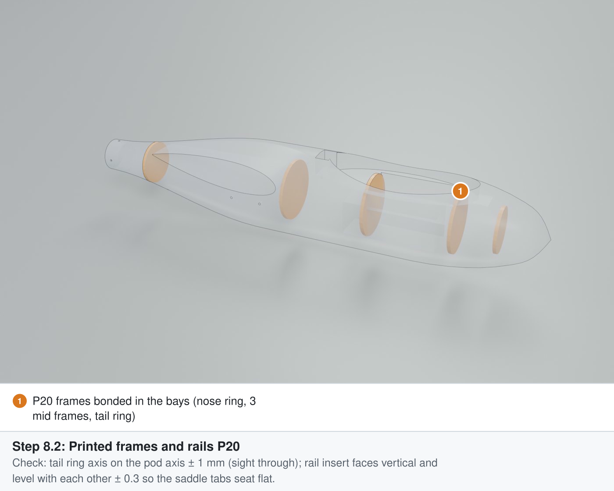

**8.2a Battery-bay ventilation and FC standoffs (thermal; `docs/research/thermal.md` §6.4 items 1 and 5; review §[simulation] "Heat dissipation across the aircraft").**
- Why: the XPS bay is effectively adiabatic (k 0.029 W/mK), so a pack at 7.5 mΩ/cell ends a 35 °C mission at 59 °C, 1 K under the 60 °C limit with no allowance for sun load or a warm start; ram air through the bay brings that to about 55 °C *(thermal.md §6.4 item 1, calc, EST)*. The FC lump reaches 97 °C in a sealed canopy in the model (conservative, thermal.md §6.2).
- Parts: pod core (8.1, before skinning), knife, the 1.000 in tube offcut heated as in 4.6 or a hot-wire loop; 4 × FC standoffs Ø7 × 5.0 with a Ø3.4 hole (print with P18, PETG); 4 × M3 × 12 (F08 stock: BD-2 orders 12 for 4 used, hardware-spec §6).
- Procedure: (1) **Inlet:** cut a 15 × 30 mm EST ram-air channel from the nose (x +0.45) straight aft at pack height to the front face of the battery bay (pack front at x +0.267 *(calc: battX 0.189 + 0.155 / 2)*). (2) **Exit:** cut a 15 × 30 mm EST slot through the pod underside at the aft end of the bay (pack rear at x +0.112 *(calc: 0.189 − 0.0775)*). (3) Wrap the tape skin (8.3) into both openings, never over them. (4) **FC standoffs:** fit the 4 spacers between P18 and the board so the FC sits 5 mm off the tray (bay height 35 mm, `cad/params.txt` bayY0/bayY1: tray 3 + standoff 5 + board 17 = 25 mm *(calc)*); M3 × 12 through the board and spacer into the tray inserts (engagement 12 − 5 − 1.6 = 5.4 mm EST, board thickness EST).
- Check: inlet and exit open end to end (a paper strip drawn into the inlet by a fan comes out at the exit); pack retention unchanged (5 kg push ≤ 1 mm, 8.5); no foam crumbs in the bay; FC 5 ± 0.5 mm off the tray and still level (10.1).
- Time: 1 × 1 h.

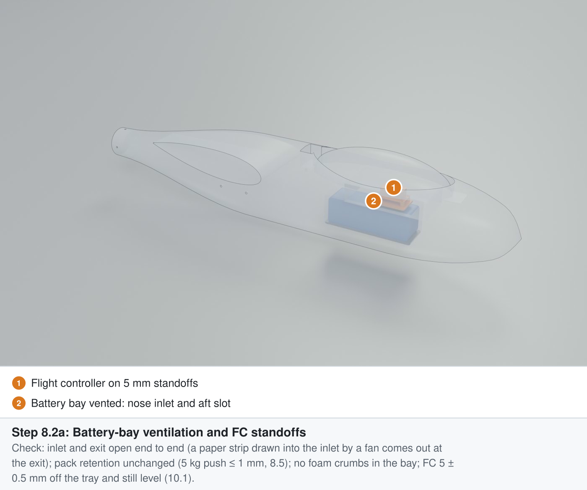

**8.3 Canopy blister F08 + hatch flange P22 (J13).**
- Parts: 2 F-150 layers, P22.
- Fasteners: F07 ISO 7380 M3 × 8 × 2 into the pod inserts, **0.4 N·m EST**.
- Procedure: shape the blister (300 × 55 × 110, Canopy bbox); hollow to a 4 mm wall EST for the FC, RX and BeeID; **drill two Ø8 mm avionics-bay vents in the blister, one forward-facing at its front and one aft-facing at its rear (`docs/research/thermal.md` §6.4 item 5, EST)**, ≥ 30 mm from the GPS pad; bond P22 (2 mm rear flange + front tongue); skin pod and blister with tape (spanwise strips around the body, 25 % overlap), cutting the tape clear of both vents and of the 8.2a battery-bay inlet and exit.
- Check: hatch removable in < 30 s; flush ± 1 mm; both Ø8 vents and the 8.2a openings open after skinning.
- Time: 2 × 2 h.


**8.4 Saddle to pod (J11, side tabs).**
- Parts: completed saddle (5.6) without the joiner.
- Fasteners: F08 ISO 4762 M3 × 12 × 2 per side, horizontal through the 6 mm side tabs into the rail inserts, e = 6.0, **0.5 N·m EST**, witness.
- Procedure: slide the saddle into the root slot; fit the 4 screws; dry-assemble both panels with the joiner.
- Check: wing incidence to the pod axis 0 ± 0.5° (the CAD places the chord line on the pod X axis; `cad/params.mjs` adds no incidence — confirm with the structures lead); wing centred ± 1 mm; the joiner slides through the saddle by hand.
- Time: 2 × 1 h.


**8.5 Battery tray P21 and straps (J18); ballast provision.**
- Parts: P21, 2 × ShareGoo straps, F09 ballast block (0.5 kg, G6).
- Procedure: bond P21 to the bay floor with the pack centre at x = **+0.189 m** (`cad/params.txt` battX; `analysis/results.json` cg.xb) and ± 30 mm fore-aft marks; fit the straps through the 22 × 3 slots; make a strap-down for the 0.5 kg ballast at the payload station x = +0.150 (cg.items "Payload allowance", bay x EST) — the ballast is **required for flight with no payload** (`cad/README.md` operating rule; without it SM 5.1 % by AVL, `analysis/aero/aero_results.json` neutral_point, or 4.9 % by the sizing, `analysis/results.json` cg.SM_noPayload).
- Check: pack cannot move > 1 mm under a 5 kg push; ballast strapped the same way; the XT90-S pigtail reaches the hatch opening (else cut a 60 × 40 side door, EST).
- Time: 1 × 1 h.


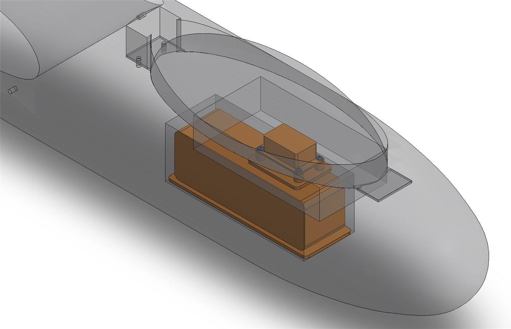

**8.6 Pusher motor cup P03, adapter and prop (J12, J03b).**
- Parts: P03, pusher X4110S, M6 adapter + prop washer + bullet nut (motor box), APC 14 × 8.5EP with the Ø6 ring, pusher ESC.
- Fasteners: F01 × 4 + W01 (0.6 N·m EST, Loctite 242, M4 check) from inside the cup; **F13** M3 × 8 (EST, motor-supplied) × 4 adapter to hub, 0.8 N·m, Loctite 242; F07 ISO 7380 M3 × 8 × 4 radial cup-to-ring, **0.4 N·m EST**; N04 M6 bullet nut.
- Procedure: solder the motor leads to the pusher ESC first (W07); fit the motor into the cup; fit the adapter; push the cup into the tail ring (FT11) with the wire groove down; radial screws; prop on the adapter with the chosen ring, washer, bullet nut tightened with a 3 mm rod through its cross-hole until the prop cannot be slipped by hand (torque —, hardware-spec §2d); EP prop facing aft.
- Check: shaft on the pod axis ± 1°; tip tracking ≤ 2 mm; pusher disc ground clearance **41.9 mm** on the legs (`cad/verification.txt`) ≥ 30 measured; disc clearance to the rear lift discs ≥ 20 mm (design 79.0, `cad/verification.txt`); P03 cup slots (2.7) clear of the tail-ring wall or matched by openings in it (§8.2 item 11); the prop blows aft at the WP11 pusher check.
- Time: 2 × 1.5 h.


**8.7 Landing legs, fairings and feet (J07; sheet 7).**
- Parts: 4 × T04 legs, 4 × P25 fairings, 4 × P23 feet, 5-min epoxy, tape.
- Fasteners: F05 ISO 4762 **M3 × 30** + W01 + N01 per leg, along local x, **0.5 N·m EST** (rev B: head in the Ø7.5 × 4.0 counterbore, nut in the 5.7 AF × 4.3 pocket, both outside the leg tube).
- Procedure: slide the fairing over the leg from the bottom (TE aft); push the leg top into the blind socket (14 mm, FT03; ream if tight); drill Ø3.4 through the clamp's holes and the leg in one pass (or align the pre-drilled hole); fit F05; slide the fairing up against the gear clamp, clock its TE aft, tape its top to the clamp; bond the dome foot into the leg bottom (plug 15 mm).
- Check: four feet touch the flat table with the booms level (sand a dome ≤ 1 mm EST to true); legs vertical ± 1°; fairing TE aft ± 3°, no rattle; pusher clearance 42 ± 5 mm; lift props **273 mm** above the ground *(calc: prop y +0.023 − yGround −0.2497)*.
- Time: 1 × 2 h.


**WP8 traveler**

| # | Item | Measured | Spec | Pass | Done | Checked | Date |
|---|---|---|---|---|---|---|---|
| 8.1 | Pod diameter / length / bay stations | | 160 ± 2 / 850 ± 3 / ± 1 | ☐ | | | |
| 8.2 | Tail ring bore / rails level | | 56.0 ± 0.2 / ± 0.3 | ☐ | | | |
| 8.4 | Wing incidence to pod / centred; joiner slides | | 0 ± 0.5° / ± 1 mm; yes | ☐ | | | |
| 8.2a | Battery-bay inlet + exit open; FC on 5 mm standoffs; canopy Ø8 vents ×2 (8.3) | | open; 5 ± 0.5; open | ☐ | | | |
| 8.5 | Pack at x +0.189; ballast strap-down at +0.150 | | ± 1 mm; present | ☐ | | | |
| 8.6 | Pusher axis / tracking / clearances | | ± 1° / ≤ 2 / ≥ 30 and ≥ 20 mm | ☐ | | | |
| 8.7 | Legs vertical; feet touch; fairings TE aft | | ± 1°; ≤ 1 mm rock; ± 3° | ☐ | | | |
| — | Pod assembly mass g (no battery) | | sizing mFus 0.60 + saddle | ☐ | | | |

---

### WP9 — Electrical

Owner: electrical lead. Harness table: `docs/build/wiring.csv` (W01–W07 power, S01–S11 servos, M01–M05 DShot, A01–A08 avionics). Output map **exactly** `firmware/vtol_c0.param` §2 / `firmware/README.md` §4.4: S1/S2 ailerons L/R, S3 elevator, S4 rudder L, S5 Motor1 front-right CCW, S6 Motor2 rear-left CCW, S7 Motor3 front-left CW, S8 Motor4 rear-right CW (DShot150), S9 pusher (DShot150), S10 empty, S11 rudder R, S12/LED spare.

Power path: pack → XT90-S → CoreWing PDB (90 A cont, 215 A peak; ardupilot.org board page, checked 2026-10-21) with the included 470 µF capacitor → 4 × 12 AWG lift ESC feeds with an XT60H at each wing root + 1 × 14 AWG pusher feed. Currents: hover 41.1 A total, transition 68.4 A, one X4110S max 27.7 A at 22.2 V (`analysis/results.json` C0.sized; budget-lift A3). `Q_M_BAT_CURR_MAX 85` caps the lift motors below the 90 A sensor.

**9.1 Harness lengths and labels.**
- Procedure: cut every conductor per wiring.csv (+ 50 mm service loop); label both ends with masking tape before soldering.
- Check: 39 leads needed ≈ 11.8 m *(calc: servos 2 × 1.0 + 3 × 1.6 = 6.8 m; DShot 4 × 1.0 + 0.5 = 4.5 m; GCS/RID short)* vs 40 leads × 0.3 m = 12 m in BOM v0.4.
- Time: 1 × 1 h.

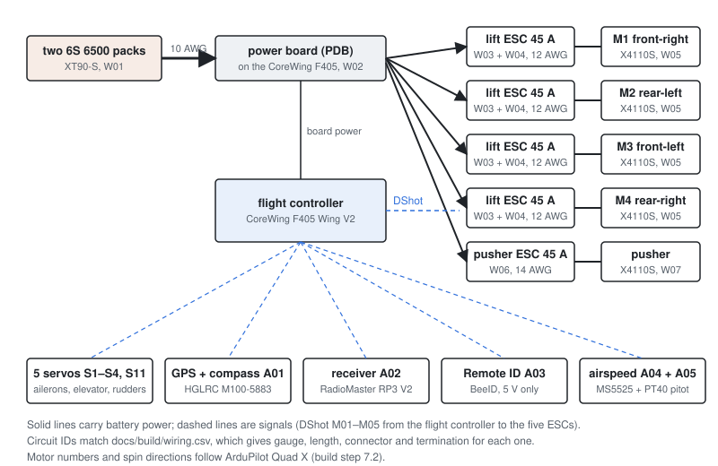

**9.2 Re-terminate the packs EC5 → XT90-S (W01).**
- Parts: 2 packs, 2 × XT90-S male (kit: confirm which half is the anti-spark side, —), heat shrink.
- Tools: 60 W iron, chisel tip, tape.
- Procedure: one lead at a time with the other taped; cut the EC5 off the red lead; strip 6 mm; slide shrink on; tin; fill the + cup; hold 3 s; cool; shrink; repeat for black.
- Check: polarity with the meter (red = +); joint pull 5 kg EST; no exposed copper.
- Time: 1 × 0.5 h.

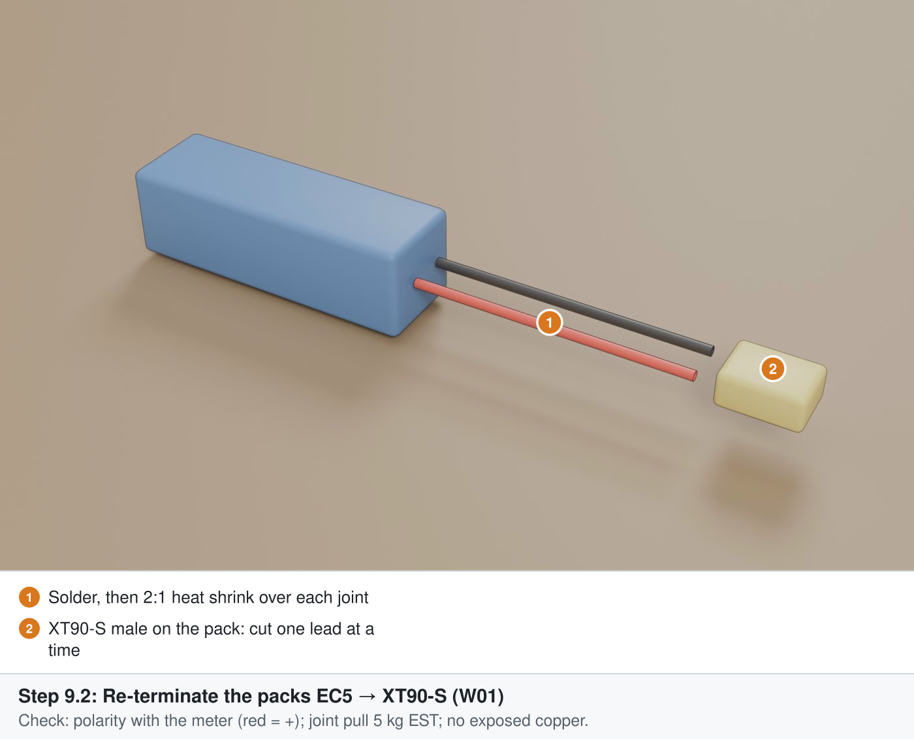

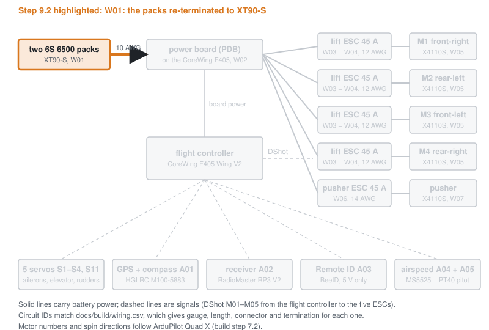

**9.3 Battery pigtail to the PDB (W02).**
- Parts: 10 AWG × 120 mm red/black, XT90-S female, 470 µF capacitor (FC box).
- Procedure: pre-tin the BAT+/BAT− pads; solder the pigtail; solder the capacitor across the pads observing polarity (`firmware/README.md` §4.1).
- Check: continuity; no bridge to adjacent pads; capacitor polarity; pull 5 kg EST.
- Time: 1 × 0.5 h.


**9.4 Lift ESC feeds (W03/W04).**
- Parts: 4 × 12 AWG pairs 0.35 m (PDB → XT60H female at the root) and 4 × 0.75/0.80 m (XT60H male → ESC).
- Procedure: solder; route W04 in the wing channel (4.9) then along the boom underside and up to the ESCs on the boom side/top face (7.8); tape the channel; zip-tie to P24 anchors every 150 mm.
- Check: polarity at every XT60H (meter); channel closed, no bulge > 1 mm.
- Time: 2 × 2 h.


**9.5 Motor phase leads (W05/W07).**
- Procedure: solder each motor's 3 leads to its ESC pads (extend with 14 AWG if short); shrink each; shrink the ESC. Direction is fixed in WP11 by swapping two leads or in ESC-Configurator.
- Check: no loose strand; leads clear of the bell through full travel.
- Time: 1 × 1.5 h for five.


**9.6 Pusher feed (W06).**
- Procedure: 14 AWG × 0.55 m PDB → pusher ESC, direct solder.
- Check: continuity and polarity with the meter; service loop present.
- Time: 1 × 0.3 h.


**9.7 DShot signal leads (M01–M05).**
- Parts: 5 servo leads with the red wire removed at the ESC end (never an ESC BEC on the rail, `firmware/README.md` §4.1).
- Procedure: S5 → FR, S6 → RL, S7 → FL, S8 → RR, S9 → pusher; label at the FC end; S10 stays empty.
- Check: labels match the map above.
- Time: 1 × 1 h.


**9.8 Servo leads (S01–S11).**
- Parts: 300 mm extensions (chain 3–4 for the ailerons ≈ 1.0 m, 5 for the tail ≈ 1.6 m).
- Procedure: S1 → AL, S2 → AR, S3 → E, S4 → RL, **S11 → RR**; field disconnects: one JR plug per wing root (ailerons), one at each tail clamp (E + RL left, RR right); set the servo-rail jumper to **6 V**.
- Check: every plug keyed/marked; rail 5.9–6.2 V at the first power-up.
- Time: 2 × 1.5 h.


**9.9 Avionics power and data (A01–A04, A08).**
- Procedure: GPS on the GPS connector (UART5 + I²C + 4V5; the connector pin order differs from the pads — use the board image); RX on TX6/RX6 + 5 V (receiver TX → RX6); BeeID on the 5 V pad + GND only (not the 4V5 rail); airspeed on the I²C connector **only after the CSB strap (WP10 10.5)**; BLE/WiFi module on the extender connector.
- Check: with the pack through the watt meter and no props: idle ≤ 1.0 A EST; 5 V rail 4.9–5.3 V; servo rail 5.9–6.2 V.
- Time: 1 × 1 h.


**9.10 First power-up (no props, XT90-S through the watt meter).**
- Procedure: 5 s smoke test; then 2 min; IR thermometer on the PDB and each ESC; FC boots on USB + Mission Planner.
- Check: nothing above 40 °C at idle; pack voltage on the GCS within 0.1 V of the meter (else `BATT_VOLT_MULT`, WP11).
- Time: 2 × 0.5 h.


**9.11 Strain relief and chafe.**
- Procedure: 10 mm shrink sleeve where a wire crosses a tube edge or clamp; zip ties snug not crushing.
- Check: 2 kg tug on every joint EST; nothing moves.
- Time: 1 × 0.5 h.

**WP9 traveler**

| # | Item | Result | Spec | Pass | Done | Checked | Date |
|---|---|---|---|---|---|---|---|
| 9.2 | Pack A / B polarity, XT90-S | | correct | ☐ | | | |
| 9.3 | Capacitor fitted, polarity | | yes | ☐ | | | |
| 9.4 | XT60H ×4 polarity | | correct | ☐ | | | |
| 9.7 | S5…S9 → FR RL FL RR P; S10 empty | | correct | ☐ | | | |
| 9.8 | S1 AL, S2 AR, S3 E, S4 RL, S11 RR; rail V | | correct; 5.9–6.2 | ☐ | | | |
| 9.10 | Idle current A / hottest part °C | | ≤ 1.0 / ≤ 40 | ☐ | | | |
| — | Harness mass g (sizing mWiring 0.37 kg) | | log | ☐ | | | |

---

### WP10 — Avionics install

Owner: electrical lead. Positions from `cad/params.txt`: FC tray x +0.225 at the avionics-bay floor y −20; canopy x +0.07 to +0.33; GPS on the canopy top; pitot under the left tip. `firmware/README.md` §4 and `firmware/peripherals.md` govern pad names.

**10.1 FC tray P18 and vibration isolation (J15).**
- Parts: P18 (bosses at the measured pattern, M6), CoreWing F405 Wing V2.
- Fasteners: F07 ISO 7380 M3 × 8 × 4 into the tray inserts, 0.4 N·m EST; fallback foam tape (G5).
- Procedure: bond P18 to the bay floor; mount the FC arrow forward on the four 5 mm standoffs of 8.2a (M3 × 12; `docs/research/thermal.md` §6.4 item 5), level with the pod axis (`AHRS_ORIENTATION 0`).
- Check: FC pitch/roll to the wing chord line ± 1° (level app vs the wing); no wire pulls on the board; the tray and screws clear the battery top (CAD notes J15: 7 mm).
- Time: 1 × 1 h.


**10.2 GPS/compass (A01).**
- Procedure: on the P24 pad on the canopy top, arrow forward, ≥ 100 mm from any power wire EST.
- Check: compass offsets < 400 after calibration (`firmware/README.md` §6.3); `COMPASS_AUTO_ROT 2` finds the orientation.
- Time: 1 × 0.5 h.


**10.3 Receiver (A02).**
- Procedure: RP3 V2 inside the canopy, antennas 90° apart taped to the blister; receiver failsafe set to "no pulses" (`firmware/README.md` §8).
- Check: LQ 100 % at 50 m line of sight on the bench.
- Time: 1 × 0.3 h.


**10.4 Remote ID (A03).**
- Procedure: BeeID on foam tape inside the canopy, ≥ 50 mm from the GPS; 5 V + GND only.
- Check: broadcasting on a phone Remote ID app with the serial number matching the FAA DoC lookup (budget-avionics §4.2).
- Time: 1 × 0.3 h.


**10.5 Airspeed sensor: CSB strap to 0x77, then install (A04/A05) — M9.**
- Parts: Holybro MS5525DSO board, PT40, silicone tubing (kit; G3 if short).
- Tools: fine iron, magnifier, multimeter.
- Procedure: **before the sensor is ever connected to the FC**, re-strap the MS5525DSO CSB pin from VDD to GND on the Holybro breakout (lift the pull-up or cut the trace, bridge to GND; jumper presence —; TE datasheet address 111011Cx, C = complement of CSB: CSB low → 0x77, `firmware/README.md` §4.3); photograph for the build log; mount the board near the FC on foam tape; connect to the I²C airspeed connector; run two tubes to the PT40 via the wing channel with a push-on disconnect at the root; power the FC on USB with only the airspeed on I²C.
- Check: Mission Planner Messages shows `MS5525[0]: Found on bus 0 addr 0x77` with `ARSPD_TYPE 5`, and the barometer still reads altitude; blow gently into the pitot: airspeed rises; pinch test holds 30 s. If the message shows 0x76 or the baro misbehaves: **do not fly**; fix the strap or go to the MS4525DO fallback (`ARSPD_TYPE 1`).
- Time: 1 × 1.5 h.


**10.6 Battery and ballast.**
- Procedure: pack on the tray, straps; ballast block at x +0.150 if no payload is fitted; XT90-S pigtail reachable.
- Check: pack and ballast cannot move > 1 mm under a 5 kg push; plug reachable with the hatch on.
- Time: 1 × 0.2 h.


**10.7 Vibration pre-check.**
- Procedure: hatch on, no props; lift motors at `Q_M_SPIN_MIN` for 20 s (WP11 motor test); read Vibe in the GCS.
- Check: Vibe X/Y/Z < 15 m/s² EST at this stage; clipping 0.
- Time: 1 × 0.5 h.

**WP10 traveler**

| # | Item | Result | Spec | Pass | Done | Checked | Date |
|---|---|---|---|---|---|---|---|
| 10.1 | FC level to wing | | ± 1° | ☐ | | | |
| 10.2 | Compass offsets | | < 400 | ☐ | | | |
| 10.4 | RID serial matches DoC | | yes | ☐ | | | |
| 10.5 | CSB strapped; "Found … addr 0x77"; baro OK; leak 30 s | | all yes | ☐ | | | |
| 10.7 | Vibe no-prop | | < 15 | ☐ | | | |

---

### WP11 — Firmware and configuration

Owner: electrical lead. **Programming steps are in `firmware/README.md`** (§1 tools, §3 DFU first flash, §5 parameter load, §6 calibrations, §7 motor/servo checks, §8 failsafes, §9 build-up) and `firmware/peripherals.md`, and are not duplicated here. Hardware hand-off conditions:

**11.1 Flash and load.**
- Procedure: ArduPlane 4.7.2 stable `arduplane_with_bl.hex` over DFU (`firmware/README.md` §3; the target is in the stable release, no longer beta); load `firmware/vtol_c0.param` **twice** with a reboot between (`Q_ENABLE`); validate with `py firmware/tools/check_params.py firmware/vtol_c0.param --corewing --require-every-line-commented`.
- Check: checker exit code 0; Compare Params shows every row matching.
- Time: 1 × 1 h.

**11.2 Calibrations (README §6).**
- Procedure: accelerometer with "Calibrate Level" at the wing chord line; compass (Large Vehicle MagCal); radio (CH5 arm, CH6 six modes, CH7 E-stop, CH8 QAssist, CH9 RTL); `BATT_VOLT_MULT` against the meter; `BATT_AMP_PERVLT` against the watt meter at 10 A and 30 A; airspeed offset.
- Check: volts ± 0.05 V; current within 5 % (README 6.7; budget-energy-test M5 says 3 % for the meter itself); airspeed 0 ± 1 m/s still air.
- Time: 2 × 2 h.

**11.3 Output direction tests — props OFF (README §7).**
- Procedure: Motor Test A = front-right (S5) CCW, B = rear-right (S8) CW, C = rear-left (S6) CCW, D = front-left (S7) CW; fix a wrong motor at the header, a wrong direction by swapping two phase leads or in ESC-Configurator; servo sense: right roll → right aileron up / left down; pull back → elevator TE up; right yaw → both rudders TE right; set `SERVOn_REVERSED` (never the `RLL2SRV` signs); set `SERVOn_MIN/MAX/TRIM` so nothing binds; pusher stopped in Q modes, blows aft in FBWA.
- Check: all five motors and five surfaces correct; `Q_M_SPIN_ARM` / `SPIN_MIN` from the lowest clean spin-up (tethered, props on).
- Time: 2 × 1 h.


**11.4 Thrust stand T1–T4 (review §[testing]).**
- Parts: 20 kg load cell + HX711 + Nano, watt meter, IR thermometer, one lift motor + ESC + prop on the 350 mm boom offcut in a P05 pair.
- Procedure: T1 calibrate 0–10 kg (≤ 2 % FS); T2 thrust curve 5 steps per motor; T3 hover-duty heat 1.64 kg × 90 s × 3 (sized Tunit_g 1637.9); T4 pusher curve, then bench M1: pusher power at 100 % for ≤ 3 s and at 85 % for 10 s on a full pack (≥ 25.0 V) — `THR_MAX` 85 caps the pusher because the C0 SITL model gives ≈ 890 W at 100 % on 25.2 V vs the X4110S 615 W rating (`firmware/vtol_c0.param` THR_MAX comment; TEST-PLAN C09).
- Check: T2 max ≥ 2.62 kgf (R13 strict: 1.6 × 6.55 / 4 *(calc)*, TEST-PLAN C07; the review's 2.4 kgf is superseded); T3 can ≤ 80 °C EST; M1 pusher power at 85 % on a full pack ≤ 615 W (else lower `THR_MAX`); T4 ≥ 1.5 kgf at 60 %; fit `Q_M_THST_EXPO` from T2 (README).
- Time: 2 × 4 h.


**11.5 Failsafe bench checks (R20; README §8).**
- Procedure: TX off in QLOITER → QLAND message; `BATT_LOW_VOLT` raised above pack voltage → warning + RTL; arm attempt in FBWA → refused; CH7 → all motors stop; fence shows on the map.
- Check: all as the README table.
- Time: 1 × 1 h.

**11.6 SITL rehearsal (review §[flighttest] F0; README §9.1).**
- Procedure: each pilot runs `sitl/mission_test.py` and flies the SITL by hand on the **C0 airframe model** (`firmware/sitl/run_c0_sitl.ps1`, `firmware/sitl/README.md` C0 section), including three back-transitions from 18 m/s to see the airbrake pitch-up; log on the traveler.
- Check: all seven scenarios pass and every pilot recovers a failed transition (review M[flighttest].1).
- Time: per pilot, —.

**WP11 traveler**

| # | Item | Result | Spec | Pass | Done | Checked | Date |
|---|---|---|---|---|---|---|---|
| 11.1 | check_params exit code; firmware hash | | 0; recorded | ☐ | | | |
| 11.2 | Volt mult / amp per volt error | | ± 0.05 V / ≤ 5 % | ☐ | | | |
| 11.3 | 5 motors direction, 5 surfaces sense, pusher aft | | all correct | ☐ | | | |
| 11.4 | T2 max ×4 kgf; T3 can °C; T4 kgf at 60 % | | ≥ 2.62; ≤ 80; ≥ 1.5 | ☐ | | | |
| 11.5 | RC failsafe; arm refused in FBWA; E-stop | | per README §8 | ☐ | | | |
| 11.6 | SITL per pilot | | pass | ☐ | | | |

---

### WP12 — CG, ballast and the weight-and-balance record

Owner: structures lead. Target CG: **79.6 mm aft of the wing LE** (`analysis/results.json` cg.target −0.0796 m = 28 % chord), acceptable **75.8–83.3 mm** (26.7–29.3 %: battery ± 30 mm sweep, cg.cgBattFwd/cgBattAft). **Operating rule (v0.4):** with no payload fitted, **0.5 kg of ballast must be strapped at the payload station x = +0.150 m** (ahead of the LE); without it the CG moves to 98.5 mm (34.7 %) and the static margin falls to 4.9 % (cg.SM_noPayload; 5.1 % by AVL, `analysis/aero/aero_results.json`; `cad/README.md`; drawing sheet 1 note 5; aerodynamics.md §4). Lateral CG on the centreline ± 5 mm EST.

**12.1 Weigh every assembly.**
- Tools: kitchen scale.
- Procedure: weigh each piece of §5; sum.
- Check: empty without battery, payload or ballast ≤ 5.23 kg + 15 % = 6.02 kg *(calc: sized m 6.552 − 0.82 − 0.5 = 5.232; × 1.15)*; over → re-run `analysis/sizing.mjs` (review M[model3d].1).
- Time: 2 × 1 h.


**12.2 Longitudinal CG with the ballast fitted.**
- Parts: full aircraft, battery, props, hatch, **0.5 kg ballast at +0.150**.
- Tools: tape marks at 79.6 mm aft of the LE on both lower surfaces at z ± 0.3 m, or two kitchen scales under the front and rear legs.
- Procedure: balance on fingertips at the marks, moving in 5 mm steps; or x_cg = x_front − W_rear × L / (W_front + W_rear) with L = **0.761 m** between leg stations *(calc: 0.30094 − (−0.46008), `cad/params.txt` Gear_Clamp comps)* and x_front = 0.301 m ahead of the LE.
- Check: 75.8–83.3 mm aft of the LE; adjust by sliding the battery (± 30 mm moves the CG ± 3.8 mm *(calc: 0.82/6.55 × 30)*); out of range at the stops → move the ESCs/avionics, no extra ballast without the structures lead's sign-off.
- Time: 2 × 1 h.


**12.3 Repeat with a real payload.**
- Procedure: when a payload exists, repeat 12.2 with it fitted instead of the ballast.
- Check: same acceptance as 12.2.
- Time: 2 × 0.5 h.

**12.4 Lateral balance.**
- Procedure: hang from the pusher adapter and the nose; trim by moving the RX/BeeID, then tape ballast at a tip (log).
- Check: wings level ± 1° (tips within 20 mm of each other EST).
- Time: 2 × 0.3 h.


**12.5 Record.**
- Procedure: fill the §5 form; sign; photograph the marks and the ballast strap-down.
- Check: form complete and counter-signed.
- Time: 1 × 0.3 h.

**WP12 traveler**: the §5 form.

---

### WP13 — Final inspection and proof loads

Owner: integration lead with the structures lead; a second person repeats every check. References: review M[structures].1–M[structures].5, `firmware/checklists.md`, drawing sheet 1 notes.

| # | Check | Acceptance | Pass | Init |
|---|---|---|---|---|
| 13.1 | Wing proof load (review M[structures].1): wing inverted on supports at the pod width, sandbags to 3.0 × W = 3 × 64.2 N = 193 N ≈ 19.7 kg elliptically distributed, 30 s (`analysis/results.json` C0.sized.W) | no permanent set (tips return within 2 mm); tip deflection < 120 mm; no crack; joiner and stops intact (joiner still slides out afterwards with the bolts removed) | ☐ | |
| 13.2 | Boom clamp proof (review M[structures].5): 1.5 × T_max = 1.5 × 30.7 N = 46 N ≈ 4.7 kg at the front motor station, rear free | no rotation > 1° (witness lines), no crack | ☐ | |
| 13.3 | Splice and tail clamp slip (M7): 2 kg at 0.25 m | witness lines unbroken | ☐ | |
| 13.4 | Gear drop (review M[structures].3): empty airframe 0.3 m onto grass | peak < 8 g in the FC log; fairings and feet intact | ☐ | |
| 13.5 | Every torqued fastener: witness mark present; count 139 screws / 40 nuts / 28 washers (sheet 8) | all | ☐ | |
| 13.6 | Motor screw tips (M4) after the proof loads | 2.8–3.2 mm; no stator contact marks | ☐ | |
| 13.7 | Props: F12 0.8 N·m witness, pusher nut hand-slip test, tracking ≤ 2 mm, no chips, CW/CCW handedness per 7.2 | all | ☐ | |
| 13.8 | Control surfaces: travel, sense, slop ≤ 1 mm at the TE, tape hinges intact with no lifted edge | all | ☐ | |
| 13.9 | Harness: every connector seated, zip ties, nothing within 10 mm of a prop disc; S10 empty | all | ☐ | |
| 13.10 | Pitot: unobstructed, leak test 30 s; sensor reports 0x77 at boot | holds; yes | ☐ | |
| 13.11 | GPS 3D fix, HDOP < 1.5 outdoors; compass heading ± 10° of a phone | yes | ☐ | |
| 13.12 | RID broadcasting; registration number marked on the airframe (R18) | yes | ☐ | |
| 13.13 | Battery: both packs charged, cells ± 0.02 V, labelled; LiPo bag + ammo can + extinguisher packed | yes | ☐ | |
| 13.14 | **Ballast 0.5 kg strapped at +0.150 when no payload is fitted**; CG 75.8–83.3 mm; W&B form signed | yes | ☐ | |
| 13.15 | Leg fairings taped, TE aft; no contact with the props | yes | ☐ | |
| 13.15a | Thermal provisions: battery-bay inlet and exit open (8.2a), canopy Ø8 vents open (8.3), FC on standoffs (10.1), lift ESCs on the boom side/top face in the prop wash (7.8); each pack's C11 resistance written on its label (> 5 mΩ/cell = hot-day no-go, TEST-PLAN §6) | all | ☐ | |
| 13.16 | Geofence and site parameters loaded (`vtol_c0_hover_phase.param` for hover sessions) | yes | ☐ | |
| 13.17 | All 14 travelers complete and counter-signed | yes | ☐ | |

Time: 3 × 2 h.

---

### WP14 — Transport breakdown and field assembly (R4, R5)

Pieces (drawing sheet 1 breakdown note; `cad/README.md` wing root and joiner): the stubs **stay** on the front booms (the splice is a shop joint with nylocks); the tail unit comes off at the 4 fin-shoe screws (J09); the props and leg fairings stay on; the **joiner slides out** of the saddle (slip fit) so the pod piece is only 0.16 m wide.

| Piece | Qty | Size m EST | Fits 1.5 × 0.5 × 0.4 m (R4, EST)? |
|---|---|---|---|
| Boom unit: front boom + stub, 2 motor mounts, 2 motors + props, 2 gear clamps + legs + fairings, 2 ESCs | 2 | 1.48 × 0.43 (prop) × 0.25 (leg) *(calc: 991.0 + 485.9 mm)* | yes (20 mm under the 1.5 m estimate) |
| Wing panel with aileron, servo, spar socket, hardpoints (left with pitot) | 2 | 1.12 × 0.28 × 0.04 | yes |
| Joiner (0.76 m), always carried loose in its own sleeve, never left in a panel | 1 | 0.76 × 0.022 | yes (left in a panel it would make a 1.58 m piece *(calc)*, over the R4 1.5 m estimate) |
| Tail unit: stabiliser + elevator + 2 fins/rudders/shoes + 3 servos | 1 | 0.92 × 0.19 × 0.16 | width over 0.5: lies flat on a seat (as the review notes) |
| Pod + saddle + avionics + pusher + battery tray | 1 | 0.85 × 0.16 × 0.16 | yes (rev B: joiner removed) |
| 2 packs, ballast, charger, tools, ammo can | — | — | yes |

**14.1 Breakdown (shop → car), 2 people.**
- Procedure: XT90-S out; props covered; tail: unplug 3 servo leads at the tail clamps, 4 × F02 out, lift the tail unit off; booms: unplug 2 XT60H + 1 aileron lead per side, 4 × M3 clamp screws per boom (F06 × 2 + F04 × 2 on the diagonals), lift wing + pod off the booms; wing: 2 × M5 out, slide the panels off the joiner, slide the joiner out of the saddle, disconnect the pitot tubes at the left root; 14 screws into a labelled bag.
- Check: nothing left plugged; bag count 14.
- Time: target 10 min (2 people).


**14.2 Assembly (car → flight-ready), 2 people, stopwatch.**
- Procedure: booms on the ground on their legs 0.867 m apart (yIn ± 0.4337), noses forward; slide the joiner through the saddle; slide the wing panels on until they bottom on the stops and the tongues enter the pillars; 2 × F09 M5 × 20 at **1.0 N·m** (torque driver, or the 1.70 kg hanging mass; not "by feel"); lift wing + pod onto the booms, clamp uppers on the hardpoints, 8 × M3 (F06 × 4, F04 × 4) at 0.5 N·m with witness lines matching; tail unit on the tail clamps, 4 × F02 at 0.5 N·m through the fin shoes; plug 3 tail servo leads, 4 × XT60H, 2 aileron leads, pitot tubes; walk-around per WP13 13.7–13.10; CG touch check at the marks; **ballast strapped if no payload**; battery in and strapped; transmitter on; props clear; XT90-S **last**.
- Check: total ≤ 15 min median over three timed runs (review M[model3d].3; R5); every witness line matched; no connector open; ballast present.
- Time: 3 runs × 2 × 0.5 h.


**WP14 traveler**

| Run | Date | Crew | Breakdown min | Assembly min | Screws 14/14 | Ballast ☐ | Pass (≤ 15) | Init |
|---|---|---|---|---|---|---|---|---|
| 1 | | | | | ☐ | ☐ | ☐ | |
| 2 | | | | | ☐ | ☐ | ☐ | |
| 3 | | | | | ☐ | ☐ | ☐ | |

---

## 5. Weight-and-balance form (DBF-MAN-001 / W&B, Rev B)

Reference masses and arms from `analysis/results.json` concepts.C0.cg.items (v0.4, re-based 2026-10-25 on the 11.75 m/s stall target; repo x forward from the LE; here arm = mm **aft** of the LE, positive). Moment = mass × arm.

| Item | Sizing mass kg | Sizing arm mm aft of LE | Measured mass kg | Measured arm mm | Moment kg·mm |
|---|---|---|---|---|---|
| Lift units, front (2 motors + ESCs + props + mounts) | 0.484 | −391 (ahead of LE) | | | |
| Lift units, rear | 0.484 | +550 | | | |
| Booms + clamps + stubs + splice | 0.626 | +298 | | | |
| Wing (2 panels + sockets + stops + saddle + skins + hardpoints) | 1.390 | +114 | | | |
| Tail unit (incl. tail servos) | 0.141 | +857 | | | |
| Fuselage pod (frames, skin, hatch, pusher cup, trays) | 0.600 | −25 | | | |
| Landing gear (4 legs, clamps, feet, **fairings**) | 0.443 | +71 | | | |
| Avionics (FC, GPS, RX, RID, airspeed) | 0.250 | −250 | | | |
| Pusher set (motor, ESC, prop, adapter) | 0.227 | +418 | | | |
| Servos (5; sizing counts them at the tail-weighted mean) | 0.216 | +568 | | | |
| Wiring | 0.370 | +100 | | | |
| **Empty, no battery, no payload/ballast** (sum) | **5.231** *(calc)* | | | | |
| Battery (placed for CG) | 0.820 | −189 | | | |
| **Payload or ballast 0.500 kg (mandatory when no payload)** | 0.500 | −150 | | | |
| **Flight mass** | **6.551** *(calc; sized MTOW 6.552)* | | | | |
| **CG = Σ moment / Σ mass** | | **79.6** (target, 28 %) | | | |

Acceptance: CG 75.8–83.3 mm aft of the LE (26.7–29.3 % chord) **with the ballast or payload fitted**; empty ≤ 6.02 kg; lateral within ± 5 mm. Joiner captured (bolts on). Signed: structures lead ______ date ______; second check ______.

---

## 6. Gaps — consumables not in the BOM (listed, **not added**; prices checked 2026-10-21 unless stated)

| ID | Item | Why | Price / URL |
|---|---|---|---|
| G1 | Template backing: 3 mm plywood 300 × 600 mm or 1.5 mm aluminium; sandpaper 120/240/400; masking tape; paint pen; isopropyl | WP3–WP8 | Home Depot pages returned HTTP 403 today; $10–15 EST. $0 fallback: print P29 backs in PETG; makerspace sandpaper |
| G3 | Silicone pitot tubing 3 mm ID × 2.5 m, only if the Holybro kit's tubing (length —) is under 2.5 m | A05 run to the left tip | ≈ $7 EST (not priced live) |
| G4 | Longer ruthex M3 inserts, only if the M3 torque-out fails | WP2 2.3 | — (decide after the coupon) |
| G5 | Double-sided foam tape 3 mm (FC fallback, ESC pads, RX, BeeID, airspeed board) | J15, WP10 | ≈ $6 EST (not priced live) |
| G6 | **Ballast 0.500 kg** for the payload bay (steel bar, lead shot in a bag, or a 0.5 L water bottle at $0) + a strap-down | WP12 operating rule | $0 (water bottle) to ≈ $10 EST |
| G7 | Nichrome wire 0.5 mm × 5 m + bow materials | WP4 | within the BOM's $40 hot-wire allowance, not an extra line |

Former G2 (two more servo-lead packs) is in BOM v0.4 and removed from this list. BOM v0.4 reserve is **$103.21** (R7 ≥ $100 met); G1, G3, G5, G6 at EST prices would take it to ≈ $65.

---

## 7. Vendor link register (links checked 2026-10-21)

| Item | URL | Result today |
|---|---|---|
| SunnySky X4110S (lift + pusher) | https://sunnyskyusa.com/collections/multirotor-motors/products/sunnysky-x4110s-motors | resolves; 165 g; KV 340/400; $46.99; box contents not listed |
| X4110S drawing (bolt pattern, 3.3 mm depth, adapter, bullet nut) | https://cdn.shopify.com/s/files/1/2024/0305/files/X4110S.jpg?v=1553581346 | cited from hardware-spec (image) |
| APC 14 × 8.5EP | https://www.apcprop.com/product/14x8-5ep/ | resolves; $6.79; hub 0.80 × 0.44 in, bore 1/4 in, LPAR06E rings included |
| EMAX ES3005HV | https://shop.emax-usa.com/products/es3005hv-high-voltage-servo | resolves; $19.99; dims/holes not listed |
| CoreWing F405 Wing V2 (ArduPilot) | https://ardupilot.org/plane/docs/common-CoreWingF405WingV2.html | resolves; 52 × 32 × 17 mm, 40 g; BEC 5/6/7.2 V 8 A; groups 1-2 / 3-4 / 5-7 / 8-10 / 11-12 |
| CoreWing F405 Wing V2 (RMRC) | https://readymaderc.com/products/details/85786-speedybee-f405-wing-app-fixed-wing-flight-controller | resolves; $67.26; in stock; "30 × 30, custom" |
| ArduPlane stable firmware for the target | https://firmware.ardupilot.org/Plane/stable/CoreWingF405WingV2/ | cited from `firmware/README.md` (checked there 2026-10-21) |
| HGLRC M100-5883 | https://www.racedayquads.com/products/hglrc-m100-5883-gps-module-10th-gen | resolves; $20.49; 21 × 21 × 8 mm, 7.73 g |
| NewBeeDrone BeeID v1.1 | https://www.racedayquads.com/products/newbeedrone-beeid-v1-1-m10q-gps-module-remote-id | resolves; $36.99; 22 × 15.6 × 8 mm, 5.2 g; 5 V |
| RadioMaster RP3 V2 | https://www.radiomasterrc.com/products/rp3-expresslrs-2-4ghz-nano-receiver | resolves; $19.99; 22 × 13 × 4 mm, 4.6 g |
| RadioMaster Pocket Crush | https://www.radiomasterrc.com/products/pocket-crush-radio-controller | resolves; $64.99 |
| Holybro airspeed (MS5525DSO / MS4525DO + PT40) | https://holybro.com/products/digital-air-speed-sensor | resolves; $59.99; MS5525 I²C 0x76 as shipped, MS4525 0x28; board 20 × 22 × 11.4 mm |
| MS5525DSO datasheet (CSB address select) | https://www.farnell.com/datasheets/2722597.pdf | cited from `firmware/README.md` §4.3 (checked there 2026-10-21) |
| Harbor Freight ammo can 63750 | https://www.harborfreight.com/50-caliber-metal-ammo-can-63750.html | resolves; $19.99 |
| Polymaker PA6-CF20 (West3D) | https://west3d.com/products/polymaker-fiberon-engineering-filament-pa6-cf20 | resolves; $39.99; hardened nozzle, dryer, anneal |
| PA6-CF20 TDS v1.1 | https://fiberon.polymaker.com/wp-content/uploads/TDS_FIBERON-PA6-CF20_V1.1_EN.pdf | PDF read: 280–300 / 40–50 °C, fan off, dry 100 °C 10 h, anneal 100 °C 16 h |
| Prusament PETG TDS (PETG reference) | https://www.3dprintergear.com.au/assets/files/technical-data-sheet%20(1).pdf | PDF read: 250 ± 10 / 80 ± 10 °C, fan 50 %, 1.27 g/cm³, HDT 68 °C |
| ArduPilot QuadPlane frame setup (motor order) | https://ardupilot.org/plane/docs/quadplane-frame-setup.html | resolves; Quad X: M1 FR CCW, M2 RL CCW, M3 FL CW, M4 RR CW |
| CNC Kitchen heat-set insert guide | https://cnckitchen.com/blog/how-to-use-our-threaded-insert-removal-tool | resolves; iron 10–20 °C above print temperature |
| Harvard GSD hot-wire SOP | https://fablab.gsd.harvard.edu/health-and-safety/standard-operating-procedure-sop/hot-wire-foam-cutting-eps-and-xps | resolves; local exhaust, PPE, XPS/EPS only |
| Bolt Depot (14 fastener lines; BD-5 now 6385 M3 × 30) | https://boltdepot.com/Product-Details?product=6379 (and 6381, 6382, 6383, 6385, 6386, 6387, 7219, 6635, 6365, 4792, 4794, 7362, 4513) | **HTTP 403 to the fetch tool today**; pages read by browser for hardware-spec; 6385 price EST $0.10 (not verified) |
| OnlineMetals 1.000 × 0.035 / 0.058, 0.875 × 0.058 | https://www.onlinemetals.com/en/buy/aluminum/1-od-x-0-035-wall-x-0-93-id-aluminum-round-tube-6061-t6-drawn/pid/1211 ; pid/4342 ; pid/6891 | **HTTP 403 today**; prices from budget-airframe (2026-10-13) |
| Home Depot FOAMULAR NGX F-250 2 in / F-150 1 in | https://www.homedepot.com/s/foamular%20150 ; https://www.homedepot.com/p/100320352 | **HTTP 403 today**; prices from budget-airframe (2026-10-13) |
| Amazon lines (ELEGOO PETG B0D41Y3WWZ, ruthex B08BCRZZS3, SoloGood B0DJQVGSBC, JeeFly B0FJ21V736, HTRC C150 B0H4QLJYHY, Ovonic B09CTRKLM4, Loctite B000I1RSNS, Scotch tape B000087KUA, horns B0B58ZSC8J, Du-Bro B0006O8TAI, XT90S B0893CGLP7, foam glue B0FRM9N2CS, UBEC B0CQ1R55BV, 10 AWG B0D968WN4W, XT60H B0DPBP1N59, servo leads B0FYCJLY1V) | https://www.amazon.com/dp/<ASIN> | all resolve to the product (titles confirmed) but return Amazon's fallback page without prices; prices from the research files (2026-10-13 / 2026-10-21) |

---

## 8. Resolved in Rev B, and open inconsistencies

### 8.1 Resolved in Rev B (Rev A items closed by the v0.4 / rev B work)
1. Boom cut lengths: BOM, `cad/params.txt` and `analysis/results.json` now agree at 960.8 + 485.9 mm, butt-spliced (Rev A item 1).
2. Hardware kit: BOM v0.4 carries the Bolt Depot / ruthex / Loctite lines; Mywish kit and generic inserts gone (item 2).
3. Wing bolt: CAD is M5 × 20 with the 8.5 deep nut pocket (item 3).
4. Output map: review §[controls] is superseded by `firmware/README.md` §4.4 / `docs/research/firmware.md` §4; manual and wiring.csv follow the firmware (item 4).
5. Airspeed: `firmware/vtol_c0.param` keeps the BOM's MS5525DSO at `ARSPD_TYPE 5` (0x77) with the CSB strap; `docs/research/firmware.md` now exists (item 5). Remains an **M-item** (M9), not an inconsistency.
6. Transport envelope: the joiner is a slip fit (FT06 rev B) and slides out, so the pod piece is 0.85 × 0.16 × 0.16 (item 6). A residual note on the joiner-in-panel option is in 8.2.
7. Servo count: `results.json` cg.items now "Servos (5)" with the tail-weighted arm (item 7); review's "M4 clamp through-bolts" superseded by hardware-spec J04 friction + witness lines.
8. Rudders: CAD fins carry 30 % chord rudders from 22 mm above the root (item 8).
9. Pusher adapter screws: modelled as F13 M3 × 8 EST, supplied with the motor (item 9) — length still to be confirmed on receipt (WP1 1.5).
10. Review §[build] print count: replaced by this manual's 29-type print list (item 11).
11. Servo-lead shortfall (Rev A Gap G2): two more packs are in BOM v0.4.
12. Hinge tape: removed from the BOM; hinges are the tape skin (hardware-spec §7); steps 5.4 and 6.5 rewritten.

### 8.2 Open (genuine) inconsistencies and gaps found while writing Rev B
1. **`cad/hardware.json` general_tolerances.cut_tubes** still lists "boom front 925.5" while `cad/params.txt` segF, `cad/verification.txt` and the BOM say 960.8; `hardware.json` meta.design still says "v0.3.1". Regenerate or edit the JSON. *(2026-10-25: still open — `cad/hardware.json` lists "boom front 960.8" and meta.design "CAD rev B" while `cad/params.txt` segF is now 965.7 at CAD rev C.)* *(2026-10-25, stall-target re-base: still open — `cad/hardware.json` lists "boom front 965.7" and meta.design "CAD rev C"; `cad/params.txt` segF is now 991.0 at CAD rev D.)*
2. **`analysis/results.json` "generated"** still reads 2026-10-13 although its content is the 2026-10-21 v0.4 sizing (chord 0.2632, MTOW 6.43). *(2026-10-25: still reads 2026-10-13 after the R11 re-size, chord 0.2666, MTOW 6.45.)* *(2026-10-25, stall-target re-base: resolved — `generated` 2026-10-25 matches the content, chord 0.2842, MTOW 6.55.)*
3. **`firmware/vtol_c0.param` comments** quote hover 37.5 A and transition 74.4 A (v0.3.1); v0.4 `results.json` gives 40.0 A and 73.0 A. The parameter values (`Q_M_BAT_CURR_MAX 85`, `TKOFF_THR_MAX 75`) still hold; only the comments are stale. *(2026-10-25: the comments still say 40.0 A / 73.0 A; the re-sized `results.json` gives 40.2 A / 73.5 A.)* *(2026-10-25, stall-target re-base: the comments now say 40.2 A / 73.5 A and the header MTOW 6.45 kg with hover throttle ~0.52 = 1612.6 g; `results.json` gives 41.1 A / 68.4 A, MTOW 6.55 kg, 1637.9 g (still ~0.52). Values still hold; comments stale; the param file is not edited by this re-base.)*
4. **Pushrod lengths:** `cad/README.md` says ailerons 39 / elevator 21 / rudders 96 mm; `cad/mesh/meta.json` says "cut to 44 / 32 / 100". The manual uses the meta.json cut lengths and treats the README values as pivot-to-pivot (EST). *(2026-10-25: resolved — `cad/README.md` and `cad/mesh/meta.json` now both give the cut lengths 45 / 33 / 100 mm, `cad/params.txt` rodAileron / rodElevator / rodRudder.)* *(2026-10-25, stall-target re-base: open again — `cad/params.txt` gives 48.4 / 39.6 / 102.4 and `cad/mesh/meta.json` 48 / 40 / 102 mm at CAD rev D, but `cad/README.md` controls still says 45 / 33 / 100. The manual uses meta.json / params.txt.)*
5. **APC pusher hub:** CAD models 8 mm EST; APC lists 0.44 in = 11.2 mm (apcprop.com, checked 2026-10-21). The adapter thread (14 mm) still covers 11.2 + washer 2.5 = 13.7 mm *(calc)*; confirm the bullet nut engages ≥ 3 threads on receipt.
6. **Joiner in transport: resolved.** Rule: the joiner always travels loose in its own sleeve (WP14). Left in a panel it would protrude 460 mm (760 − 300 stop depth) and make a 1.58 m piece, over the R4 1.5 m estimate.
7. **PA6-CF quantity:** one 500 g spool against ≈ 400 g of PA6-CF parts + coupon leaves no spare motor mount (second spool $39.99 not added; R7 decision).
8. **Pod internal structure** (frames, rails, bay walls) is undefined in the CAD (one solid); WP8 is a method EST and the pod mass (sizing 0.60 kg EST; CAD foam alone 0.305 kg) is unverified until WP8.
9. **Servo tab pattern (46 × 10) and FC hole pattern (45 × 25)** are EST in the CAD (`cad/mesh/meta.json`); P17/P18 wait for M6.
10. **Bolt Depot 6385 (M3 × 30)** price and product number are EST (hardware-spec CAD notes J07); verify at checkout.
11. **Pusher-cup slots (2026-10-25, thermal): resolved.** Not cut at build: the re-run with the X4110S pusher (`docs/research/thermal.md` §6.3) shows the prediction is set by the loss estimate, not by the cup, and slots inside the tail-ring bore would vent into foam. The decision moves to the G03/F08 measurement (step 2.7).
12. **Disc clearance (2026-10-25):** `cad/README.md` "Disc clearance" still says 70 mm; `cad/verification.txt` and `cad/params.txt` discClear give 79.0 mm at CAD rev D. The manual uses 79.0.
13. **Longest piece (2026-10-25):** the boom unit (front boom + stub, shop-spliced) is 1.48 m *(calc: 991.0 + 485.9 mm)*, while `analysis/results.json` geo.longestPiece says 1.2 m (TEST-PLAN R4/S08 use 1.2). The boom unit is inside the R4 1.5 m estimate by 20 mm; S08 should measure it.

---

*End of DBF-MAN-001 Rev B.*
