# Test and evaluation plan — C0 lift + cruise VTOL

**Document DBF-TP-001 rev B** · 2026-10-21 · Status: draft for team review
Applies to: C0 4-lift twin-boom quadplane, design v0.4 (`analysis/results.json` generated 2026-10-25 at the 11.75 m/s design stall target, `docs/research/stall-margin.md`, with the aero build-up `analysis/aero/aero_results.json`; CAD model rev D and drawing DBF-DRW-001 rev E `cad/README.md`, `cad/verification.txt`; thermal analysis `docs/research/thermal.md`; firmware `firmware/vtol_c0.param` on ArduPlane 4.7.2 stable; BOM `docs/purchasing/C0_BOM.csv`).

Rev B changes from rev A: all predictions re-based on v0.4 (MTOW 6.43 kg, hover 888 W, cruise 297–323 W, cruise available 13.1–14.2 min, Vs 12.05 m/s predicted, neutral point 40.4 % MAC); rev A inconsistencies 1, 2, 4, 6, 7, 9, 10, 11 resolved by the design (§12); new tests C16, C17, S10, G09, F13 and a real stall-speed determination (F09); SITL portions of E05/E06/F0 marked done with evidence; spare servo and spare pushrods removed from the BOM (reserve $103.21) and from every test's assumptions.

2026-10-25: values re-based on the R11 wing re-size, chord 266.6 mm, MTOW 6.45 kg (hover 892 W, cruise 298–325 W, cruise available 12.9–14.1 min, Vs 12.00 m/s predicted, neutral point 40.3 % MAC, R10 cruise threshold 420 W; CAD model rev C, drawing DBF-DRW-001 rev D). The rev B list above and the §12 log keep their old numbers.

2026-10-25: re-based on the 11.75 m/s design stall target, chord 284.2 mm, MTOW 6.55 kg, CAD model rev D, drawing DBF-DRW-001 rev E (hover 916 W, cruise 302–337 W, cruise available 12.3–13.7 min, Vs 11.75 m/s predicted with a 2.1 % speed / 4.1 % CL_max margin to R11, neutral point 39.8 % MAC, R10 cruise threshold 414 W; FEA re-run on CAD rev D). Also new: thermal limits and hot-day rules from `docs/research/thermal.md` (§4 rule 9, §6, C08, C11, C13, F03, F08); SITL items now run against the C0 airframe model (`firmware/sitl/README.md` C0 section: E05, E06, the back-transition watch on F06–F13); pusher cap `THR_MAX` 85 and bench measurement M1 (C09). The notes above keep their numbers.

2026-10-27: design cruise speed 20 → 18 m/s, the R11 lower bound (`analysis/cruise_speed_trade.json`, `docs/research/benchmarks.md`; `firmware/vtol_c0.param` AIRSPEED_CRUISE 18): hover 912 W, cruise 239–262 W (aero build-up / sizing), cruise available 15.8–17.3 min, R10 cruise threshold 414 W unchanged (`analysis/results.json`, `aero_results.json`, both re-run 2026-10-27). Thermal study re-run 2026-10-27 with these loads (`docs/research/thermal.md`, `cad/sim/thermal/results.txt`): battery at touchdown 64 → 59 °C (hot day, limit pack), pusher can after 600 s cruise 91 → 80 °C, lift unit within 2 K. The notes above keep their old numbers.

Conventions: every number names its source as a repo file, a shown formula *(calc)*, or a URL with the date checked. **EST** = engineering estimate. **—** = unknown, never invented. Numbers quoted from `analysis/results.json` are `concepts.C0.*` unless stated; `aero_results.json` = `analysis/aero/aero_results.json`. Requirement IDs R1–R20 are from `docs/DESIGN-BASIS.md`. "Review §N" and "review MN.k" refer to the chapters and measurements of design review DBF-RPT-001.

Companion files: `docs/test/test-matrix.csv` (one row per test), `docs/test/cards/` (printable test cards and data sheets), `docs/test/analysis/` (data-reduction scripts with sample data).

---

## 1. Purpose and scope

This plan takes the aircraft from incoming parts to a verified full mission (R9) and closes every requirement R1–R20 by **T**est, **A**nalysis, **I**nspection or **D**emonstration with a numeric pass/fail criterion. It covers:

- incoming inspection and coupon tests (series C),
- structural proof and stiffness tests on the built airframe (series S),
- electrical and avionics bench tests including SITL (series E),
- ground tests on the complete aircraft (series G),
- flight tests from first lift-off to the full mission (series F),
- documentary inspections for budget, legal and configuration (series I).

Out of scope: the browser flight-simulator code (outside the project brief), destructive ultimate-load tests (no spare joiner or wing in the budget, `docs/purchasing/C0_BOM.csv`), and any test that needs equipment outside the BOM unless a zero-cost substitute is given here (§13 Gaps).

## 2. Test philosophy

1. **Build-up.** No test runs until its prerequisites have passed (matrix column "Prerequisites"). The order is component → structure → bench → ground → tethered → free hover → forward flight → transition → mission, matching the review's F0–F7 build-up (§13 "Build-up test matrix").
2. **Predict before you measure.** Every test lists the analysis prediction (from `analysis/results.json`, `aero_results.json`, `cad/sim/results.txt`, `cad/verification.txt` or `firmware/vtol_c0.param`) so the result either validates the model or triggers a re-run of `analysis/sizing.mjs`.
3. **Incremental risk.** Each flight card adds one new thing. Hover exposure is limited (≤ 5 m AGL, ≤ 60 s per hover on hover-only flights, §10 "Transition and threshold table") because C0 has no lift-motor-out tolerance (R14, `docs/DESIGN-BASIS.md` design outcomes).
4. **Cheap instrumentation.** Everything uses BOM test gear (watt meter, IR thermometer, 20 kg load cell + HX711 + Nano, LiPo bag, ammo can: `docs/purchasing/C0_BOM.csv` "Test & safety"), hand tools on hand (R6), household items (water jugs, sandbags, kitchen scale, phone) and the flight controller's own logs. Telemetry is CRSF to the handset or the ELRS MAVLink overlay (`docs/research/firmware.md` §4 R7/R9); no telemetry radio is needed or budgeted.
5. **One owner per test, one sheet per run.** Results go on the data sheet in `docs/test/cards/`, then into the matrix status column.

## 3. Roles

| Role | Duties | Minimum qualification |
|---|---|---|
| **Test director (TD)** | Owns the test card, calls go/no-go, holds the abort authority, signs the data sheet. | Has read this plan and the card; not the pilot. |
| **Safety officer (SO)** | Range clear, fire bag + extinguisher + first-aid kit, LiPo handling, crowd line, calls "abort" for any safety breach. | TRUST or Part 107 (R18). |
| **Pilot in command (PIC)** | Flies; is the only person who touches the transmitter; has passed SITL rehearsal E06 (§[flighttest] M1 of the review). | TRUST (or Part 107), AMA member for liability (R19), ≥ 1 h SITL on `firmware/vtol_c0.param`. |
| **GCS operator (GCS)** | Reads the handset CRSF telemetry (or Mission Planner over the ELRS MAVLink overlay / CoreWing BLE-WiFi near the pad): battery, mode, altitude, VIBE, EKF status every 30 s; saves logs. | Has run E06 scenarios. |
| Visual observer (VO) | Keeps VLOS on the aircraft and the sky (R18); part of the 4-person team. | — |

Crew roles are the review's (§[flighttest] "Crew, field procedure and charging") with the test director added. Names: — (assign in the matrix "Crew" column at sign-off).

## 4. Safety rules

1. **Props off** for every bench test unless the card says otherwise. Battery is plugged in last through the XT90-S (R20, §10) and unplugged first.
2. **Arming.** RC arm switch (CH5, `RC5_OPTION,153`) only; no stick arming (`ARMING_RUDDER,0`); arming only in VTOL modes (`Q_OPTIONS` bit 18). Motor emergency stop on CH7 (`RC7_OPTION,31`). Source: `firmware/vtol_c0.param` §7–8.
3. **LiPo.** Charge and store in the LiPo bag inside the ammo can; never unattended; crashed pack isolated outdoors 30 min (§[flighttest] review). Fire bag within 5 m of any powered test.
4. **Thrust stand and tied-down runs.** Prop plane never in line with a person; 3 m clear radius; eye protection; stand bolted or sandbagged so that it cannot move at 3.13 kgf (X4110S max, `docs/research/budget-lift.md` A3) × 4.
5. **Structural tests.** Nobody under a loaded wing; load in 1 kg steps; a second person watches the joiner region.
6. **Flight.** VLOS at all times; geofence `FENCE_ALT_MAX,110` m home-relative (SITL breach peak 113.1 m, under the 121.9 m (400 ft) limit, `firmware/sitl/README.md` scenario F; R18); crowd line 30 m from the take-off point and never under the flight path; flight path over open ground only; no people downrange during transitions.
7. **Ballast rule.** Without a payload, 0.5 kg of ballast is fitted in the payload bay for every flight (static margin 5.1 % at the empty-bay CG vs 11.8 % at 28 % MAC, `aero_results.json neutral_point.static_margin_pct`; `cad/README.md` operating rule; `cad/drawings/DBF-DRW-001.PDF` sheet 1 note 5).
8. **Post-flight.** IR thermometer on every motor, ESC and the pack within 30 s of landing (§[testing] M1 of the review): pack > 60 °C EST or any unit 15 °C hotter than its neighbours grounds the aircraft.
9. **Heat** (`docs/research/thermal.md`; review §[simulation] "Heat dissipation across the aircraft"). The thermal model (35 °C day) leaves 17 K on the lift motor and 14 K on its ESC after a 60 s hover but only 4 K and 5 K at the end of the take-off hover + transition, and puts a pack at the 7.5 mΩ/cell resistance limit at 59 °C at touchdown (1 K under the 60 °C limit, no margin for sun load). So: the ≤ 60 s per hover rule (§2 item 3) is load-bearing and stays; the post-flight IR limits above stay; hot-day pack and hover rules are in §6.

## 5. Abort criteria (all tests)

Any crew member can call "ABORT". The PIC then: in hover → land now (QLAND if ≥ 5 m); in forward flight → select QHOVER/QLAND if airspeed < 13 m/s or RTL (CH9) otherwise. Universal abort triggers:

| Trigger | Threshold | Source |
|---|---|---|
| Vibration | VIBE X/Y/Z > 30 m/s² sustained or clipping count rising | ArduPilot "Measuring Vibration" (ardupilot.org/plane/docs/common-measuring-vibration.html, checked 2026-10-21) |
| Attitude error in hover | > 15° | review §[flighttest] F2 |
| Oscillation | Any visible attitude or altitude oscillation | ArduPilot QuadPlane tuning step 5 (ardupilot.org/plane/docs/quadplane-vtol-tuning-process.html, checked 2026-10-21) |
| Battery | Sag-compensated voltage < 21.0 V (3.5 V/cell) or < 1,950 mAh remaining on any non-mission flight (the firmware's low-battery RTL point) | `firmware/vtol_c0.param` BATT_LOW_VOLT, BATT_LOW_MAH, BATT_FS_LOW_ACT 1 (RTL); critical 19.8 V / 1,300 mAh → QLAND |
| Temperature | Motor can > 80 °C EST after a hover; ESC > 70 °C EST | review §[testing] T3; ESC limit EST (SoloGood publishes none, —) |
| Wind | Steady > 5 m/s or gusts > 8 m/s (R16); for F01–F06, steady > 3 m/s EST | R16; EST for early flights |
| RC link | LQ < 70 % EST or any failsafe message | EST |
| GCS/EKF | "EKF variance", "GPS glitch", compass inconsistent | ArduPilot pre-arm/EKF messages |
| Fence proximity | Aircraft within 50 m of the 300 m fence circle in fixed-wing flight (a straight transition reaches it ~6 s after "Transition done", `firmware/sitl/README.md`) | `FENCE_RADIUS,300`; SITL finding |
| People or animals inside the range | any | — |
| Airspace | Any manned aircraft within sight and converging | R18 VLOS and right-of-way |

## 6. Go/no-go and weather limits

Go for any flight test requires all of:

- Prerequisite tests passed and signed in the matrix.
- Flight request approved (R19: ≥ 7 business days ahead; RFS for transition tests, ≥ 30 m AGL), Remote ID module powered and broadcasting (R18), registration marking on the airframe, PIC's TRUST/AMA documents on site.
- Pre-flight checklist complete (`firmware/checklists.md` if present; otherwise card §"Pre-flight").
- Weather: steady wind ≤ 5 m/s, gusts ≤ 8 m/s (R16); for first flights F01–F06 steady ≤ 3 m/s EST; visibility ≥ 3 sm and cloud clearance per 14 CFR 107.51 (`docs/DESIGN-BASIS.md` rule sources); no precipitation; air temperature 10–30 °C (ArduPilot tuning guide recommends 15–25 °C for first flights; the extended band is EST). Wind measured with a phone anemometer app or a hand-held anemometer if borrowed (§13 Gaps); otherwise the nearest METAR/NWS point, recorded on the card.
- Daylight: 6 a.m. to sunset (R19 site rule).
- **Hot day** (ambient ≥ 25 °C EST, the top of the 10–30 °C band; `docs/research/thermal.md` §6.4 items 2–3): only packs whose C11 resistance is ≤ 5 mΩ/cell fly (> 5 mΩ/cell is a hot-day no-go); packs and aircraft shaded until plug-in; pack start temperature by IR ≤ 60 − 3.2 × R_cell (mΩ) °C for a full mission *(calc: 24.2 K rise at 7.5 mΩ/cell over the mission, 24.2 / 7.5 = 3.2 K per mΩ/cell, adiabatic bay, thermal.md §5)*; hovers stay ≤ 60 s, and if C08 measured the can > 70 °C after 90 s, the take-off hover is limited to 45 s (thermal.md §6.4 item 3); abort at 80 °C can / 70 °C ESC as §5.
- Ballast fitted (§4 rule 7) unless a ≥ 0.5 kg payload is carried; CG per G01/G09.
- Two charged packs (≥ 4.15 V/cell), one spare prop set, spare motor, repair kit on site. (No spare servo or spare pushrods are in the BOM: a servo or pushrod failure ends the session until a replacement is bought from the reserve.)

## 7. Range setup

- Take-off pad: 3 × 3 m flat mown grass or hard surface, clear of obstacles 20 m radius, marked with the geofence home point.
- Crew line 30 m upwind of the pad for hover-only flights (F01–F05). For flights with a transition (F06 onward) it moves 30 m to the crosswind side of the take-off point, because transitions start into wind and the crew must never be under the flight path (§4 rule 6). Spectators behind the crew line. Fire bag, extinguisher and first-aid kit at the crew line.
- Transition runway: a straight ≥ 200 m EST into wind at ≥ 30 m AGL (review M[schedule].1: under 200 m or a ceiling under 30 m blocks R9 at that site). **Transitions start at the upwind field edge with an immediate turn after "Transition done"** (`firmware/README.md` §9.6; SITL: a straight transition reached the 300 m fence circle about 6 s after transition end). GPS-walk the field and set `FENCE_RADIUS` to the usable radius (default 300 m, `firmware/vtol_c0.param` §10).
- Tether anchor (G05): two sandbag-weighted ground stakes, 2 × 4 m lines of ≥ 50 kg rated cord to the landing-leg clamps, slack so the aircraft can reach 1.5 m.
- Site ceilings: RFS 400 ft, Clark Kerr 200 ft, La Loma 20 ft inside the fences (R19). Only RFS supports transition tests.

## 8. Verification cross-reference matrix

Method: T test, A analysis, I inspection, D demonstration. Status is "open" for every line at rev B except where a SITL portion is done (E05, E06).

| Req | Requirement (short) | Method | Test ID(s) | Pass criterion (numeric) | Status |
|---|---|---|---|---|---|
| R1 | Lift rotors + pusher + wing; lift rotors stopped in cruise | I, D | I03, F07, F12 | Built aircraft matches `cad/drawings/DBF-DRW-001.PDF` rev E sheet 1; log shows lift motor outputs (RCOU C5–C8) at `Q_M_PWM_MIN` (1000) for ≥ 95 % of cruise time | open |
| R2 | MTOW 8–15 kg target, < 25 kg cap; outcome 6.55 kg | T | S09, G01 | Take-off mass with pack and 0.5 kg ballast ≤ 6.55 × 1.15 = 7.53 kg *(calc, review M[model3d].1 margin; `sized.m`)* and < 25 kg | open |
| R3 | Span 2–3 m | I | I03 | Tip-to-tip 2.40 ± 0.02 m (`results.json base.span`) | open |
| R4 | Largest piece fits a standard car | D | S08 | Longest piece ≤ 1.2 m (`geo.longestPiece`); pod piece ≤ 0.5 m with the joiner slid out (`cad/README.md` wing root); every piece fits in the team's car with the hatch closed | open |
| R5 | Two-person carry; assembly ≤ 15 min | D | S08, G07 | Two people carry the assembled aircraft 50 m; median of 3 assembly runs ≤ 15 min | open |
| R6 | Spend ≤ $2,000 incl. tax and shipping | I | I01 | Ledger of receipts ≤ $2,000.00 (BOM committed $1,896.79) | open |
| R7 | Second pack, spares, reserve ≥ $100 target | I | I01 | Two packs, spare motor, spare ESCs (3 in the two 4-packs), spare props received; reserve = 2,000 − ledger ≥ $100 (BOM $103.21) | open |
| R8 | Flight-tested by 2027-04-30 | D | F12 | F12 passed and dated ≤ 2027-04-30 | open |
| R9 | Mission: VTOL take-off → hover → transition → cruise → back-transition → hover → vertical land | D | F12 | One continuous flight with all phases in the log, no failsafe, undamaged landing | open |
| R10 | ≥ 10 min cruise + ≥ 2 min hover, ≥ 20 % energy reserve | T, A | C11, F08, F13, F12 | F12 log: cruise ≥ 600 s, hover ≥ 120 s, remaining ≥ 20 % of measured usable capacity (C11) and ≥ 1,300 mAh (`BATT_CRT_MAH`); cruise power ≤ 414 W *(calc: (0.8 × 144.3 × 0.95 − 915.7 × 160/3600) × 3600/600 = 414 W, `sized.P_hover`, `base`)*; predicted 239–262 W at the 18 m/s design cruise (`aero_results.json drag.cruise.P_elec_W`, `sized.P_cruise`) | open |
| R11 | Cruise 18–22 m/s; stall ≤ 12 m/s; transition complete ≥ 1.3 × Vs | T, A | F08, F09, C09 | Trimmed cruise at 20 ± 2 m/s calibrated airspeed; measured Vs ≤ 12.0 m/s (predicted 11.75 m/s at the design stall target, `aero_results.json stall`, 2.1 % speed margin; 12.0–12.5 = team decision, aero §9; > 12.5 fail, `docs/research/aerodynamics.md` M2); `AIRSPEED_MIN` 16 ≥ 1.3 × measured Vs (Vs ≤ 12.3); airspeed calibration error ≤ 10 % | open |
| R12 | 0.5 kg payload reserve and bay volume | I, D | G01, G09, S10, F12 | 0.5 kg ballast fits the bay, is retained at 2 × 8 g, and is flown in F12 within CG limits | open |
| R13 | Hover T/W ≥ 1.6 at MTOW, storage-low voltage | T | C07, F03 | Each motor ≥ 2.62 kgf max at 3.7 V/cell (22.2 V) on the stand (= 1.6 × 6.55 / 4 *(calc)*; maker 3.13 kgf); learned `Q_M_THST_HOVER` ≤ 0.60 | open |
| R14 | Lift motor-out: cruise continues (hard); hover (desired, not met by C0) | A, D, I | E06, F07, I03 | SITL motor-fail scenario in hover (documents the accepted limitation; open — not in the A–G set); cruise with lift motors stopped shown in F07; hover limits ≤ 5 m AGL / ≤ 60 s written on every hover card | open |
| R15 | Pusher-out in cruise → re-enter hover and land | D | E06, F10 | SITL D (transition timeout → QRTL) done; in flight: pusher to idle at ≥ 60 m, Q_ASSIST engages below 13 m/s, QLAND completes, altitude loss ≤ 30 m EST | SITL done; flight open |
| R16 | Operate in steady wind ≤ 5 m/s, gusts ≤ 8 m/s | D, A | F07, F12 | At least one F07 or F12 flight in recorded steady wind 3–5 m/s with attitude error < 15°; gusts to 8 m/s by analysis only (margin: `AIRSPEED_MIN` 16 vs Vs 11.75) | open |
| R17 | Open-source autopilot with maintained VTOL support | I | E11 | Flight firmware is ArduPlane 4.7.2 stable for CoreWingF405WingV2 (`firmware/vtol_c0.param` header; `docs/research/firmware.md` §4 R10/R20: beta risk closed) | open (firmware identified; flash check pending) |
| R18 | FAA: 44809/Part 107, TRUST, registration, Remote ID, VLOS, ≤ 400 ft | I, T | I02, E12 | Documents on file; BeeID serial on uasdoc.faa.gov; broadcast seen on a Remote ID app; `FENCE_ALT_MAX` 110 m (SITL peak 113.1 m) | open |
| R19 | Campus: flight request, post-flight report, $1M liability | I | I02 | Approved request on file ≥ 7 business days before each on-campus flight; AMA card per pilot | open |
| R20 | Arming switch/kill, failsafe RTL-then-land, geofence | T, D | E05, E06, F05, F10 | SITL B/C/E/F/G done (`firmware/sitl/results/summary.json`; repeated on the C0 airframe model 2026-10-25, `firmware/sitl/results_c0.json`); bench and in flight: RC loss → QLAND (hover) / RTL → QRTL (cruise); low battery → RTL, critical → QLAND; fence breach → RTL; XT90-S disconnect and CH7 E-stop demonstrated | SITL done; hardware/flight open |

Every requirement has at least one verifying test. R14 (hover motor-out) and R16 (8 m/s gusts) are closed by analysis plus a limited demonstration because a full test would risk the aircraft.

## 9. Test series

Each test lists: objective · article/config · setup and instrumentation · procedure · data · pass/fail · predicted value · risk and mitigation · duration · crew · prerequisite tests. Dates are in `docs/test/test-matrix.csv` and §11.

### 9.1 Series C — component and coupon tests

#### C01 — Printed hole and bore coupon (first article)
- **Objective.** Set the printer's as-printed offsets so every bore and insert hole meets `docs/research/hardware-spec.md` §5b (FT02, FT07, FT08) and the rev E drawing tolerance block (`cad/README.md` drawing set).
- **Article.** One coupon per material (ELEGOO PETG, Polymaker PA6-CF20) printed on the team printer: M3 clearance holes modelled 3.4 / 3.6 mm, insert holes 3.8 / 3.9 / 4.0 / 4.1 mm, a 25.4 mm bore ring modelled 25.5 / 25.6 / 25.7 mm (hardware-spec M2), plus a 22.4 mm joiner bore ring (FT06 slip fit, 22.455 ± 0.20).
- **Instrumentation.** Calipers (hand tools, R6) or drill-shank gauges.
- **Procedure.** (1) Print both coupons with the production profile. (2) Measure each hole at two diameters. (3) Choose the model value that prints 3.4, 4.0, 22.46 and 25.6 ± 0.1 mm. (4) Record the offsets in `cad/params.mjs` notes.
- **Data.** Hole ID vs modelled value, per material.
- **Pass.** A model value exists for each target within ± 0.1 mm; otherwise adjust flow/scale and reprint (fail = no setting reaches ± 0.2 mm).
- **Predicted.** Desktop FDM ± 0.5 %, floor ± 0.5 mm (Xometry FDM tolerances via hardware-spec §5b, checked 2026-10-21): expect holes 0.2–0.4 mm undersize.
- **Risk.** PA6-CF needs a hardened nozzle (review §[build] "Prints"); if the printer cannot, PETG mounts are not acceptable near motors (HDT ~68 °C, review M[propulsion].2) → Gap list.
- **Duration** 3 h print + 0.5 h. **Crew** 1. **Prereq.** Filament received (Order B).

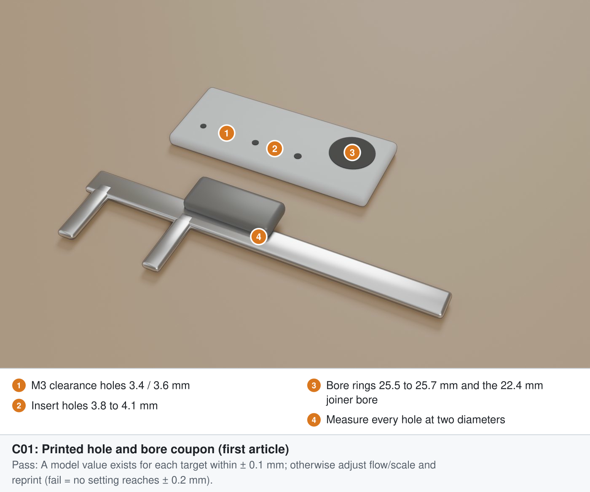

#### C02 — Heat-set insert torque-out, PETG and PA6-CF
- **Objective.** Confirm the 0.5 N·m EST working torque (hardware-spec §2d) has ≥ 2× margin to insert spin-out.
- **Article.** 3 ruthex RX-M3x5.7 inserts per material in the C01 coupon (4.0 mm holes, boss Ø ≥ 8 mm, hardware-spec §2c).
- **Setup.** M3 × 12 screw, washer; hex key with a known arm; hanging masses (water bottles: 1.0 L = 1.00 kg, kitchen scale). Torque T = m g L (hardware-spec §2d: 0.6 N·m at L = 60 mm needs 1.02 kg).
- **Procedure.** (1) Install inserts with a soldering iron at the filament vendor's temperature. (2) Thread the screw to bottom against the washer. (3) Hang mass at L = 100 mm, increase in 0.1 kg steps (0.098 N·m) every 10 s until the insert turns. (4) Record the spin-out torque; repeat for all 6.
- **Data.** Spin-out torque per insert; failure mode (insert spins / plastic cracks).
- **Pass.** Every insert ≥ 1.0 N·m (hardware-spec M3: fails the 0.5 N·m working torque if any spins below 1.0 N·m).
- **Predicted.** — (torque-out in these plastics not published; hardware-spec "Unknowns").
- **Risk.** Coupon cracks at the boss: redesign the boss diameter before printing real parts.
- **Duration** 1 h. **Crew** 1. **Prereq.** C01.

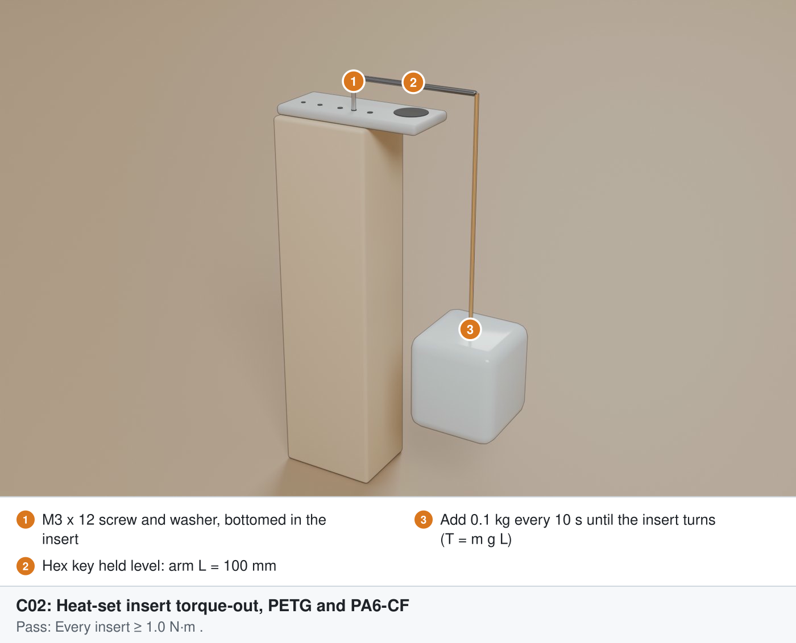

#### C03 — Heat-set insert pull-out, PETG and PA6-CF
- **Objective.** Measure the axial holding force of one M3 insert in each material.
- **Setup (zero-cost).** Lever rig: 1.2 m length of 2×4 pivoted on a block 0.2 m from one end (5:1 ratio); the coupon clamped under the short end with the screw hooked to the beam by a wire loop; water jugs hung from the long end. Or, where available, the thrust-stand load cell (C06) in series with a turnbuckle (not in BOM).
- **Procedure.** (1) Fit a M3 × 16 screw with a washer and a wire loop. (2) Add 1 kg steps at the long end (= 49 N at the insert) every 15 s. (3) Stop at pull-out or at 20 kg (981 N at the insert). (4) Three inserts per material.
- **Data.** Pull-out force per insert; failure mode.
- **Pass.** Minimum ≥ 300 N in PETG and ≥ 400 N in PA6-CF (EST: 10 × the 30.7 N full-thrust pull of one lift unit if a single screw carried it, `results.json struct.Tmax`; the PA6-CF figure adds margin for the motor mount's 0.6 N·m screw preload, hardware-spec J01).
- **Predicted.** — (not published).
- **Risk.** Lever rig slips: use a cleat under the coupon and keep hands clear.
- **Duration** 1 h. **Crew** 2. **Prereq.** C02.

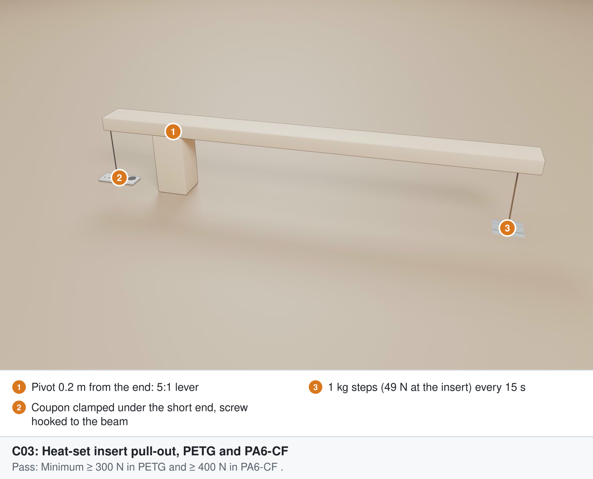

#### C04 — Motor-floor crush and relaxation (PA6-CF)
- **Objective.** Confirm the 4.5 mm PA6-CF motor floor holds a 0.6 N·m screw preload for 24 h (hardware-spec M3), with the rev B Ø7.5 counterbore and Ø7.0 washer (`cad/README.md` fasteners).
- **Procedure.** Torque an M3 × 8 with washer to 0.6 N·m (0.61 kg at L = 100 mm) through the coupon floor (printed with the Ø7.5 counterbore) into an aluminium nut plate; mark the head; wait 24 h at room temperature and again after 1 h at 60 °C EST in a sunny car or by a heat gun with the IR thermometer; re-apply 0.6 N·m and measure the angle turned.
- **Pass.** Re-torque angle ≤ 30° (hardware-spec M3); washer seats flat in the Ø7.5 counterbore with no edge contact.
- **Predicted.** — (PA6-CF compressive creep not published).
- **Duration** 0.5 h + 24 h. **Crew** 1. **Prereq.** C01.

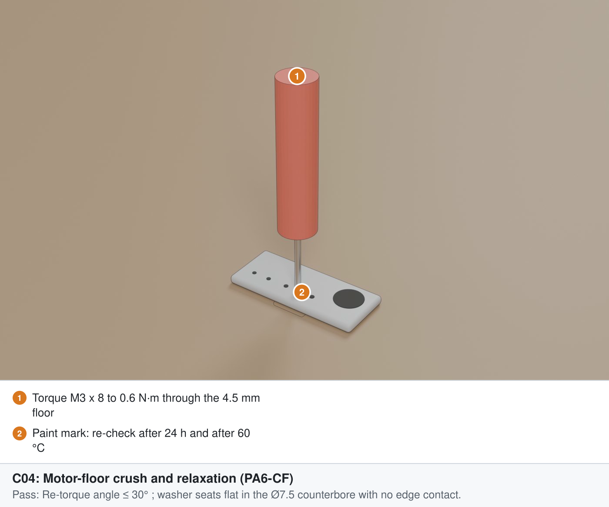

#### C05 — Tube receipt measurement and joiner fit
- **Objective.** Verify the three 6061-T6 tube sizes against the fit table FT01–FT04 (hardware-spec §5b) before cutting.
- **Procedure.** (1) Calipers: OD at 3 points along each tube, wall at both ends; record. (2) Slide the 0.875 in joiner into both 1.000 × 0.058 in socket tubes by hand. (3) With one socket clamped, measure the free-end play of the joiner at 0.76 m: lever the tip and read the vertical movement with a ruler. (4) Check leg (FT03) and splice plug (FT04) fits.
- **Pass.** OD within ± 0.102 mm and wall within ± 0.051 mm of nominal (hardware-spec §5a); joiner enters by hand (diametral clearance −0.076 to +0.534 mm, FT01); wingtip-equivalent play ≤ 5 mm at 1.2 m (`docs/research/budget-airframe.md` M4). Tight: lap. Loose > 0.30 mm: one tape wrap (FT01 action).
- **Predicted.** Nominal clearance 0.23 mm (`cad/README.md` joiner).
- **Duration** 1 h. **Crew** 1. **Prereq.** Order B received.

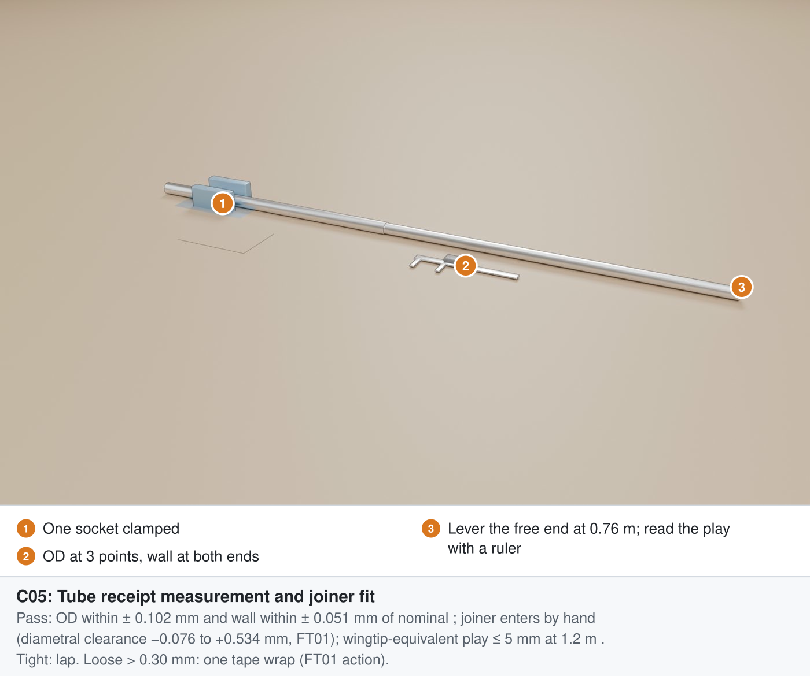

#### C06 — Thrust-stand build and calibration (review T1, accuracy 2 % of reading)
- **Objective.** Calibrate the 20 kg load cell + HX711 + Arduino Nano stand (BOM "Test & safety") so lift and pusher thrust are trusted to ± 2 % of reading at the hover point.
- **Setup.** Pivot-beam stand: motor on one arm, load cell under the other, arms equal (1:1) so thrust = cell reading; the watt meter in the pack lead; a servo tester or the FC in motor-test mode drives the ESC (DShot150 per `firmware/vtol_c0.param` §3; for a servo tester use the ESC's PWM mode). Water jugs as masses: 1.00 L = 0.998 kg at 20 °C; verify each jug on a kitchen scale.
- **Procedure.** (1) Zero. (2) Load 0, 0.5, 1, 2, 3, 5, 10 kg (use the jug positions on the arm so the moment arm equals the motor's). (3) Read the HX711 at each step, up and down. (4) Fit a line; record gain and offset in the Nano sketch. (5) Repeat after 10 min powered to check drift. (6) Tare with the motor and prop fitted.
- **Pass.** Error ≤ 2 % of reading from 0.5 to 5 kg and ≤ 2 % FS (0.4 kg) above (review T1 "2 % FS" superseded: 2 % FS = 400 g is 24 % of the 1,634 g hover point). Hysteresis ≤ 1 %. Drift ≤ 20 g over 10 min.
- **Predicted.** HX711 24-bit on a 20 kg cell: resolution ≪ 1 g; linearity is set by the stand geometry (EST).
- **Risk.** Stand flexes under 3 kgf: brace it; re-check calibration with the motor arm loaded by a jug at the motor station.
- **Duration** 4 h build + 1 h. **Crew** 2. **Prereq.** Order A received.

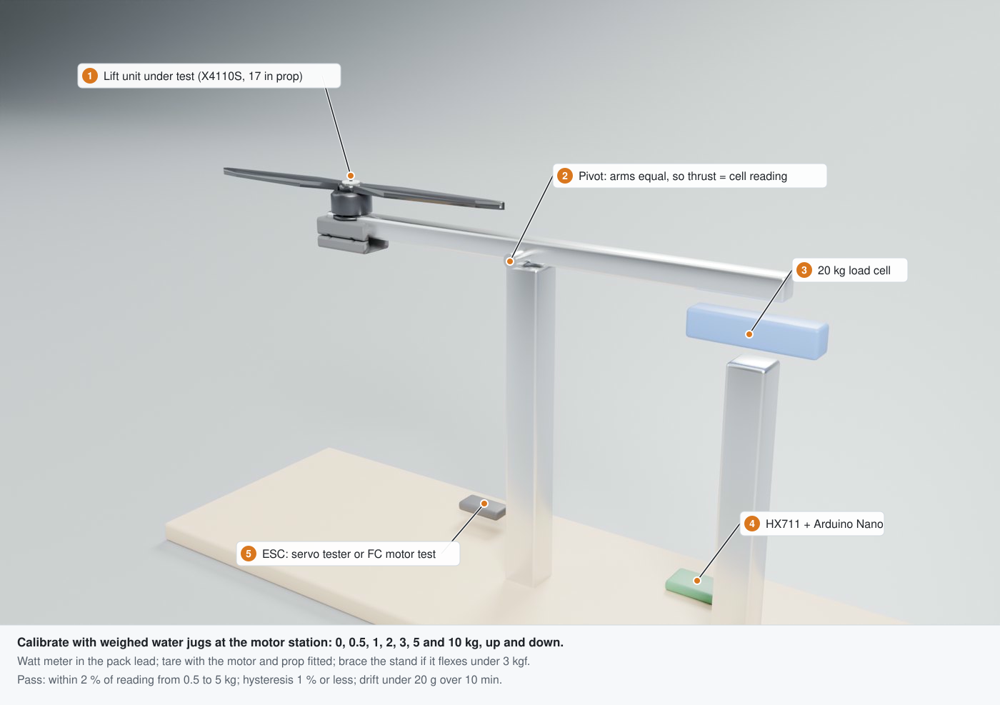

#### C07 — Lift motor thrust curve, every motor (review T2, R13 strict)
- **Objective.** Measure thrust, current, voltage and electrical power vs throttle for each of the 5 X4110S motors with the JeeFly 1755 prop and a SoloGood 45A ESC on the flight pack, and derive the hover operating point and FM·η.
- **Setup.** C06 stand; watt meter in the pack lead; IR thermometer; throttle in 10 % steps from 20 to 100 % (10 points), 5 s dwell, 20 s rest; pack voltage ≥ 24.0 V (4.0 V/cell) at the start and the 100 % point repeated at 22.2 V to match the maker table voltage.
- **Procedure.** (1) Tare. (2) Step throttle; log thrust, V, A, W at each dwell. (3) Note the throttle at 1,634 g (hover) and 3,130 g (maker max). (4) 100 % for 10 s: record max thrust and current. (5) IR temperature of the can after the sweep. (6) Repeat for every motor, same ESC; then one motor on each of the other ESCs.
- **Data.** 10-point table per motor; reduce with `docs/test/analysis/thrust_stand.py` (fits T = a·thr^b and P_elec vs T, reports throttle at hover, FM·η at hover, and `Q_M_THST_EXPO` fit).
- **Pass.** Max thrust ≥ 2.62 kgf per motor at 22.2 V (R13 strict: 1.6 × 6.55 kg / 4 *(calc, `sized.m`)*; the review's 2.4 kgf gave T/W 1.55 at 6.18 kg and 1.47 at 6.55 kg, so it is superseded); electrical power at 1,634 g ≤ 370 W per motor (= 1,484 W / 4, rounded down; 1,484 W is the hover power at which 10 min cruise at the sizing's 262 W at 18 m/s is no longer available: (0.8 × 144.3 × 0.95 − 262.4 × 600/3600) × 3600 / 160 s *(calc, `results.json base`, `sized.P_cruise`)*); motor-to-motor spread at hover ≤ 5 % in thrust at equal throttle; max current ≤ 36 A (80 % of the 45 A ESC rating, EST).
- **Predicted.** Maker table at 22.2 V, 17 × 5.8: 1,500 g / 8.1 A / 180 W; 2,000 g / 13.1 A / 291 W; 3,130 g / 27.7 A / 615 W (`docs/research/budget-lift.md` A3). Sizing hover point: 1,634 g at 229 W, FM·η 0.516 (`sized.Tunit_g`, `P_hover_per_motor`, `FMeta`); ideal power 107.5 W = T^1.5 / √(2 ρ A), A = 0.1464 m² (`sized.Pi_unit`, `sized.A`). Expected hover throttle ≈ 0.52 = 1,638 / 3,130 *(calc)*; the param file comment says ~0.52 from the 6.45 kg value 1,612.6 g (same to two figures). The 17 × 5.5 JeeFly is not the maker's 17 × 5.8 (`docs/purchasing/C0_BOM.csv`): expect a few % less thrust at equal power (EST).
- **Risk.** ESC desync at full throttle on DShot150: lower `Q_M_SPIN_MIN`, check ESC timing in BLHeli configurator. Prop strike: cage the stand.
- **Duration** 0.5 h per motor, 4 h total. **Crew** 2. **Prereq.** C06.

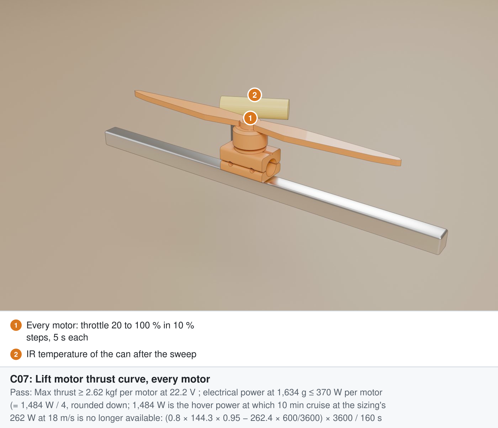

#### C08 — Hover-duty heat (review T3, expanded)
- **Objective.** Validate the lift-unit thermal model (`docs/research/thermal.md` §6.1) and the lumped motor model (90 s hover ≈ 76 °C, `cad/README.md`), and replace the 20 % loss estimate that sets every lift-unit temperature (thermal.md §6.1 sensitivity) with a measured rise and time constant.
- **Setup.** C06 stand; thrust held at 1,634 g (hover) by throttle; IR thermometer on the motor can (bell) and ESC heat-shrink every 15 s; ambient logged.
- **Procedure.** (1) Start at ambient. (2) Hold hover thrust 90 s, reading temperatures every 15 s. (3) Cool with the prop at idle until the can < 45 °C. (4) Repeat 3 times. (5) One run of 3 × 90 s with only 30 s rests (worst case, never flown) to find the limit. (6) Fit the time constant.
- **Pass.** Can ≤ 80 °C EST after one 90 s run; no ESC cut-out; ESC ≤ 70 °C EST; measured time constant ≥ 100 s (review M[simulation].2: under 100 s invalidates the lumped model).
- **Predicted.** Lift-unit model (`docs/research/thermal.md` §6.1; SOLIDWORKS transient, motor + PA6-CF mount + boom + ESC in prop wash, 45.6 W = 20 % of 228 W per motor EST, ESC 4 % EST): rise above ambient at 30 / 60 / 90 s **can +15 / +28 / +39 K, ESC +11 / +21 / +28 K** (74 °C / 63 °C at 90 s on a 35 °C day, 59 °C / 48 °C on a 20 °C day); the can crosses 80 °C at ≈ 110 s and the ESC 70 °C at ≈ 125 s of continuous hover; τ ≈ 300 s. Motor-only lumped check 76 °C at 90 s (c 470 J/kgK EST, 74–83 °C for c 500–385, `cad/README.md`); steady upper bound 143.9 °C at 45.8 W, h = 50 W/m²K EST (`cad/sim/results.txt motor_T_steady`, re-run 2026-10-25 on CAD rev D). A can > 70 °C after 90 s triggers the hot-day 45 s take-off hover limit (§6).
- **Duration** 2 h. **Crew** 2. **Prereq.** C07.

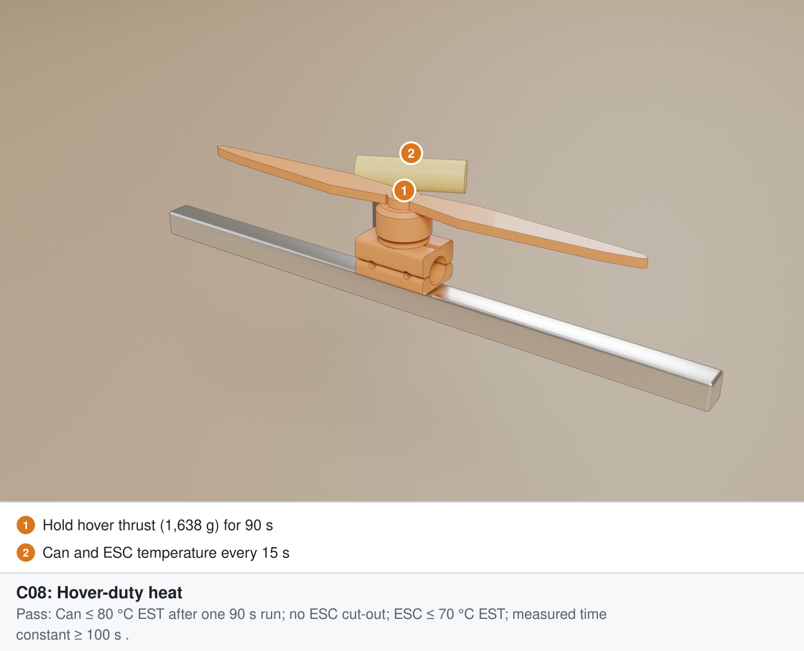

#### C09 — Pusher thrust curve, X4110S + APC 14 × 8.5EP (review T4, expanded)
- **Objective.** Static thrust and current of the pusher set; set `TKOFF_THR_MAX`, confirm the transition current budget, and confirm `THR_MAX` 85 by **bench measurement M1** (pusher power at full pack).
- **Setup.** C06 stand with the pusher adapter (M6 bolt-on, hardware-spec J03b); throttle 20–100 % in 10 % steps. **M1:** a pack at ≥ 25.0 V (full charge); 100 % for ≤ 3 s, then 85 % (`THR_MAX`) for 10 s; record W, A, V, thrust and the can temperature by IR.
- **Pass.** Static thrust ≥ 1.5 kgf at 60 % throttle (review T4); peak current ≤ 40 A (review M[propulsion].3; above that drop to a 13 × 8 prop); prop runout by eye < 1 mm at the tip (FT10 spin check); M1: electrical power at `THR_MAX` on a full pack ≤ 615 W (X4110S rating at 22.2 V, `docs/research/budget-lift.md` A3), else lower `THR_MAX` and re-check the level speed at full throttle ≥ `AIRSPEED_MAX` 25 m/s in F08.
- **Predicted.** — (no vendor table for 14 × 8.5EP on the X4110S, `docs/research/pusher-battery-servo.md` §1b). Cruise thrust needed 7.43 N = 0.76 kgf at 18 m/s (sizing, `sized.D_cruise`) or 6.78 N = 0.69 kgf (aero build-up, `aero_results.json drag.cruise.D_N`); P_cruise 262 W / 11.8 A (sizing) or 239 W / 10.8 A (aero) at η_prop 0.6 EST (`sized.P_cruise`, `aero_results.json mission`). C0 SITL model (`firmware/sitl/README.md` trim validation, APC 14 × 8.5 data, EST motor model): cruise 233 W / 14.0 A at η_prop ≈ 0.74; static 3.35 kgf at 626 W / 28 A on 22.2 V; ≈ 890 W at 100 % on 25.2 V, so `THR_MAX` 85 ≈ 547 W (est., throttle³ scaling, `firmware/vtol_c0.param`).
- **Duration** 1 h. **Crew** 2. **Prereq.** C06.

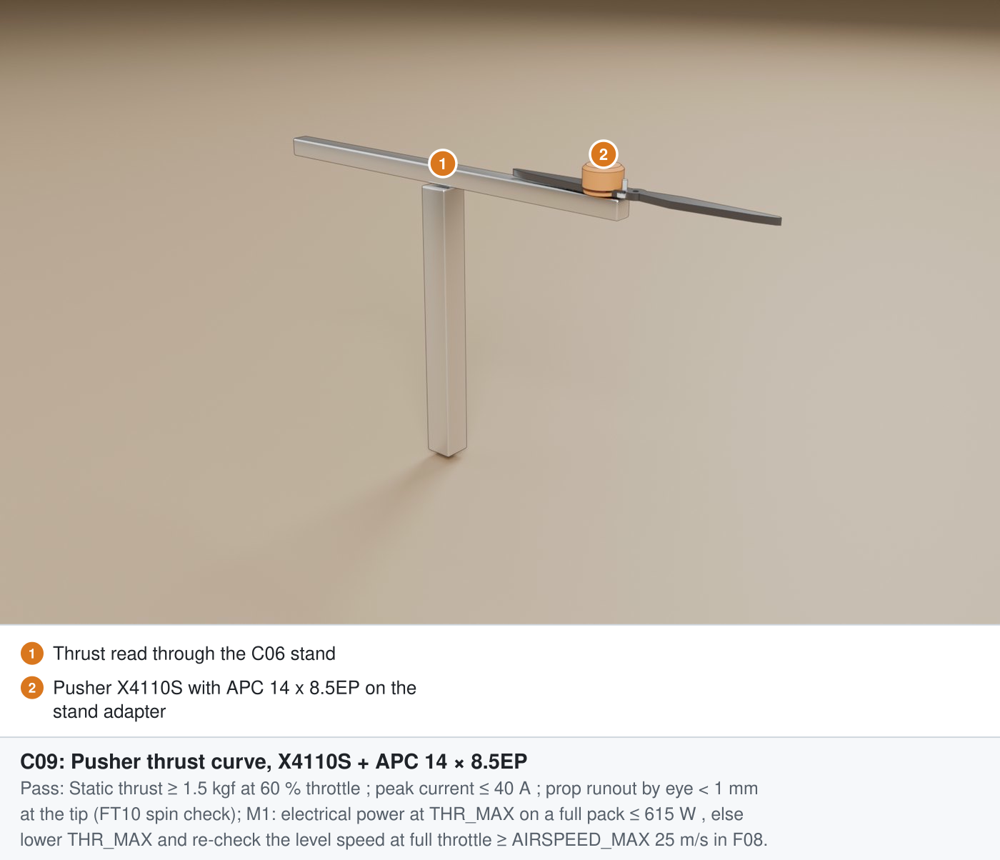

#### C10 — Stopped-prop behaviour and drag (review T5 + §[iterations] M1)
- **Objective.** Confirm an unpowered lift prop does not windmill at cruise speed and measure its drag.
- **Setup (zero-cost).** Motor + prop on a mast on a car roof rack (or held out of a window on a 1 m pole by a passenger — only on a closed lot), unpowered, 18 m/s = 65 km/h = 40 mph *(calc: 64.8 km/h, 40.3 mph)* by the car speedometer; phone video; for drag, the unit on a pivot arm with a luggage scale (Gaps) or the HX711 load cell reading the arm force.
- **Pass.** No windmilling (review T5); prop stops ≤ 30° from the airflow direction (review M[iterations].1); drag ≤ 0.8 N per stopped unit EST (model 0.44 N at 18 m/s = ½ × 1.225 × 18² × 0.00222 with CdA_rotor 0.00222 m², `aero_results.json drag.CdA_per_rotor_unit` *(calc)*; `docs/research/aerodynamics.md` M3: ΔP > 60 W across four units means the prop Cd EST is low and a prop-parking scheme is needed).
- **Risk.** Road safety: closed lot, driver only drives, ≤ 65 km/h.
- **Duration** 1 h. **Crew** 3. **Prereq.** C07.

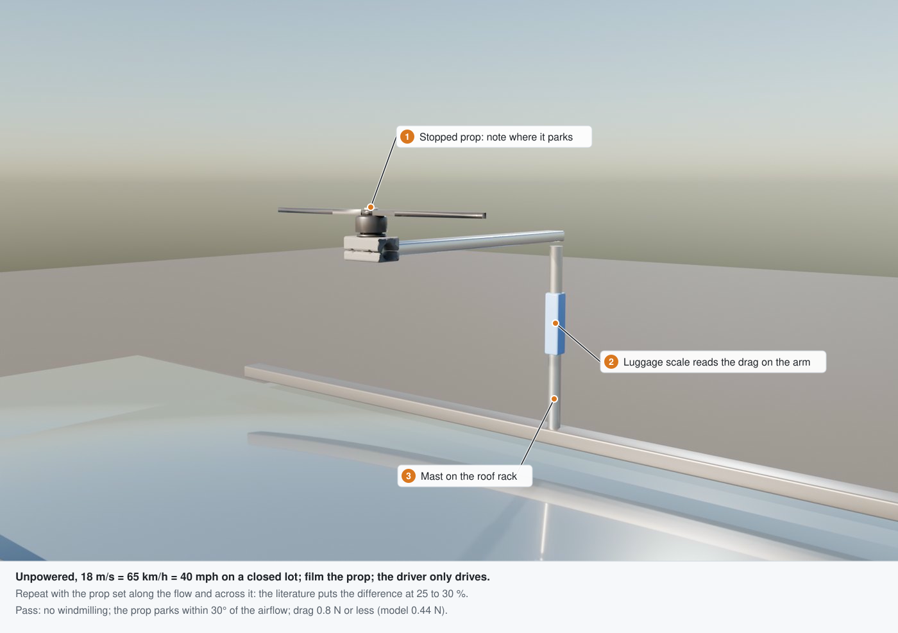

#### C11 — Battery capacity, sag and internal resistance
- **Objective.** Measure usable energy, voltage sag at hover and transition current, and per-cell internal resistance of both Ovonic 6S 6500 packs.
- **Setup.** Discharge load = two lift motors on the C06 stand or the tied-down airframe at a constant current near cruise (15 A, above `sized.I_cruise` 11.8 A at 18 m/s, so conservative for capacity EST; review M[mass].4 said 16 A) with the watt meter logging Wh, V, A; the IR thermometer on the pack; cell voltages by the charger's balance readout at rest.
- **Procedure.** (1) Full charge (4.20 V/cell). (2) Rest 30 min; record resting V. (3) Discharge at 15 ± 2 A until 3.50 V/cell under load (21.0 V); log Wh, Ah, V every 30 s (watt meter readout on phone video). (4) At 50 % delivered Ah, pause and apply a 10 s step to 41 A (hover, `sized.I_hover` 41.1 A) and a 3 s step to ≈ 76 A (`sized.I_trans` 68.4 A, four lift motors at ≈ 60 % plus pusher, or two motors at full): record V before and during. (5) Rest 30 min; record recovery voltage and pack temperature. (6) Recharge, log mAh returned. (7) Reduce with `docs/test/analysis/battery_test.py`.
- **Pass.** Delivered ≥ 110 Wh from 4.20 to 3.50 V/cell at 15 A (0.8 × 144.3 × 0.95 = 109.7 Wh *(calc)*: the energy the sizing assumes usable before the 20 % reserve); sag ≥ 3.4 V/cell at 41 A and ≥ 3.2 V/cell at the 76 A step (review M[propulsion].4); per-cell internal resistance ≤ 7.3 mΩ (= (3.70 − 3.40) / 41.1 A *(calc)*, EST); **hot-day acceptance: > 5 mΩ/cell is a hot-day no-go** (§6; `docs/research/thermal.md` §6.4 item 2: the XPS bay is adiabatic, so a pack at 7.5 mΩ/cell ends a 35 °C mission at 59 °C, 1 K under the limit; > 5 mΩ/cell means a > 16 K rise) — write the measured value on the pack label; pack ≤ 60 °C EST after discharge; both packs within 3 % of each other.
- **Predicted.** 144.3 Wh nameplate (`packs[0].Wh`); loaded-pack voltage 21.0 V at hover (`firmware/vtol_c0.param` BATT_LOW_VOLT comment); mission needs 88.7 Wh from the pack (84.28 / 0.95 *(calc, `sized.E_Wh`, `base.etaBatt`)*), landing at 39 % of nameplate *(calc: (144.3 − 88.7) / 144.3)*. Pack temperature rise over a full mission ≈ 3.2 K per mΩ/cell *(calc: 24.2 K at 7.5 mΩ/cell, thermal.md §5; 23.6 K at the 7.3 mΩ/cell pass limit)*; with the battery-bay vents (BUILD-MANUAL 8.2a) about 55 °C at touchdown from 35 °C at 7.5 mΩ/cell (thermal.md §6.4 item 1, EST).
- **Risk.** Over-discharge: watch 3.5 V/cell; LiPo bag under the pack.
- **Duration** 2 h per pack. **Crew** 2. **Prereq.** C06.

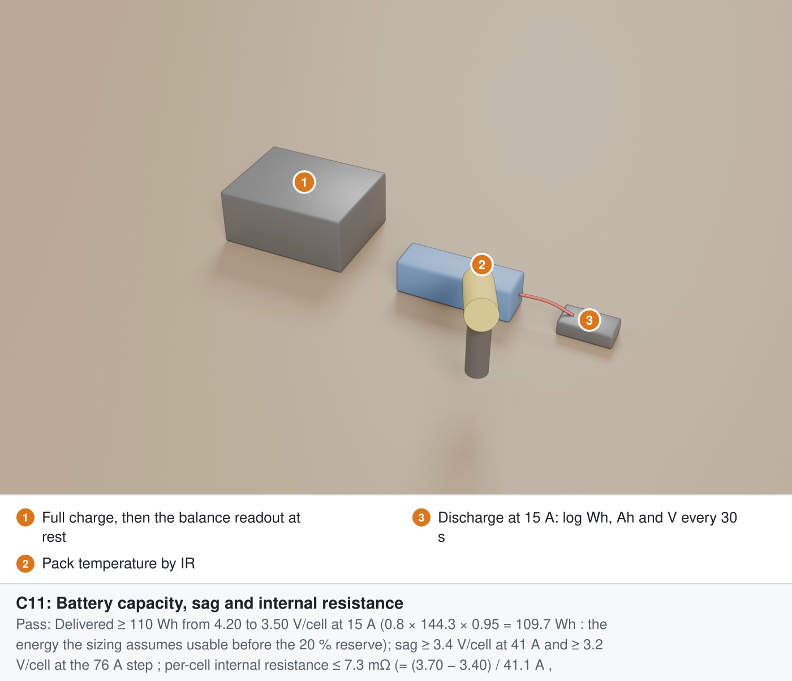

#### C12 — Servo torque, speed and centering (EMAX ES3005HV × 5, no spare)
- **Objective.** Confirm each of the five flight servos (2 ailerons, elevator, 2 rudders; `docs/purchasing/C0_BOM.csv`) meets its rating at the FC servo-rail voltage and centres repeatably. The BOM carries no spare servo: a failed servo is replaced from the $103.21 reserve (BOM "Crash reserve").
- **Setup.** Servo on a bench block, 50 mm arm, luggage scale or hanging jug on a string over a pulley (zero-cost: masses only), bench 6.0 V from the FC BEC or a UBEC (hardware kit, BOM); servo tester or FC output.
- **Procedure.** (1) Centre at 1500 µs; mark. (2) Hang masses at 50 mm until the arm stalls (torque = m g × 0.05 m: 8 kg·cm = 0.785 N·m needs 1.60 kg at 50 mm *(calc)*); hold ≤ 2 s to avoid heating. (3) Command ± 45°, measure travel. (4) Return to centre 10 times from each side; measure the arm tip position. (5) Time a 60° sweep by phone video (30 fps).
- **Pass.** Stall ≥ 6.4 kg·cm at 6.0 V (80 % of the 8 kg·cm rating, EST; rating from `docs/research/budget-avionics.md` §6, shop.emax-usa.com checked 2026-10-13); centring repeatability ≤ 1° (≤ 0.9 mm at 50 mm *(calc)*, EST); no buzzing at centre under 1 kg·cm; all five within 10 % of each other.
- **Predicted.** 8 kg·cm at 6.0 V, 10 at 7.4 V (budget-avionics §6). Hinge-moment need: ≤ 4 kg·cm per aileron (review M[controls].3; measured in S07). Pushrods: 2-56 Du-Bro Kwik-Link cut to the CAD lengths (ailerons 48 mm, elevator 40 mm, rudders 102 mm, `cad/mesh/meta.json`; `cad/params.txt` rodAileron / rodElevator / rodRudder); the 5-pack covers five surfaces with no spare pushrod.
- **Duration** 1.5 h. **Crew** 1. **Prereq.** Order B.

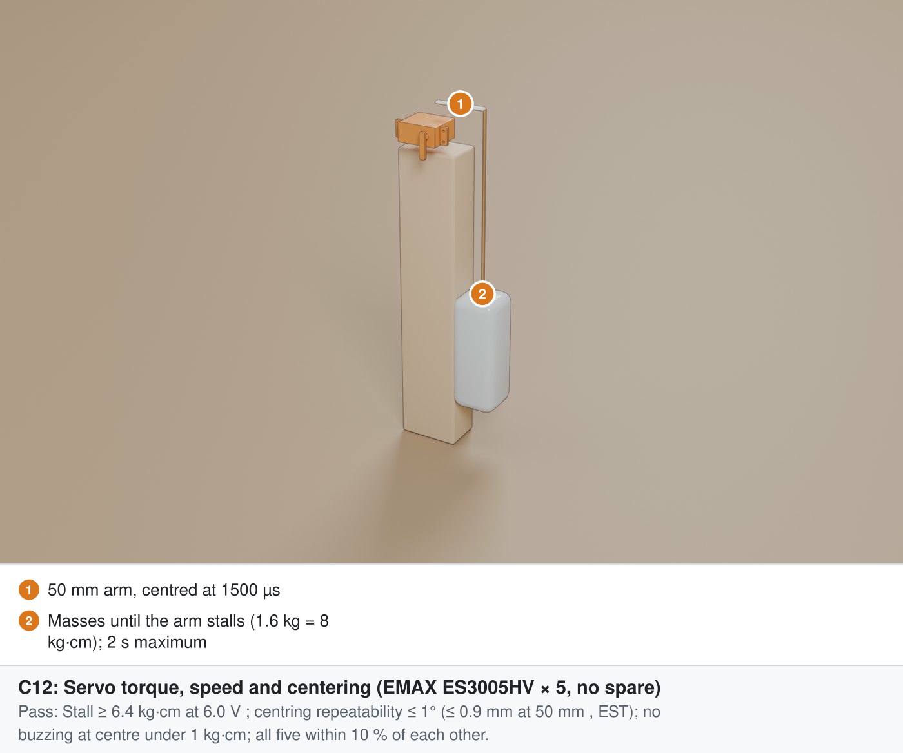

#### C13 — Harness, connector and ESC heating
- **Objective.** Confirm the 12 AWG ESC feeds, 14 AWG pusher/BEC feeds, XT90-S and XT60H connectors (BOM) stay cool at hover and transition current.
- **Setup.** Run during G03 (tied-down full-system run); IR thermometer on each connector, the pack lead, each ESC and the FC current-sensor board.
- **Pass.** Any connector or wire ≤ 60 °C EST after 60 s hover current + 10 s transition current; ESC ≤ 70 °C EST; no discolouration.
- **Predicted.** 10.3 A per lift ESC at hover (41.1 / 4 *(calc)*); pack lead 41.1 A hover (43.5 A at 21 V), 68.4 A transition (`sized.I_hover`, `I_hover_loaded`, `I_trans`); XT90 continuous rating — (not in repo). Lift ESC on the boom in prop wash (BUILD-MANUAL 7.8): 56 °C after a 60 s hover and 65 °C at the mission peak on a 35 °C day (`docs/research/thermal.md` §6.1, 4 % loss EST).
- **Duration** in G03. **Crew** 2. **Prereq.** G03 setup.

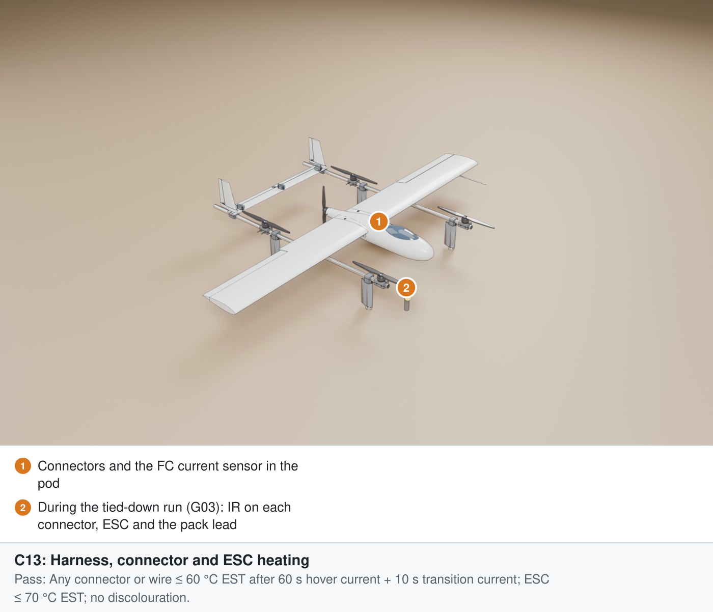

#### C14 — Tape-skin mass sample (review M[structures].4)
- **Objective.** Check the wing skin mass assumption before the sizing is frozen for the build.
- **Procedure.** Cut a 0.5 m² XPS sample, weigh on the kitchen scale, tape one side as per the build, weigh again.
- **Pass.** ≤ 0.1 kg/m² per side (review M[structures].4); otherwise update `base.wGlass` (0.06 kg/m², `results.json`) and re-run `analysis/sizing.mjs`.
- **Duration** 0.5 h. **Crew** 1. **Prereq.** Foam and tape received.

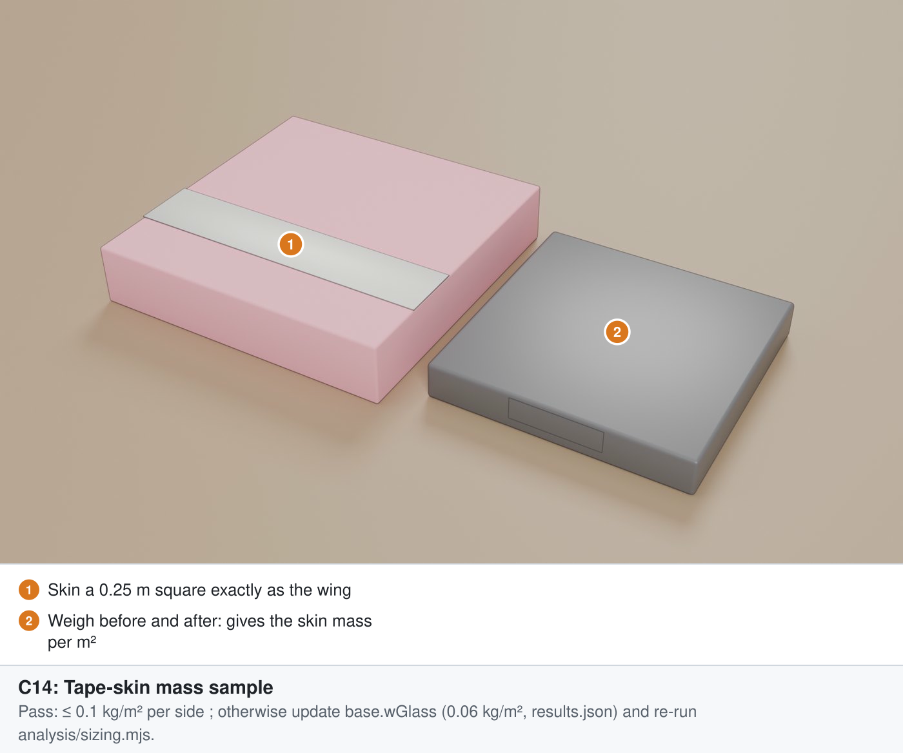

#### C15 — Prop and hub inspection
- **Objective.** Hub thickness for screw length (hardware-spec M5), balance and runout.
- **Procedure.** Calipers on the JeeFly 1755 and APC 14 × 8.5EP hubs; static balance on a bolt through the hub between two glasses (zero-cost); spin each prop on its motor at 30 % with a card held near the tip to see runout.
- **Pass.** Prop screw engagement 4.5–8.0 mm (hardware-spec M5); balance: no preferred rest position after 3 trials or sanded until so; tip runout < 1 mm by eye.
- **Duration** 1 h. **Crew** 1. **Prereq.** Order A.

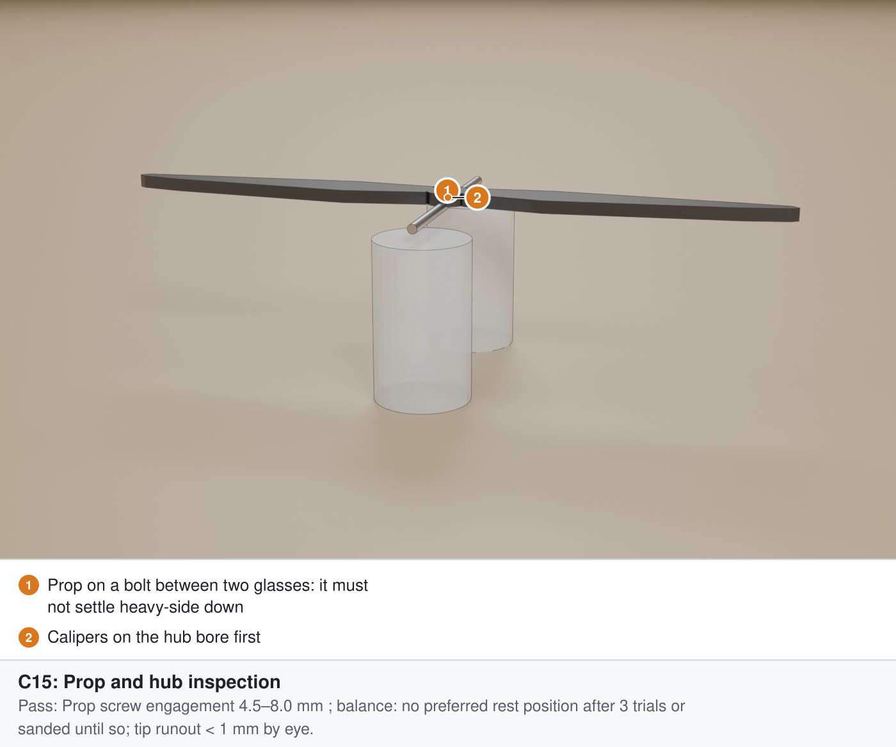

#### C16 — Gear-clamp F05 M3 × 30 and motor counterbore Ø7.5 first-article fit (new in rev B)
- **Objective.** Confirm the two spec values the CAD changed because they could not be built: F05 is M3 × 30 (its nut and head must clear the leg tube in the gear clamp) and the motor counterbores are Ø7.5 (the Ø7.0 washer does not fit Ø6.5) (`cad/README.md` fasteners; `cad/hardware.json`; `cad/drawings/DBF-DRW-001.PDF` sheet 5).
- **Article.** One printed gear clamp pair (PETG) with a 205 mm leg offcut; one motor-mount upper half (PA6-CF).
- **Procedure.** (1) Fit the leg in the gear clamp socket (FT03) and the F05 M3 × 30 cross-bolt with its nylock: check head and nut clearance to the leg tube and that the bolt passes through the leg's Ø3.4 hole (hardware-spec J07). (2) Torque to 0.5 N·m EST; mark. (3) Motor mount: drop a Ø7.0 washer into each Ø7.5 counterbore; fit an M3 × 8 from inside the bore and measure the tip proud of the 4.5 mm floor (hardware-spec M4). (4) Bolt a motor on and check the screw tip ≤ 3.2 mm proud.
- **Pass.** F05 passes with ≥ 0.5 mm clearance between the nut/head and the leg tube; nylock engages ≥ 2 threads past the nut; washers seat flat in all 4 counterbores; screw tip ≤ 3.2 mm (hardware-spec M4; > 3.3 mm reaches the windings).
- **Predicted.** `cad/verification.txt` "rotation check F05 … box extents x 33.0 mm" (M3 × 30 modelled); 0 cut warnings.
- **Duration** 1 h. **Crew** 1. **Prereq.** C01.

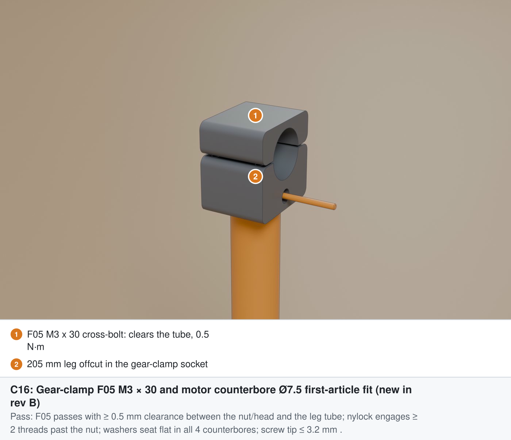

#### C17 — Joiner slip fit and joiner-stop retention (new in rev B)
- **Objective.** Verify the rev B change that the joiner is a slip fit (not bonded) in the saddle and sockets, slides out for transport (R4), and is captured by the two printed `Joiner_Stop` discs bonded 300 mm inside the spar sockets (`cad/README.md` wing root; `cad/hardware.json` J11/FT06 "SLIP FIT, NOT BONDED"; `cad/verification.txt` Joiner_Stop 2 × 5.0 g).
- **Procedure.** (1) With the saddle and both wing panels built, slide the joiner through the saddle bores and into both sockets by hand; measure the push force with the kitchen scale (push the joiner end against the scale). (2) Bolt both panels (M5 × 20, N02 nylock, 1.0 N·m EST, J10). (3) Push the joiner axially from each wingtip end with 10 kg (98 N) by hand on a bathroom scale: the stop disc must hold. (4) Unbolt one panel, slide the joiner out: time it and check the pod transport piece measures ≤ 0.5 m (R4 envelope). (5) Repeat the slide-in/out 10 times; re-measure the push force.
- **Pass.** Joiner enters and leaves by hand with ≤ 5 kg push (EST) and no tape wrap needed beyond FT01's rule; stop discs do not move at 98 N (≥ 2 × the ~50 N EST axial load from a one-wheel landing side load, EST); push force unchanged after 10 cycles (no wear > 0.05 mm on the joiner OD); pod piece ≤ 0.5 m long with the joiner out.
- **Predicted.** FT06 band −0.072 to +0.532 mm (hardware-spec §5b); joiner engagement 0.30 m per side, 13.5 diameters (`struct.engage`, `engageD`).
- **Duration** 1 h. **Crew** 2. **Prereq.** C05, saddle and panels built.

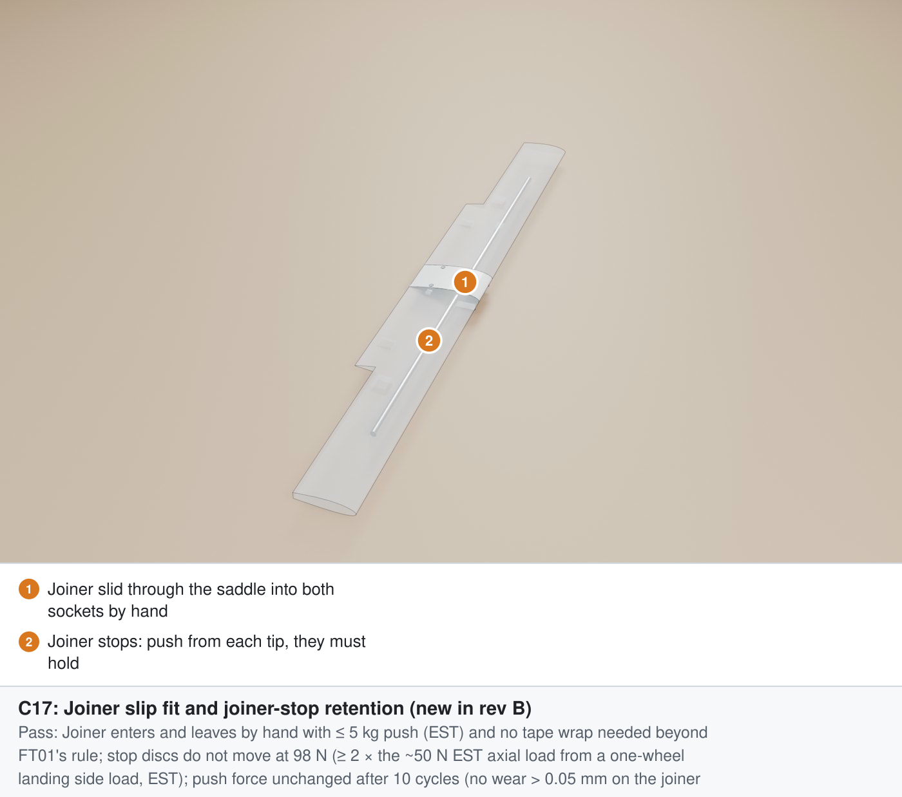

### 9.2 Series S — structural tests on the built airframe

#### S01 — Wing static proof load (limit load, 3.0 g)
- **Objective.** Prove the wing, joiner, joiner stops, sockets and saddle at limit load and compare tip deflection with the FEA.
- **Article.** Complete wing (both panels on the saddle and joiner, M5 wing bolts torqued to 1.0 N·m EST, hardware-spec J10), no aileron servos needed.
- **Setup.** Wing inverted on two padded supports at the pod width (saddle edges, ≈ 0.1 m each side of centre); ruler or dial gauge at each tip against a fixed reference; sandbags or water jugs (kitchen-scale-weighed, ± 10 g) at six stations per side.
- **Load schedule.** Total 15.5 kg = n × (m − m_wing) = 3.0 × (6.55 − 1.39) *(calc; `sized.m`, `sized.m_wing`; the wing's own 1.39 kg already loads the spar in the inverted position, so this is slightly above 3.0 g at the root — conservative)*. Elliptic spanwise: per side, stations at 0.1 / 0.3 / 0.5 / 0.7 / 0.9 / 1.1 m from centre: 1.64 / 1.59 / 1.49 / 1.33 / 1.08 / 0.62 kg *(calc: elliptic integral over 0.2 m bins, data sheet `cards/DS-S01.md`)*. Chordwise at 30 % chord (spar line; chord 0.284 m, `sized.chord`).
- **Procedure.** (1) Zero the tip gauges. (2) Load symmetrically in four increments (25, 50, 75, 100 % of schedule), reading both tips each step; listen for cracking; look at the socket foam cover and the saddle bolts. (3) Hold 100 % for 30 s (review M[structures].1). (4) Unload in the same steps. (5) Record residual tip deflection after 5 min. (6) Slide the joiner out and inspect for marks or bow against a straight edge; check the stop discs are still bonded.
- **Pass.** Tip deflection at 100 % ≤ 120 mm (10 % of the 1.2 m semi-span, review M[structures].1); residual ≤ 2 mm EST; no permanent set in the joiner (straightness ≤ 0.5 mm over 0.76 m, EST); no foam crush at the sockets; no bolt loosening; stop discs intact.
- **Predicted.** Spar tip 15.5 mm at 3.0 g, scaled from the FEA 23.2 mm at 4.5 g (`cad/sim/results.txt spar_tip_disp` × 3/4.5 *(calc)*; FEA re-run 2026-10-25 on CAD rev D at the root moment 73.6 N·m, `struct.Mroot`, `cad/README.md` simulations). The FEA bonds an idealised joiner (OD = socket ID), so the real wing with 0.23 mm joiner clearance and foam compliance will deflect more; between 15 and 60 mm is the expected band (EST). Root moment at 3.0 g: 49.1 N·m = n W b / (3π) *(calc; `struct.Mroot` 73.6 × 3/4.5)*; joiner stress 105 MPa, RF 2.62 on 275 MPa yield (`struct.sigJ` 157.5 MPa × 3/4.5 *(calc)*).
- **Risk.** A failure drops 15 kg of bags: nobody under the wing; pad the floor.
- **Duration** 2 h. **Crew** 3. **Prereq.** C05, C17, wing built.

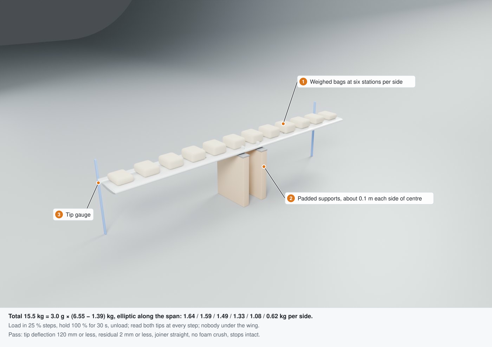

#### S02 — Boom static stiffness (review M[simulation].1)
- **Objective.** Measure boom tip deflection under a known load with the real printed clamp to check the FEA boundary condition.
- **Setup.** One boom clamped in its front and rear wing clamps on the wing (or in a bench fixture using the real clamps); a jug of known mass hung at the front motor station (arm Lb = 0.462 m, `struct.Lb`); ruler/dial gauge at the motor station.
- **Procedure.** Hang 1.0, 2.0, 3.0 kg (9.8–29.4 N, up to the 30.7 N full-thrust case `struct.Tmax`); read deflection each step and after removal.
- **Pass.** Deflection at 3.0 kg ≤ 1.5 × prediction = 4.0 mm (review M[simulation].1 rule; 1.5 × FEA 2.70 mm = 4.05 mm *(calc)*, rounded down); residual 0; no clamp slip (witness line).
- **Predicted.** 2.84 mm hand (P L³ / 3EI, `struct.defl_max`), 2.70 mm FEA at 30.7 N (`cad/sim/results.txt boom_disp_max`, re-run 2026-10-25 on CAD rev D at the arm Lb 0.462 m).
- **Duration** 1 h. **Crew** 2. **Prereq.** Booms built.

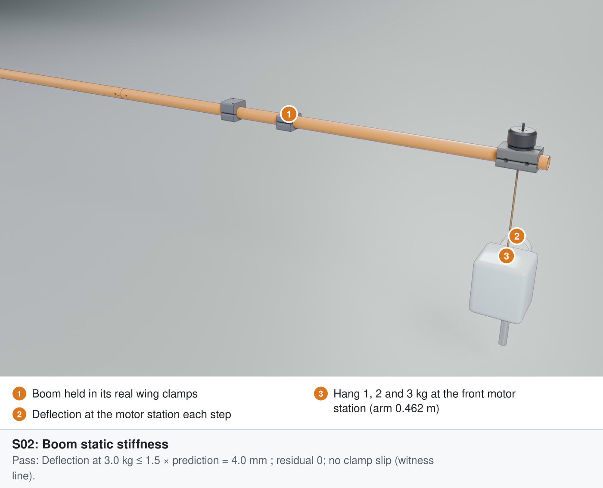

#### S03 — Boom modal tap test (review M[structures].2)
- **Objective.** First bending frequency of each boom with the lift unit fitted, vs the hand 32.3 Hz / FEA 34.4 Hz.
- **Setup.** Aircraft assembled on its gear; phone taped to the motor mount running a free accelerometer logging app (e.g. phyphox, phyphox.org, free; EST adequacy: phone IMU rates 100–400 Hz give ≤ 50–200 Hz bandwidth); tap the motor with a rubber mallet handle.
- **Procedure.** 10 taps per boom, vertical then lateral; export the accelerometer CSV; FFT in the app or with numpy; read the first peak.
- **Pass.** f1 within 26–41 Hz EST (hand 32.3 Hz − 20 % to FEA 34.4 Hz + 20 % *(calc)*) in both planes; and not within ± 15 % of the hover rotor frequency or twice it (review M[structures].2). Hover rpm comes from C07 throttle and the no-load 8,880 rpm × throttle fraction EST (BLHeli_S has no telemetry on these ESCs, —).
- **Predicted.** 32.3 Hz hand at the 0.462 m arm (`struct.fn`), 34.4 Hz FEA (`cad/sim/results.txt boom_f1`, re-run 2026-10-25 on CAD rev D); a compliant clamp lowers it (`analysis/sizing.mjs` comment on fn).
- **Duration** 1 h. **Crew** 2. **Prereq.** S02.

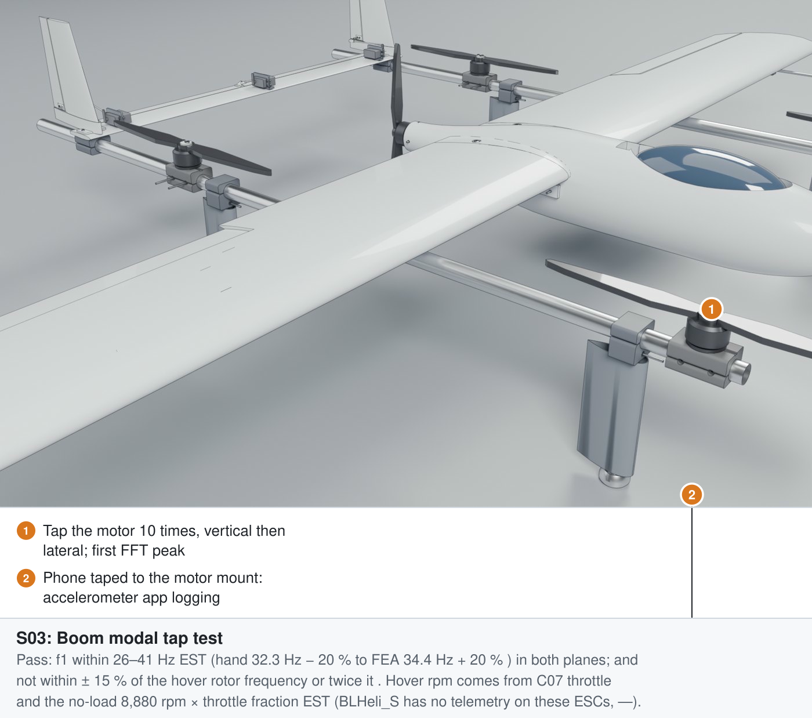

#### S04 — Boom clamp and splice slip proof (hardware-spec M7, review M[structures].5)
- **Objective.** Prove the printed clamps and the rear splice do not slip under full thrust or torsion.
- **Procedure.** (1) Torsion: hang 2 kg on a 0.25 m lever (4.9 N·m, hardware-spec M7) from a motor mount, then from the tail clamp; check the paint witness line. (2) Bending: hang 1.5 × Tmax = 46.0 N (4.69 kg *(calc; `struct.Tmax`)*) from the front motor station with the rear free (review M[structures].5); check rotation at the clamps with a protractor app.
- **Pass.** Witness line unmoved; rotation ≤ 1°; no crack (review M[structures].5).
- **Predicted.** Clamp friction capacity about 16 N·m about the boom axis at 0.5 N·m per screw, μ 0.3 EST (hardware-spec J04); clamp moment 14.2 N·m (`struct.Mclamp`); socket shear 11.3 MPa (`struct.tauSock`).
- **Duration** 1 h. **Crew** 2. **Prereq.** C02, booms built.

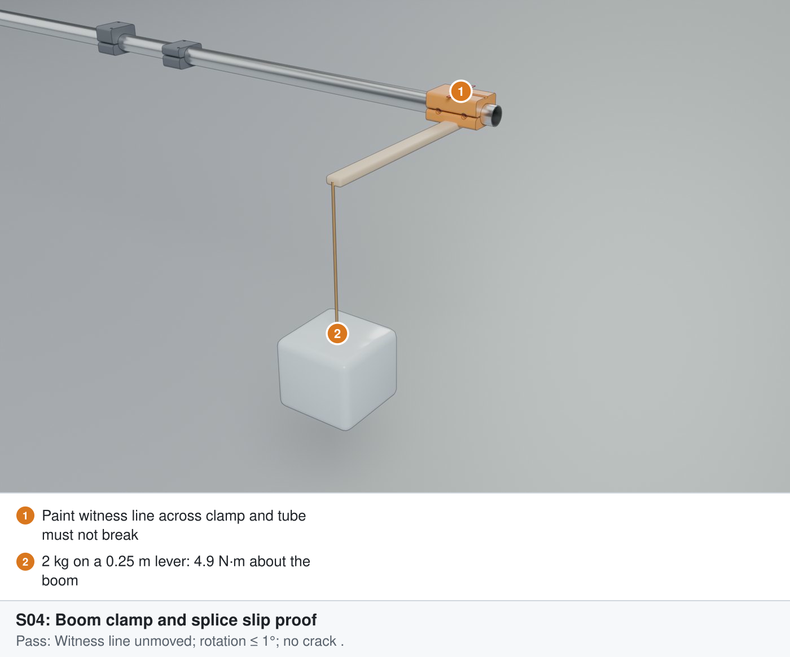

#### S05 — Motor-mount pull and insert test on real parts
- **Objective.** Confirm the as-printed PA6-CF motor mounts (rev B: upper half with the 4.5 mm floor + lower cap, `cad/README.md` printed clamps) and their inserts hold the motor at full thrust with margin.
- **Procedure.** With a motor bolted to its mount (0.6 N·m, Loctite 242, hardware-spec J01; screws from inside the bore) and the mount clamped on a boom, hang 2 × Tmax = 61.4 N (6.26 kg *(calc)*) from the motor bell in the thrust direction for 60 s; then torque one spare mount's insert to 1.0 N·m to confirm C02 on the real geometry.
- **Pass.** No crack, no insert movement, screws unchanged on re-torque (≤ 30°).
- **Predicted.** Lift unit reaction at full thrust 30.7 N (`struct.Tmax`).
- **Duration** 0.5 h. **Crew** 2. **Prereq.** C02, C03, C16, mounts printed.

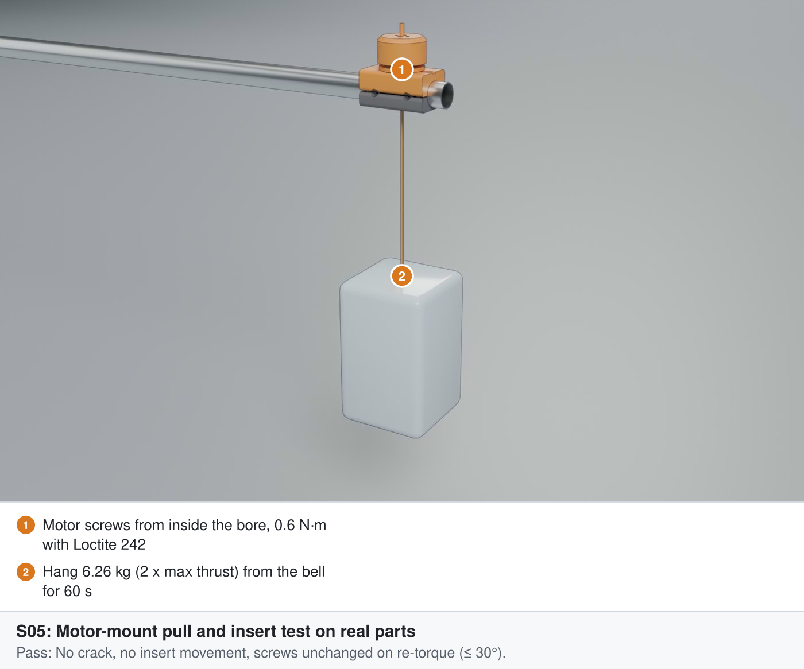

#### S06 — Landing-gear drop test (review M[structures].3)
- **Objective.** Measure peak deceleration in a 0.3 m drop and decide on compliant feet; check the leg fairings survive.
- **Setup.** Empty airframe (no pack; ballast to flight mass with a jug strapped in the bay, total 6.55 kg) with the FC powered by a bench battery and logging (`LOG_DISARMED,1` temporarily) or a phone accelerometer in the bay; grass surface; leg fairings fitted (`cad/README.md` gear: printed 3:1 teardrop, 170 mm, taped at the clamp).
- **Procedure.** Lift to 0.30 m under the feet (tape measure), release level, three drops; inspect legs, gear clamps, boom clamps, fairings and the ballast mount (S10) after each.
- **Pass.** Peak ≤ 8 g (review M[structures].3) — otherwise fit softer feet (foam/TPU, about 100 mm travel keeps n ≤ 8, review §[structures] "Landing loads"); no crack or permanent bend in the 0.205 m legs; fairings undamaged and still taped.
- **Predicted.** Impact speed 2.43 m/s = √(2 g h) (review §[structures] Load cases); bare aluminium legs as springs: n = 2(1 + h/s) = 32 g at 20 mm stroke, 8 g at 100 mm (`struct.strokes`). So without compliant feet the test is expected to **fail**; run it first with the planned feet.
- **Risk.** Damage to the pod: the drop is onto the gear only, pad the pod with foam.
- **Duration** 1 h. **Crew** 2. **Prereq.** S01, S10, gear built.

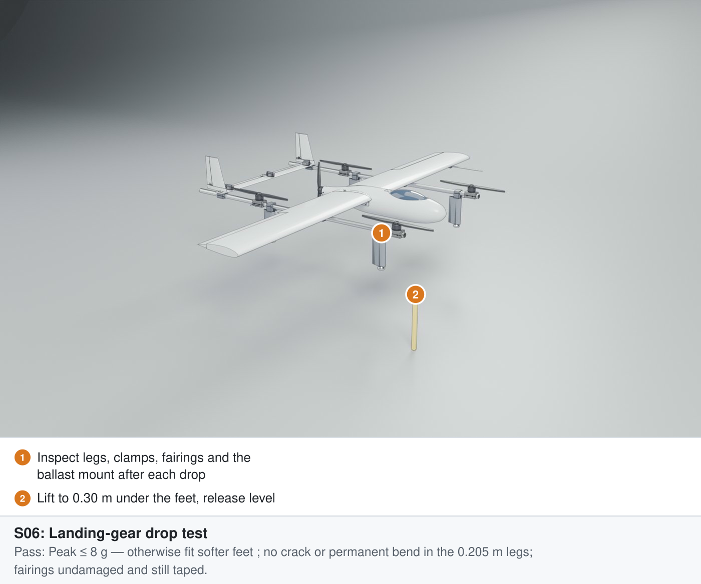

#### S07 — Control-surface hinge moment and joiner/spar post-test inspection
- **Objective.** (a) Measure the aileron hinge moment to size the servo margin (review M[controls].3); (b) inspect the joiner, sockets and saddle after S01 and S06.
- **Procedure.** (a) Spring/luggage scale (Gaps; zero-cost: hang a jug from a string over the trailing edge) on a built aileron at 25 % of its chord behind the hinge with the surface held by the servo at 20° in an 18 m/s stream (car-roof, as C10) or, failing that, static estimate from Ch = ½ ρ V² S_a c_a Ch_δ δ with Ch_δ EST −0.5/rad and the hand calc on the card. (b) Slide the joiner out; straight-edge; look for socket foam crush and saddle bolt witness marks.
- **Pass.** (a) Hinge moment ≤ 4 kg·cm (review M[controls].3, half of 8 kg·cm). (b) No set > 0.5 mm; no crush.
- **Predicted.** — (hinge moment not computed in the repo, `docs/research/pusher-battery-servo.md` caveat 5).
- **Duration** 1.5 h. **Crew** 2. **Prereq.** S01.

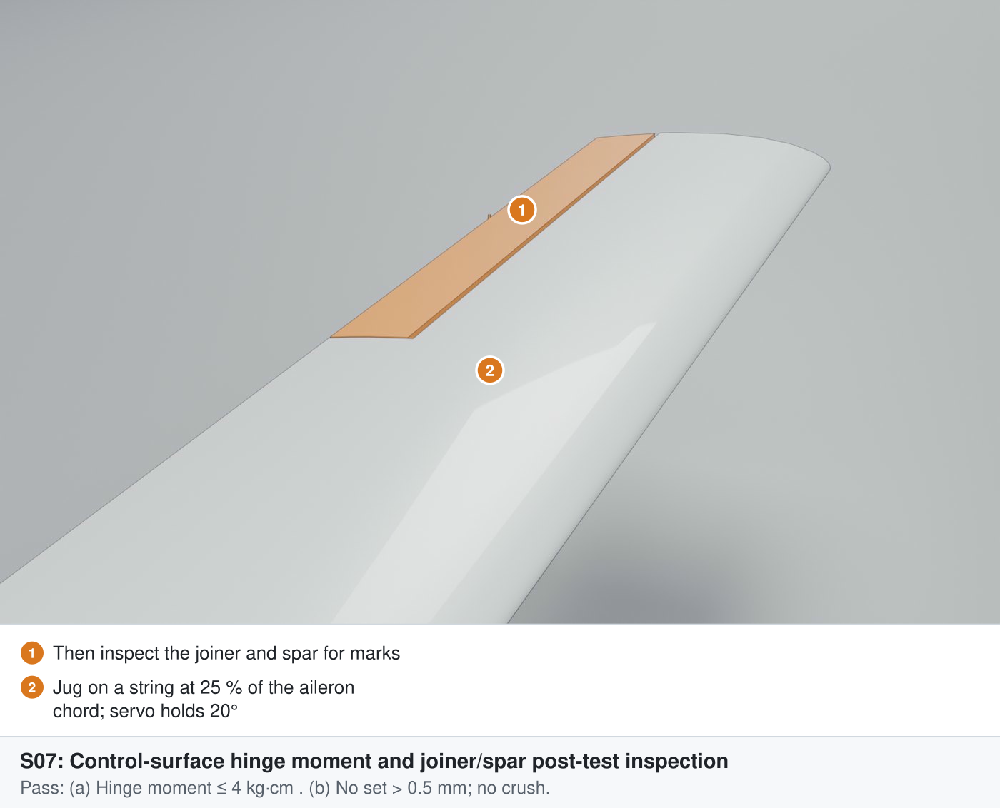

#### S08 — Transport, car fit and two-person carry (R4, R5)
- **Objective.** Demonstrate break-down into the measured car and the assembled carry.
- **Procedure.** (1) Measure the team car's load space (review M[model3d].2). (2) Break the aircraft into its transport pieces (wing panels off the saddle, joiner slid out of the pod piece, booms off at the field breakdown joint — 4 screws per boom, hardware-spec J05; tail off with four screws, `cad/README.md` tail). (3) Load everything with the pack box and tools; close the hatch. (4) Two people carry the assembled aircraft 50 m over grass and set it down; no part touched the ground.
- **Pass.** All pieces fit; longest piece 1.20 m (`geo.longestPiece`) ≤ measured clear length (R4 working envelope 1.5 × 0.5 × 0.4 m, `docs/DESIGN-BASIS.md` R4); pod piece ≤ 0.5 m with the joiner out; carry completed without strain or contact.
- **Duration** 1 h. **Crew** 2. **Prereq.** C17, airframe built.

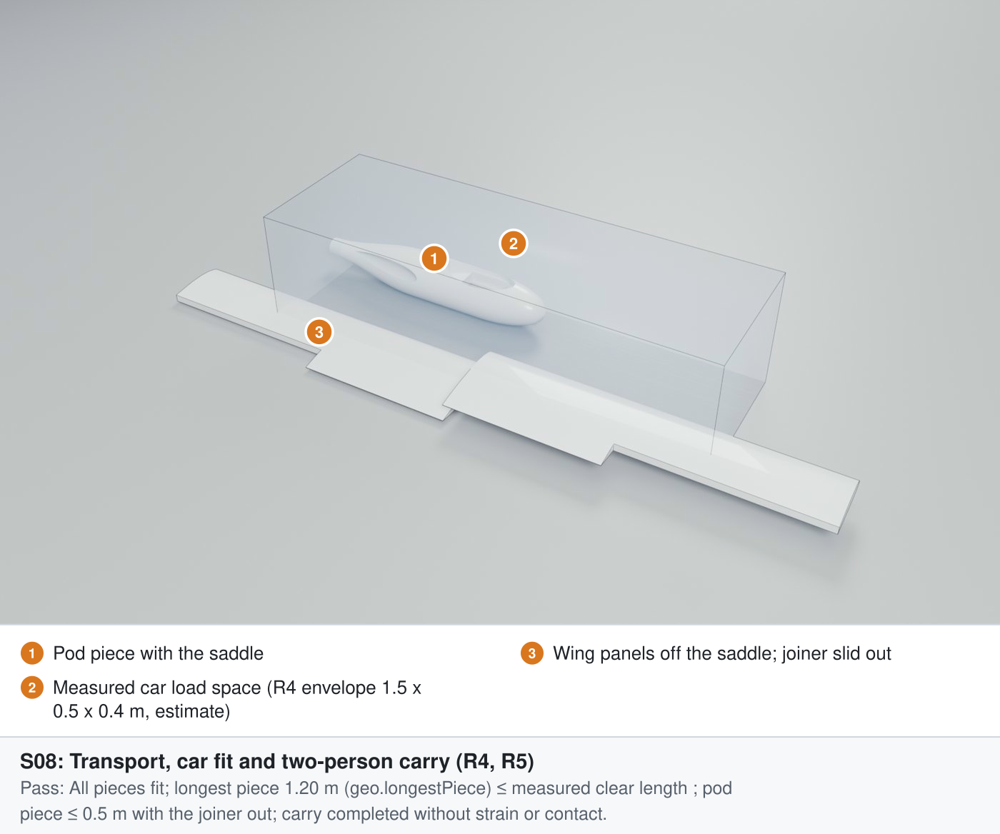

#### S09 — Built component masses and empty weight (review M[model3d].1)
- **Objective.** Weigh every part as it comes off the bench and the empty airframe, and compare with the sizing mass roll-up and the CAD roll-up.
- **Procedure.** Kitchen scale (5 kg, 1 g) per part; bathroom scale or two kitchen scales for the assembled airframe; log against `cad/verification.txt` "Mass roll-up" (modelled 6.36 kg incl. pack; fasteners 228 g, printed 1.38 kg, tubes 1.67 kg, foam 0.95 kg without skins, vendor 2.12 kg) and the sizing items (`cg.items`).
- **Pass.** Empty mass without pack and payload ≤ 5.23 kg × 1.15 = 6.02 kg (`sized.m` − 0.82 − 0.5 *(calc)*, review M[model3d].1); otherwise re-run `analysis/sizing.mjs`.
- **Predicted.** Wing 1.39, booms + clamps 0.626, lift units 0.968, tail 0.141, pod 0.6 EST, gear 0.443 EST (CAD legs 433 g + fairings 101.5 g + clamps 210 g), avionics 0.25 EST, pusher set 0.227, servos (5) 0.216, wiring 0.37 EST kg (`cg.items`; `cad/verification.txt`).
- **Duration** ongoing. **Crew** 1. **Prereq.** none.

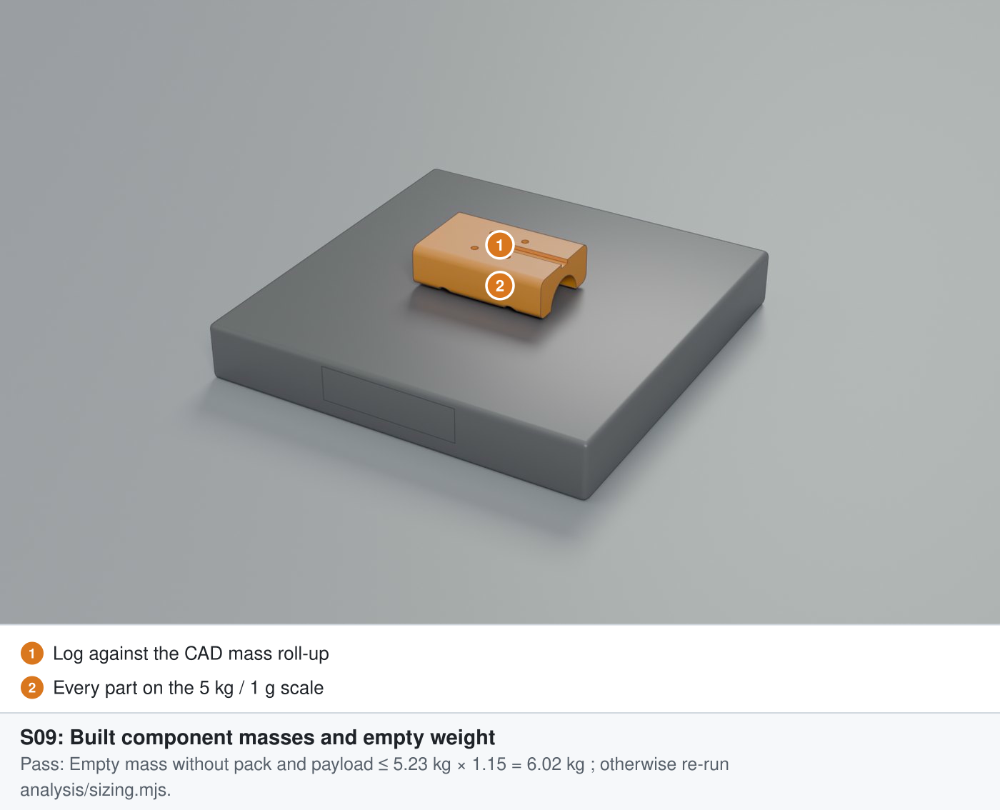

#### S10 — Ballast-mount retention (new in rev B)
- **Objective.** Prove the 0.5 kg ballast (R12 payload allowance; §4 rule 7) cannot shift or leave the bay in a hard landing or a 4.5 g manoeuvre.
- **Article.** The ballast block (sand/lead in a printed or taped block, mass 0.500 ± 0.005 kg on the kitchen scale) in the payload bay on its mount/strap (battery-strap type, BOM "ShareGoo LiPo battery straps").
- **Procedure.** (1) Fit the ballast at the bay station (x = +0.15 m from the LE EST, `cg.items` "Payload allowance"). (2) Static pull: hang 8 kg (78 N = 2 × 0.5 kg × 8 g *(calc; S06 limit 8 g, factor 2 EST)*) from the ballast in the downward, forward and sideways directions via a string over the bay edge; check movement. (3) Shake test: hold the pod and shake 10 s; check position. (4) Include in the S06 drops.
- **Pass.** Movement ≤ 2 mm in any direction after each pull; no strap slip; position unchanged after S06.
- **Predicted.** 4.5 g ultimate manoeuvre load on 0.5 kg = 22 N; 8 g landing = 39 N *(calc)*.
- **Duration** 0.5 h. **Crew** 1. **Prereq.** Pod built.

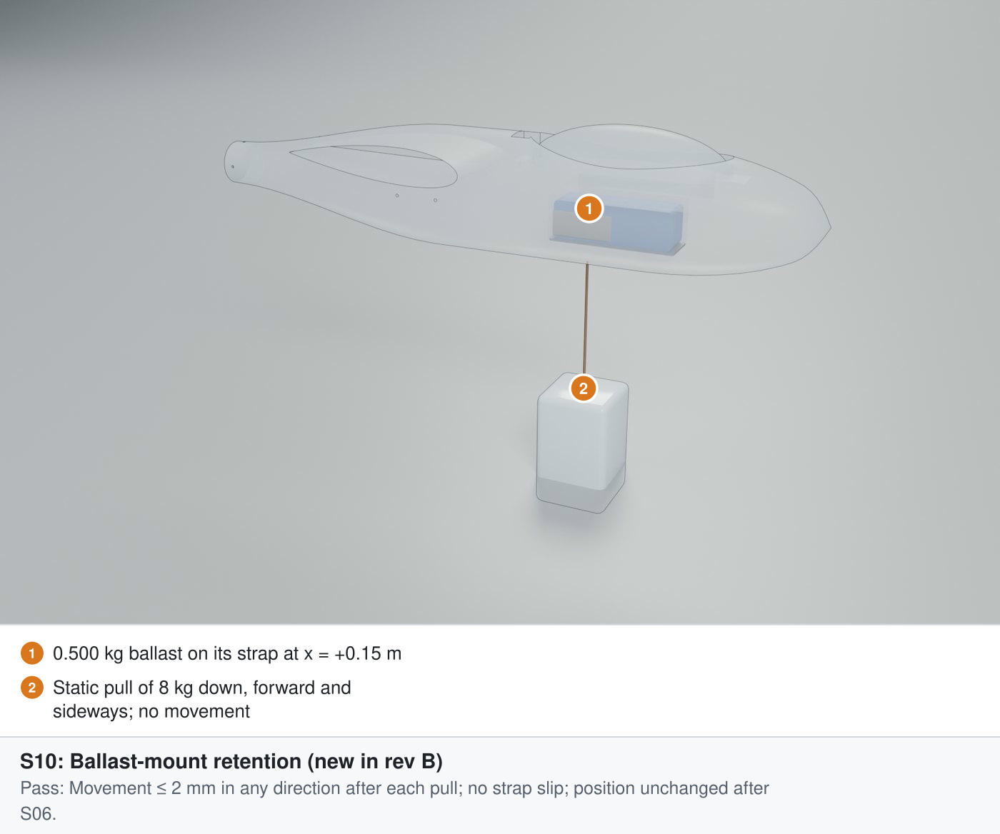

### 9.3 Series E — electrical and avionics bench tests

All E tests: **props off**, aircraft on a bench, pack through the XT90-S, fire bag at hand.

#### E01 — Power-up, smoke test and sensor calibration
- **Objective.** First power-up of the integrated avionics; calibrate the FC voltage and current sensors.
- **Procedure.** (1) Continuity and polarity check of the harness with a multimeter (hand tools; Gaps if none). (2) Power through the XT90-S with the watt meter in line; watch for heat/smoke for 60 s. (3) Idle current. (4) Compare FC `BATT` voltage with a multimeter at the balance lead: set `BATT_VOLT_MULT`. (5) With motors at a steady 20 % (props off, brief) compare FC current with the watt meter at two points: set `BATT_AMP_PERVLT` (`firmware/vtol_c0.param` §9 says to calibrate both).
- **Pass.** Idle current ≤ 1.0 A EST; FC voltage within ± 0.1 V of the meter; current within ± 5 % at ≥ 5 A.
- **Predicted.** Board defaults 11.05 V/V and 64 A/V (`firmware/vtol_c0.param`).
- **Duration** 1 h. **Crew** 2. **Prereq.** C13 harness built, E11.

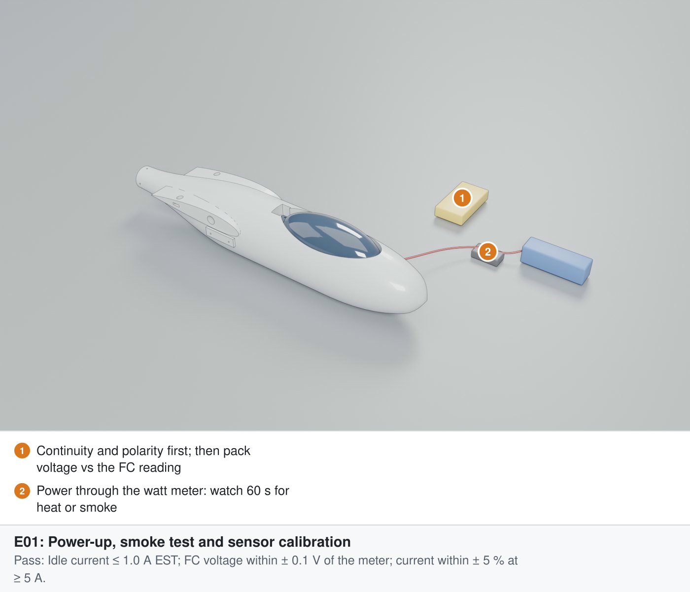

#### E02 — ESC protocol, motor order, direction and spin thresholds
- **Procedure.** Mission Planner motor test in the ArduPilot order (Motor1 front-right CCW on S5, 2 rear-left CCW on S6, 3 front-left CW on S7, 4 rear-right CW on S8, pusher on S9; `firmware/vtol_c0.param` §2); set direction with DShot commands (`SERVO_DSHOT_ESC,2`) or BLHeli passthrough; find the lowest output that spins every motor (`Q_M_SPIN_ARM`) and that gives a little thrust (`Q_M_SPIN_MIN`) per the tuning guide step 4 (checked 2026-10-21); pusher on S9 responds to throttle only in fixed-wing modes.
- **Pass.** All four lift motors spin in the correct position/direction at the test's 10 % command; `Q_M_SPIN_ARM` ≥ the measured spin threshold + 0.02; no desync at 100 % for 3 s (props off).
- **Predicted.** `Q_M_SPIN_ARM` 0.10, `Q_M_SPIN_MIN` 0.15 (param file defaults).
- **Duration** 1 h. **Crew** 2. **Prereq.** E01.

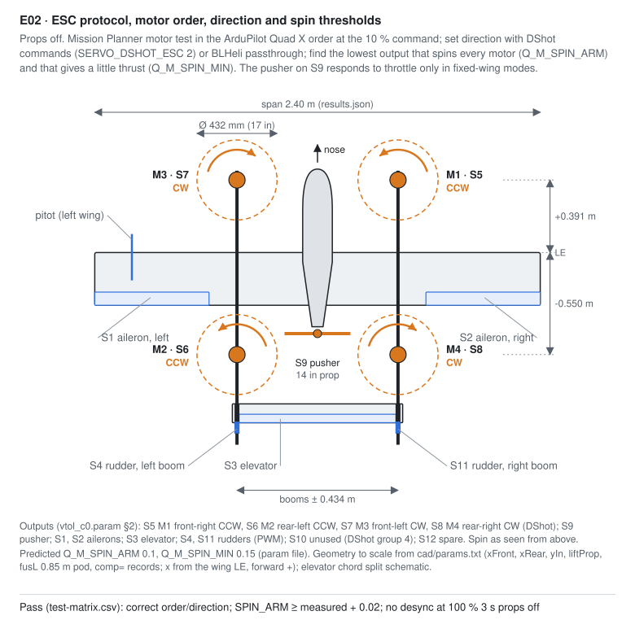

#### E03 — Servo direction, throws and centering on the airframe (5 servos)
- **Procedure.** In MANUAL and FBWA: stick right → right aileron up; stick back → elevator up; rudder right → both rudders (S4 left boom, S11 right boom) trailing edge right; in FBWA roll the aircraft and check surfaces counter the motion. Measure throws with a ruler at the trailing edge; set `SERVOn_MIN/MAX/TRIM/REVERSED`.
- **Pass.** Correct sense on all 5 servos; aileron ± 20° EST, elevator ± 20° EST, rudder ± 20° EST (no repo values, —; typical sport-plane throws); surfaces return to within 1 mm of neutral; no binding at full throw; servo current at full throw ≤ 1 A each EST. Elevator reserve at stall: trim needs about −8.2° elevator at Vs (`aero_results.json stall.trim_at_Vstall.elevator_deg`), so the elevator throw must be ≥ 15° EST.
- **Duration** 1 h. **Crew** 2. **Prereq.** C12, E01.

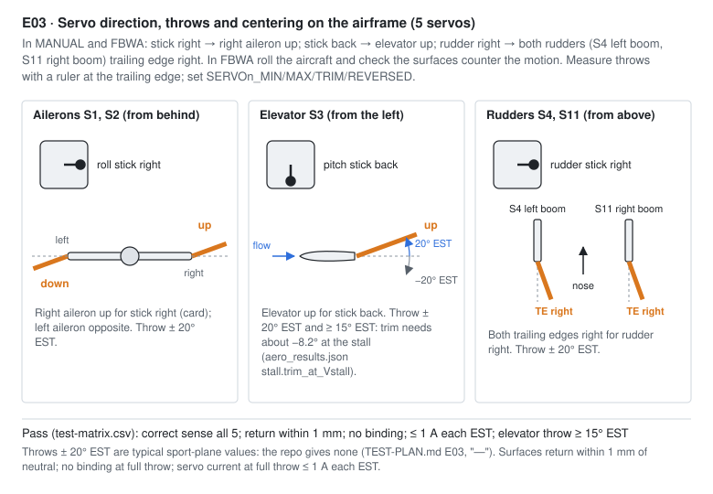

#### E04 — RC link: channel map, switches, telemetry and range walk
- **Procedure.** Check AETR on CH1–4, arm CH5, mode CH6 six positions (`FLTMODE1–6`), E-stop CH7, Q_ASSIST CH8, RTL CH9. CRSF telemetry on the handset (battery V/A, mode, GPS, LQ) and, if used, the ELRS MAVLink overlay to Mission Planner (`docs/research/firmware.md` §4 R7/R9: switchable, not simultaneous with CRSF). Range walk: aircraft on the bench outdoors, powered; walk the transmitter 300 m away (the `FENCE_RADIUS`) with LQ/RSSI on the transmitter screen; the second person watches a servo move.
- **Pass.** All switches map; LQ ≥ 90 % EST at 300 m with the antenna vertical; handset telemetry shows battery voltage within 0.1 V of the FC and the mode name; failsafe not triggered.
- **Predicted.** — (ELRS range at the Pocket's output power not in repo).
- **Duration** 1 h. **Crew** 2. **Prereq.** E01.

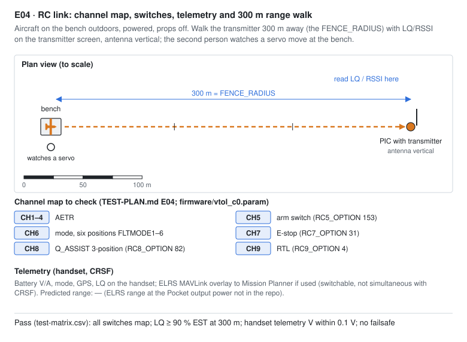

#### E05 — Failsafe bench test (hardware portion; SITL portion done)
- **SITL evidence (done 2026-10-21).** `firmware/sitl/results/summary.json`: scenarios B (RC loss in cruise → RTL → QRTL), C (RC loss in hover → QLAND), D (transition timeout 15 s → QRTL), E (low battery → RTL → QRTL), F (fence 110 m → RTL, peak 113.1 m), G (ELRS MAVLink override loss → QLAND) all PASS on ArduPlane 4.7.2; 133 parameters read back equal. **Repeated 2026-10-25 on the C0 airframe model** (`firmware/sitl/c0_physics.py` on SITL's JSON interface; `firmware/sitl/results_c0.json`): 7/7 PASS with `vtol_c0.param` unchanged, 131 parameters checked, none mismatched (`firmware/sitl/README.md` C0 section).
- **Hardware procedure.** Props off, armed in QLOITER on the bench with GPS lock (outdoors): (1) switch the transmitter off → expect QLAND within `FS_LONG_TIMEOUT` 5 s + 1.5 s short; (2) set `BATT_LOW_MAH` temporarily to 6,400 → expect the low action RTL (`BATT_FS_LOW_ACT,1`); `BATT_CRT_MAH` to 6,400 → QLAND (`BATT_FS_CRT_ACT,4`); restore 1,950 / 1,300; (3) set `FENCE_ALT_MAX` to 1 m and lift the aircraft 2 m by hand → fence breach message; restore 110; (4) E-stop CH7 stops all motors at 20 % command; (5) XT90-S pull under load.
- **Pass.** Each failsafe produces the configured mode within the timeout; parameters restored and verified with `firmware/tools/check_params.py`.
- **Duration** 1.5 h. **Crew** 2. **Prereq.** E04.

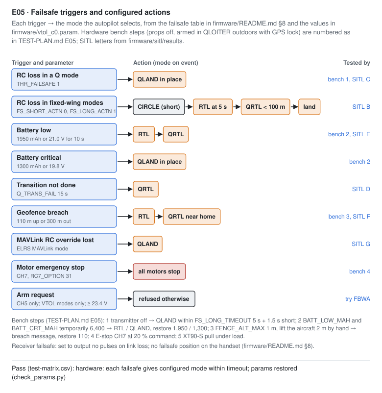

#### E06 — SITL rehearsal (review F0, §[flighttest] M1): scripted portion done, pilot portion open
- **Done.** Scripted scenarios A–G passed 2026-10-21 (`firmware/sitl/README.md`; `firmware/sitl/results/`): nominal AUTO mission with VTOL land 0.1 m from home, forward transition 10 s, "Transition airspeed reached 16.0" 5 s after start. Attitude-tracking RMS 0.67°/0.62° (VTOL), 4.5°/1.7° (fixed wing). **C0 airframe model, 2026-10-25** (`firmware/sitl/results_c0.json`): 7/7 again; scenario A forward transition 13 s / 144 m with no altitude loss, 17.5 m/s at "Transition done", peak 70.6 A; back-transition 7 s / 34 m with 1.7 m altitude loss and a −17°/+33° pitch swing (the airbrake phase pitches to the 30° VTOL limit and stalls the wing); VTOL land 0.0 m from home. **Re-run 2026-10-27 at the 18 m/s cruise** (`AIRSPEED_CRUISE` 18): 7/7; scenario A forward transition 15 s / 166 m, 16 m/s 10 s after start, no altitude loss, peak 55.8 A; back-transition 4 s / 29 m, no altitude loss, 79 A peak, −18°/+33° pitch swing; VTOL land 0.0 m from home. The 15 s transition sits at the ≤ 15 s pass line of F07 and the 166 m distance is above the 100 m line, as the 144 m of the 20 m/s run was: the turn-at-once rule (§7) stands.
- **Open.** (1) Each pilot hand-flies the **C0 airframe model** (`firmware/sitl/run_c0_sitl.ps1`, Mission Planner on TCP 127.0.0.1:5760; the generic QuadPlane only if the model will not start) with the Pocket Crush as a joystick: three back-transitions from 18 m/s to see the airbrake pitch-up (F06–F13 watch item), QLOITER take-off, FBWA transition from the upwind edge with an immediate turn, failed transition (throttle low → QRTL), RC loss in cruise, RC loss in hover, low battery, fence; (2) `SIM_ENGINE_FAIL` on one lift motor in hover (documents the R14 limitation; not in the A–G set).
- **Pass.** Every pilot recovers a failed transition and a pusher-out without ground contact in 3 of 3 attempts and keeps inside the 300 m fence after a transition (review M[flighttest].1: a pilot who cannot does not fly F06–F12).
- **Duration** 2 h per pilot. **Crew** PIC + GCS. **Prereq.** E11.

#### E07 — Compass and GPS calibration
- **Procedure.** Outdoors, away from steel; Mission Planner compass calibration (`COMPASS_AUTO_ROT,2` detects the external compass orientation); accelerometer calibration; check HDOP and satellite count after 2 min; heading vs a phone compass at 4 headings.
- **Pass.** Calibration fitness "good"; heading error ≤ 10° at all four headings EST; HDOP ≤ 1.5, satellites ≥ 10 EST; no "compass inconsistent".
- **Duration** 0.5 h. **Crew** 1. **Prereq.** E01.

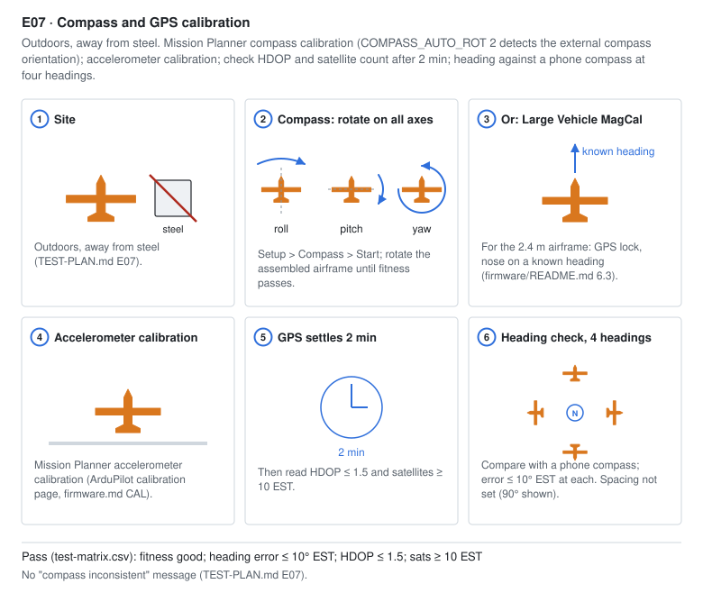

#### E08 — Airspeed sensor bench check (MS5525DSO at 0x77)
- **Procedure.** Before fitting: strap the MS5525DSO CSB low so it answers at I²C 0x77 (ships at 0x76, the onboard SPL06 baro's address; `firmware/vtol_c0.param` ARSPD_TYPE 5 comment; `docs/research/firmware.md` D4; `firmware/README.md` §4.3). On the bench: confirm the baro and the airspeed sensor are both detected (no "ARSPD: no sensor found", baro healthy); pitot fitted (hardware-spec J16); cover and uncover, blow gently: reading ≥ 6 m/s (ArduPilot airspeed calibration page, checked 2026-10-21); zero with the tube covered; leak check.
- **Pass.** Both sensors detected on bus 0; static reading 0 ± 1 m/s; blow test ≥ 6 m/s; reading holds for 10 s with the pitot sealed.
- **Duration** 0.5 h. **Crew** 1. **Prereq.** E01.

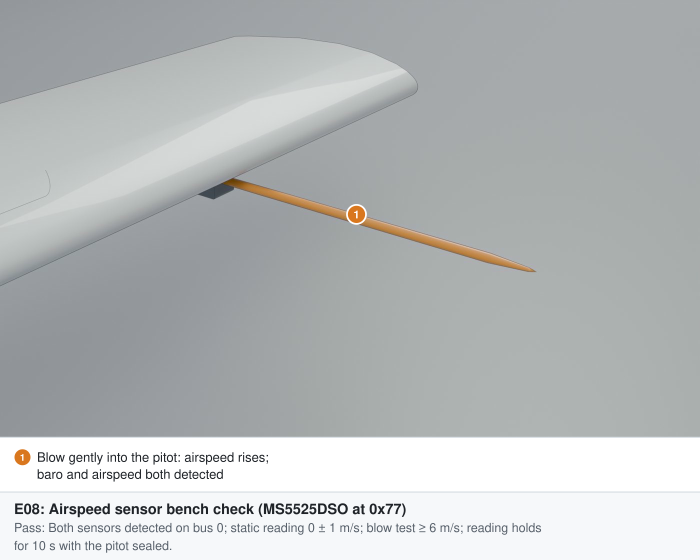

#### E09 — Bench vibration and ESC thermal soak (tied-down, props on)
- Runs as part of G03; recorded separately. **Pass.** VIBE X/Y/Z < 30 m/s² and clipping = 0 during a 60 s hover-throttle run (ArduPilot vibration page, checked 2026-10-21); ESC ≤ 70 °C EST.

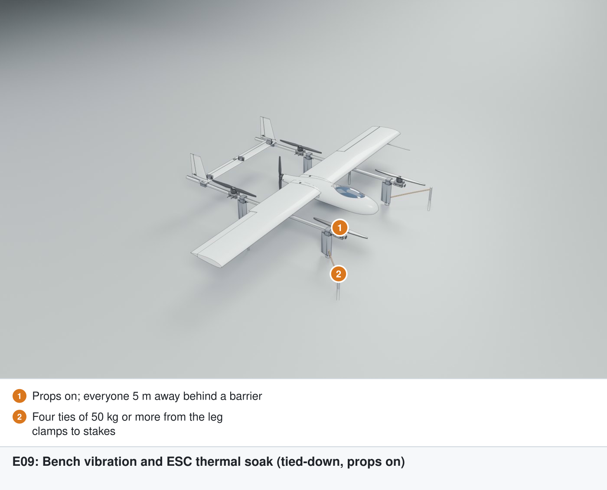

#### E10 — Telemetry links
- **Procedure.** (1) CRSF telemetry on the handset: confirm the sensors listed (battery, GPS, mode, LQ/RSSI) during the E04 range walk. (2) ELRS MAVLink overlay (if enabled on the RX/TX): Mission Planner connects; note that RC then arrives as `RC_CHANNELS_OVERRIDE` and that loss → QLAND (SITL G). (3) CoreWing BLE/WiFi (`SERIAL1_PROTOCOL,2`): bench link only; measure the drop-out range by walking away.
- **Pass.** Handset telemetry present at 300 m (E04); MAVLink overlay, if used, holds a GCS link at ≥ 300 m EST; BLE/WiFi range recorded (expected tens of metres, —).
- **Predicted.** — (ELRS MAVLink range not in repo). No SiK radio is planned (`docs/research/firmware.md` §4 R9).
- **Duration** 0.5 h. **Crew** 2. **Prereq.** E04.

#### E11 — Firmware and parameter inspection (R17)
- **Procedure.** Flash ArduPlane 4.7.2 stable for CoreWingF405WingV2 (`firmware/vtol_c0.param` header: firmware.ardupilot.org/Plane/stable/CoreWingF405WingV2, checked 2026-10-21); load `firmware/vtol_c0.param` twice (Q_ENABLE reboot, per its header); run `firmware/tools/check_params.py`; record the firmware version string and git hash. The 2027-02-22 beta go/no-go is closed (stable 4.7.2 includes the target, `docs/research/firmware.md` §4 R20); the date stays as the integration milestone.
- **Pass.** Firmware is a stable release with QuadPlane; zero parameter mismatches (SITL read-back of 133 parameters was equal); all arming checks enabled (`ARMING_SKIPCHK,0`).
- **Duration** 1 h. **Crew** 1. **Prereq.** FC received.

#### E12 — Remote ID check (R18)
- **Procedure.** Look up the BeeID serial at uasdoc.faa.gov (review M[schedule].3); power the module; confirm broadcast with a free Remote ID receiver app on a phone (e.g. OpenDroneID OSM, free, Android) showing the serial and position.
- **Pass.** Serial listed; broadcast received at 30 m EST.
- **Duration** 0.5 h. **Crew** 1. **Prereq.** BeeID received, registration done.

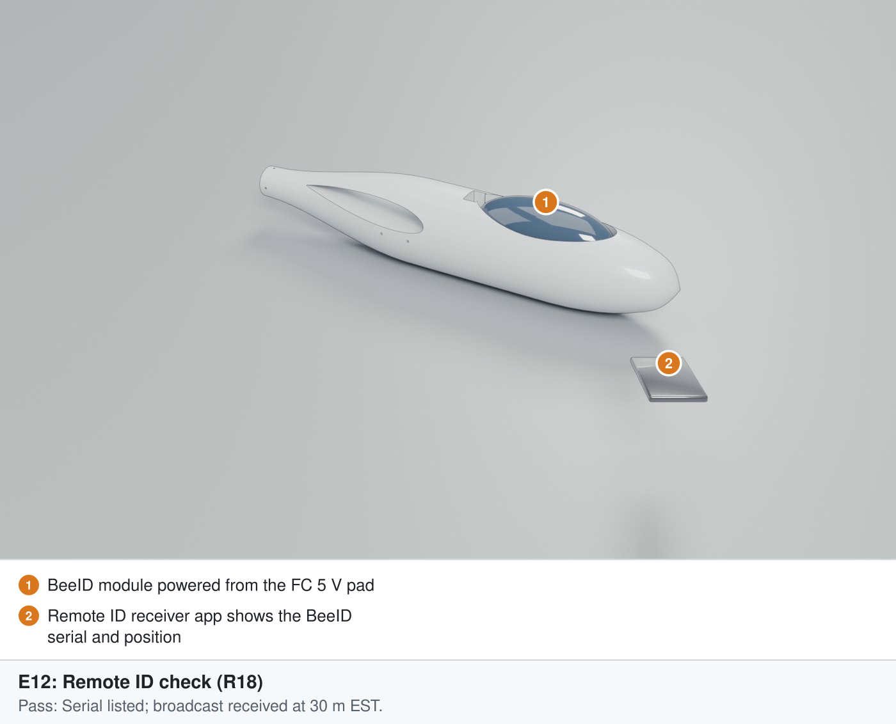

### 9.4 Series G — ground tests on the complete aircraft

#### G01 — Weight and balance (review M[cg].1)
- **Procedure.** Two kitchen scales at known stations: the front legs and the rear legs each on a board across one scale (Figure G01), or one scale and a pivot. Weigh with pack and 0.5 kg ballast; compute CG from the moments. Mark the CG target on the pod. Move the pack to bring the CG within 2 cm of the thrust centroid.
- **Pass.** Take-off mass ≤ 7.53 kg (R2 line); CG at 28 ± 2 % MAC (target `cg.pct.target` 28; ± 2 % MAC = ± 5.7 mm *(calc, MAC = chord 0.2842 m)*) with ballast; CG never aft of 31.8 % MAC (= neutral point 39.8 % − 8 % SM, `aero_results.json neutral_point.AVL_pod_pct_MAC`, review M[cg].1 rule *(calc)*); CG within 20 mm of the thrust centroid at x = −0.0796 m from the LE (`cg.thrustCentroid`).
- **Predicted.** CG at 26.7–29.3 % MAC over the battery travel (`cg.pctFwd`, `pctAft`); static margin 11.8 % at 28 % (aero, AVL with pod), 11.5 % by the sizing (`geo.SM`).
- **Duration** 1 h. **Crew** 2. **Prereq.** S09, avionics fitted.

#### G09 — CG with and without ballast; ballast rule check (new in rev B)
- **Objective.** Confirm the empty-bay CG and that the 0.5 kg ballast restores the 28 % MAC target (`docs/research/aerodynamics.md` M4; `cad/README.md` operating rule).
- **Procedure.** Repeat G01 (1) with pack only, no ballast; (2) with pack + 0.5 kg ballast at the bay station; (3) with the ballast moved ± 30 mm to map the sensitivity; record the pack station for each.
- **Pass.** Empty-bay CG recorded and confirmed aft of 31.8 % MAC → the ballast rule is mandatory (expected); with ballast CG 28 ± 2 % MAC; the rule and the ballast station are written on the GA sheet note 5 and on every flight card.
- **Predicted.** 34.7 % MAC without payload (`cg.pct.noPayload`; `aero_results.json geometry.CG_no_payload_pct_MAC`), static margin 5.1 % (aero) / 4.9 % (sizing `cg.SM_noPayload`); 28 % with ballast.
- **Duration** 0.5 h. **Crew** 2. **Prereq.** G01, S10.

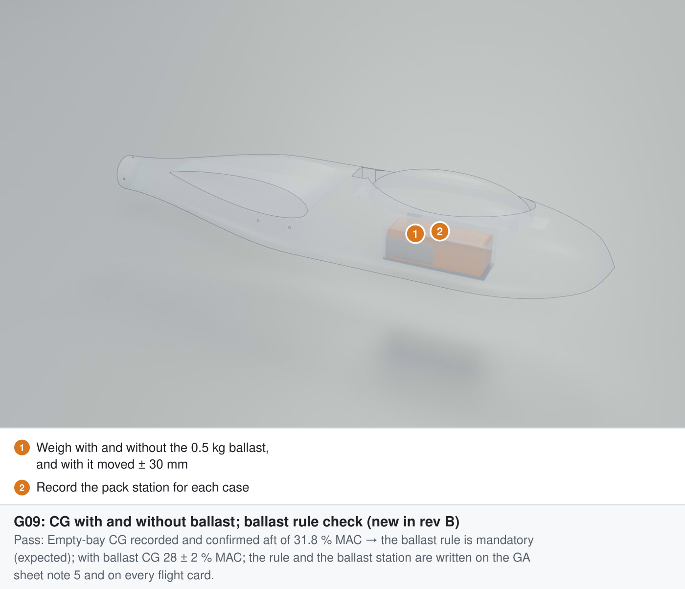

#### G02 — Hand-carry sensor sanity walk
- **Procedure.** Powered, disarmed, logging on (`LOG_DISARMED,1` temporarily): carry the aircraft 50 m and back at walking speed, pitch and roll it ± 30° by hand; watch the handset/GCS HUD, airspeed and EKF.
- **Pass.** Attitude follows within 5°; GPS track matches the walk; no EKF or compass warnings; airspeed stays < 3 m/s.
- **Duration** 0.5 h. **Crew** 2. **Prereq.** E07, E08.

#### G03 — Full-system tied-down run (review T6, expanded; includes C13, E09)
- **Objective.** All four lift motors and the pusher under load on the airframe: pack sag, harness heat, vibration, EMI, and the pitch/roll authority check.
- **Setup.** Aircraft strapped to a heavy bench or to ground stakes by the landing-leg clamps with ≥ 4 ratchet or rope ties rated ≥ 50 kg each (total restraint > 4 × 3.13 kgf = 12.5 kgf, `budget-lift.md` A3); props on; everyone ≥ 5 m away behind a barrier; watt meter in line; IR thermometer; logging.
- **Procedure.** (1) Arm in QSTABILIZE; raise throttle to the C07 hover throttle (~52 %) for 60 s; (2) 3 s at 100 % on all four (review M[propulsion].4 burst); (3) in FBWA, pusher to 100 % for 10 s (G06 may be combined); (4) full transition current: hover throttle plus pusher 75 % (`TKOFF_THR_MAX`) for 10 s; (5) read temperatures within 30 s; (6) download the log.
- **Pass.** Pack ≥ 3.4 V/cell at hover draw and ≥ 3.2 V/cell in the burst (review T6, §[mass] M1); hover current 41.1 A ± 15 % EST; transition current ≤ 85 A (`Q_M_BAT_CURR_MAX`); VIBE < 30 m/s², clipping 0; motors/ESCs/connectors within the C08/C13 limits; no desync; no loose fasteners after (witness marks).
- **Predicted.** 41.1 A hover at 22.2 V, 43.5 A at 21 V, 68.4 A transition (`sized.I_hover`, `I_hover_loaded`, `I_trans`).
- **Risk.** Restraint failure: tie to the leg clamps not the legs; check knots; nobody in the rotor plane.
- **Duration** 2 h. **Crew** 3. **Prereq.** S04, E02, E03, E05, G01.

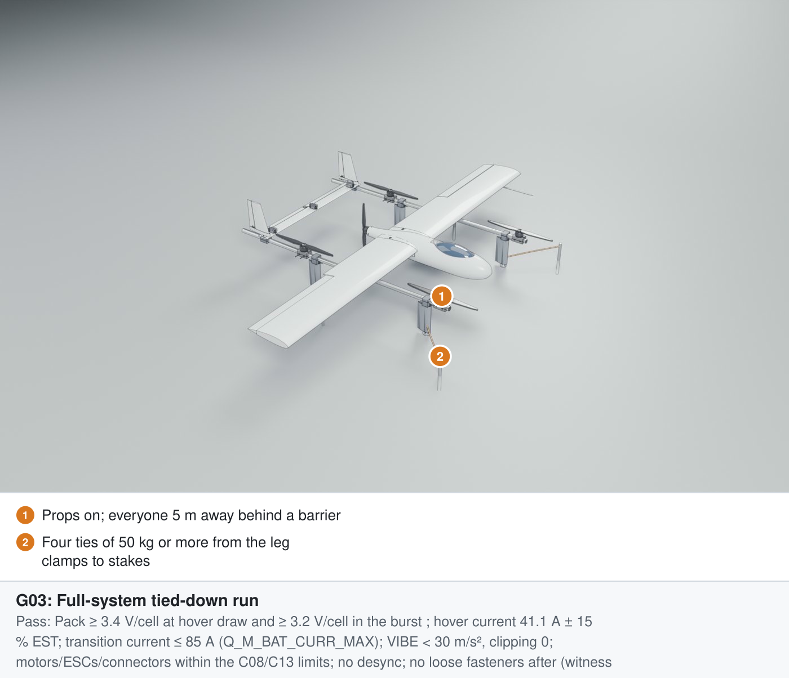

#### G04 — Compass interference (compassmot) check
- **Procedure.** During G03 step 1, run Mission Planner's CompassMot with the throttle raised to hover; or read the compass field change in the log (`MAG` vs `RCOU`).
- **Pass.** Interference ≤ 30 % EST (the ArduPilot compassmot page returned HTTP 404 on 2026-10-21; 30 % is the figure commonly quoted by that page — treat as EST until re-checked); heading change < 10° between idle and hover throttle.
- **Duration** in G03. **Prereq.** E07.

#### G05 — Tethered hover (review F2)
- **Setup.** Two 4 m tether lines to the leg clamps from stakes 3 m apart, slack to 1.5 m; grass; crew 10 m away; wind ≤ 3 m/s EST; ballast fitted.
- **Procedure.** QSTABILIZE: arm, throttle up slowly until light on the gear, back down (ArduPilot step 5 lift-off check); then lift to 1 m, hold 30 s, land. Then QHOVER, 1 m, 30 s. Three cycles, motors cooled < 45 °C between (review F3).
- **Pass.** 30 s stable at 1 m; attitude error < 15°; lift output < 60 % (review F2); VIBE < 30; no oscillation; tether never taut.
- **Predicted.** Hover throttle ≈ 0.52 (1,638 / 3,130 *(calc)*).
- **Duration** 2 h. **Crew** 4. **Prereq.** G03, G04, G09, flight request approved, I02.

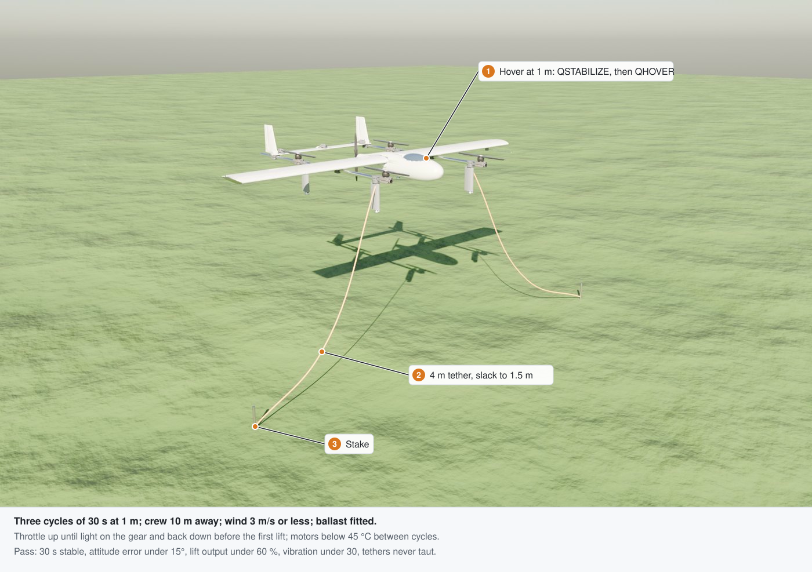

#### G06 — Pusher ground run on the airframe
- **Procedure.** Aircraft tail-tied to a stake through the luggage scale (Gaps; zero-cost: the HX711 load cell in line), nose free to pull: FBWA, throttle 60 % and 100 % for 10 s each; IR temperature on the pusher can and ESC; watch the tail boom stubs and fins for buffet.
- **Pass.** Static pull ≥ 1.5 kgf at 60 % (review T4) on the airframe; current ≤ 40 A; no tail buffet visible; stubs do not flex visibly; pusher prop ground clearance ≥ 40 mm with the aircraft loaded (CAD 41.9 mm, `cad/verification.txt`).
- **Duration** 0.5 h. **Crew** 3. **Prereq.** C09, G03.

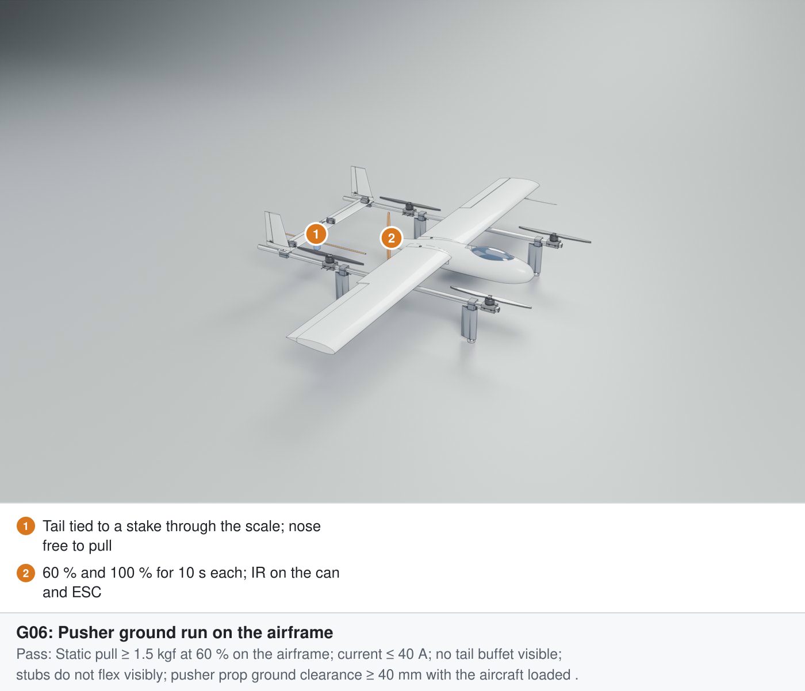

#### G07 — Assembly and breakdown time (R5)
- **Procedure.** Stopwatch, two people, from the loaded car to armed pre-flight (review M[model3d].3), including sliding the joiner in and bolting both panels (C17), the booms (4 screws each) and the tail (4 screws); three runs on different days; then breakdown back into the car.
- **Pass.** Median assembly ≤ 15 min; no tool other than the hex keys; witness marks aligned after assembly.
- **Duration** 1.5 h. **Crew** 2. **Prereq.** S08.

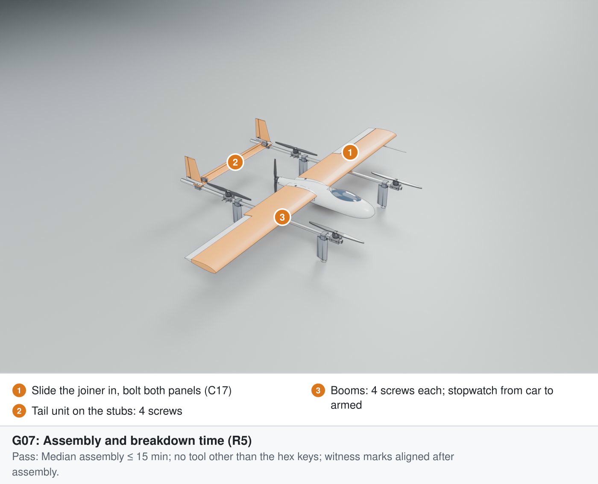

#### G08 — Field procedure rehearsal
- **Procedure.** Full dry run of a flight session at the site without arming: set-up, pre-flight checklist, crew calls, abort call, post-flight temperatures, log download, pack change, field charging (review M[flighttest].2: time one full charge at the field supply).
- **Pass.** Checklist completed with no missed item; charge time per pack ≤ 1.5 h (review M[flighttest].2) on the field supply (— source to be found, Gaps).
- **Duration** 2 h. **Crew** 4. **Prereq.** G05 planned.

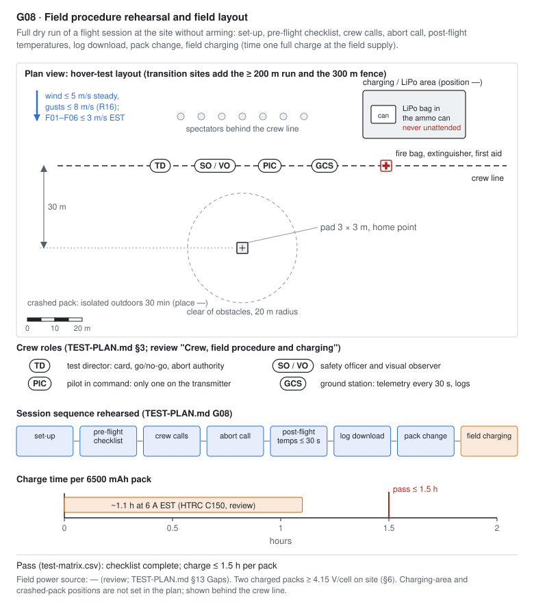

### 9.5 Series F — flight tests

All flight tests use the card in `docs/test/cards/`. Common rules: weight and CG per G01/G09 recorded on the card, ballast fitted; two packs; ≤ 5 m AGL and ≤ 60 s per hover on hover-only flights (R14 mitigation, §10); transitions start at the upwind field edge with an immediate turn (§7); post-flight temperatures within 30 s; logs downloaded and named before the next flight (§10). Hover tests at any approved site; F06 onward at RFS only (R19).

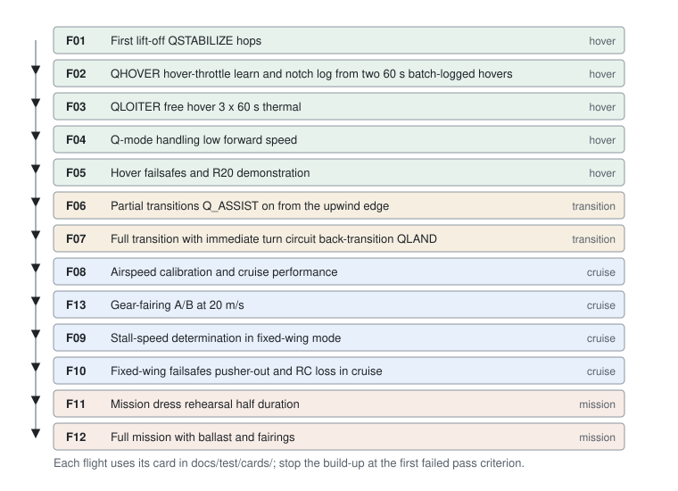

| ID | Title | Review step | Build-up points | Pass criteria (summary; full on the card) | Prereq |
|---|---|---|---|---|---|
| F01 | First lift-off, QSTABILIZE hops | F3 start | lift-off and set down; 1 m hover 10 s; ± 5° roll/pitch inputs | no oscillation; attitude error < 15°; VIBE < 30; clipping 0 | G05 |
| F02 | QHOVER hover-throttle learn and notch log (two 60 s batch-logged hovers) | F3 | 1–3 m, 2 × 60 s with `INS_LOG_BAT_MASK,1`, `INS_LOG_BAT_OPT,4` (`docs/research/firmware.md` D13) | learned `Q_M_THST_HOVER` 0.3–0.6 and ≤ 0.60; FFT peak identified; front/rear output split ≤ 15 % (review M[cg].2) | F01 |
| F03 | QLOITER free hover, 3 × 60 s, thermal | F3 | ≤ 5 m AGL; position hold; 1 m/s translations | hold within 2 m EST; motors ≤ 80 °C; cooled < 45 °C between; hover current 41.1 A ± 15 % | F02 |
| F04 | Q-mode handling at low forward speed | F4 | box pattern at 5–8 m/s, ≤ 10 m AGL | no unexpected Q_ASSIST; attitude error < 15°; airspeed sensor reads 5–8 m/s ± 2 | F03 |
| F05 | Hover failsafes and R20 demonstration | — | at 20 m AGL EST over the pad: RC off → QLAND; `FENCE_ALT_MAX` temporarily 25 m, climb → RTL; low battery forced → RTL; critical forced → QLAND | each action within timeout; touchdown within 5 m of the pad EST | F04, E05 |
| F06 | Partial transitions (Q_ASSIST on) | F5 | ≥ 30 m AGL from the upwind edge; FBWA with throttle until 12 m/s then back to QHOVER; × 3; watch the back-transition pitch-up (C0 SITL model, ≤ 2 m loss) | airspeed rising within 6 s (review F5); altitude loss ≤ 10 m EST; lift motors re-engage on back-transition | F05, I02 (RFS) |
| F07 | Full transition, circuit, back-transition, QLAND | F6 | after 3 × F06: FBWA to `AIRSPEED_MIN` 16 from the upwind edge, immediate turn, one circuit at 18 m/s, back-transition, QLAND | transition ≤ 15 s and ≤ 100 m (review M[controls].2); turn started ≤ 3 s after "Transition done"; lift outputs at min in cruise (R1); QLAND touchdown ≤ 1 m/s EST | F06 × 3 |
| F08 | Airspeed calibration and cruise performance | F6+ | `ARSPD_AUTOCAL` 5 min circuits; then reciprocal passes (≥ 15 s steady each, ≥ 60 s per heading in total) at 18, 20 and 22 m/s; record current | `ARSPD_RATIO` 1.5–3.0 and airspeed vs GPS mean error ≤ 10 % (review M[controls].1); cruise power ≤ 414 W / 18.6 A *(calc, R10 line)*; predicted at 18 m/s 239–262 W, 10.8–11.8 A (`aero_results.json drag.cruise`, `sized.P_cruise`, `sized.I_cruise`); pusher can ≤ 80 °C EST by IR after the legs (thermal.md §6.3: 80 °C after 600 s on a 35 °C day, model bound with the estimated loss) | F07 |
| F13 | Gear-fairing A/B at 18 m/s (new in rev B) | — | same reciprocal legs as F08 with fairings on, then (separate flight) fairings removed; watt-meter/BAT power at 18 m/s | with fairings ≤ 414 W (R10); predicted 239 W faired vs 371 W bare (`aero_results.json drag.gear_faired_case`, `gear_round_case`); ΔP ≥ 100 W confirms the fairings are load-bearing for R10 | F08 |
| F09 | Stall-speed determination in fixed-wing mode (new in rev B; replaces the rev A margin approach) | aero M2 | ≥ 80 m AGL EST, Q_ASSIST forced off, FBWA, idle, decelerate ≤ 0.3 m/s² to the pitch break; three runs; recover; then with Q_ASSIST auto note the assist speed | measured Vs (calibrated) ≤ 12.0 m/s = pass (R11; predicted 11.75); 12.0–12.5 = team decision (aero §9 option: accept); > 12.5 = fail; altitude loss ≤ 30 m EST; `AIRSPEED_MIN` 16 ≥ 1.3 × Vs (Vs ≤ 12.3) | F08 |
| F10 | Fixed-wing failsafes: pusher-out (R15), RC loss in cruise (R20) | — | ≥ 60 m AGL EST: pusher throttle to idle in FBWA → Q_ASSIST → QLAND; separate flight: RC off in cruise → RTL → QRTL | hover re-entered with altitude loss ≤ 30 m EST; RTL → QRTL → land within `RTL_RADIUS` 100 m of home | F09 |
| F11 | Mission dress rehearsal (half duration) | F7 prep | 1 min hover, transition, 5 min cruise at 18 m/s, back-transition, 1 min hover, land | energy used ≤ 60 % of C11 usable (predicted 52.3 Wh = 48 % *(calc: (912.5 × 120 + 262.4 × 300) / 3600 = 52.3 Wh; 52.3 / 109.7; `sized.P_hover`, `sized.P_cruise`)*); all phases logged; no failsafe | F10, F13 |
| F12 | Full mission (R8, R9, R10) | F7 | ≥ 1 min hover, transition, ≥ 10 min cruise at 18–22 m/s, back-transition, ≥ 1 min hover, vertical land; with 0.5 kg ballast; fairings on; wind 3–5 m/s if available (R16) | landing ≥ 20 % of C11 usable energy and ≥ 1,300 mAh; no failsafe; aircraft undamaged; dated ≤ 2027-04-30 | F11 × 2 |

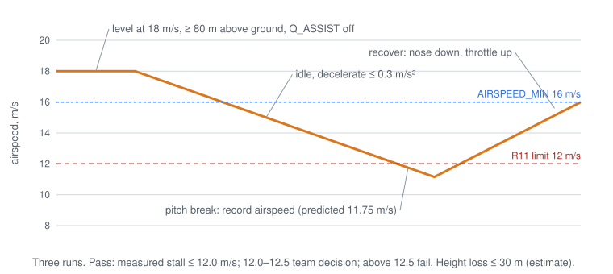

Cards: `docs/test/cards/FTC-F01.md` … `FTC-F13.md`.

#### F01 — First lift-off, QSTABILIZE hops

See the F01 row in the table above and its card in docs/test/cards/ for the full procedure.

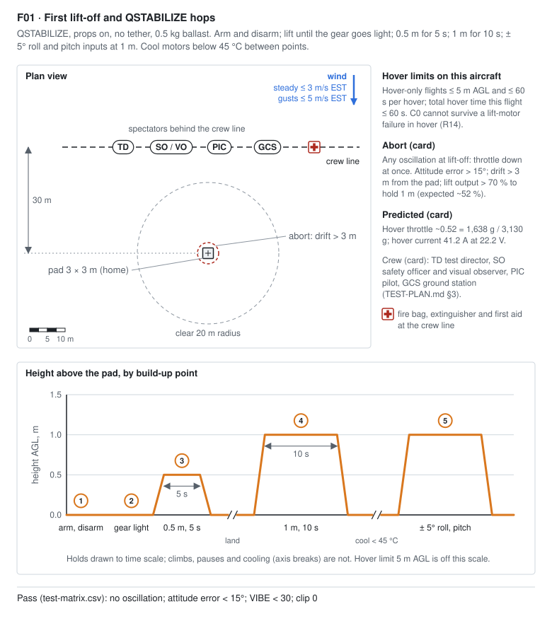

#### F02 — QHOVER hover-throttle learn and notch log (two 60 s batch-logged hovers)

See the F02 row in the table above and its card in docs/test/cards/ for the full procedure.

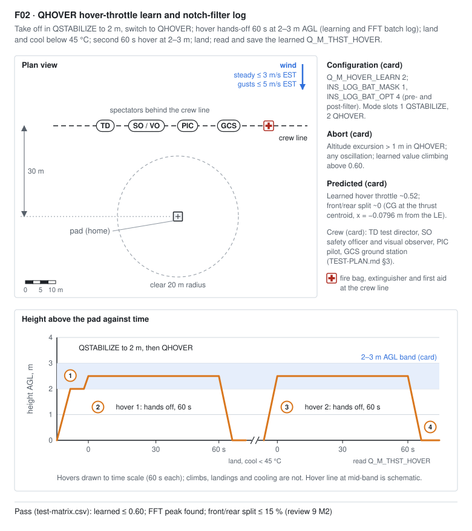

#### F03 — QLOITER free hover, 3 × 60 s, thermal

See the F03 row in the table above and its card in docs/test/cards/ for the full procedure.

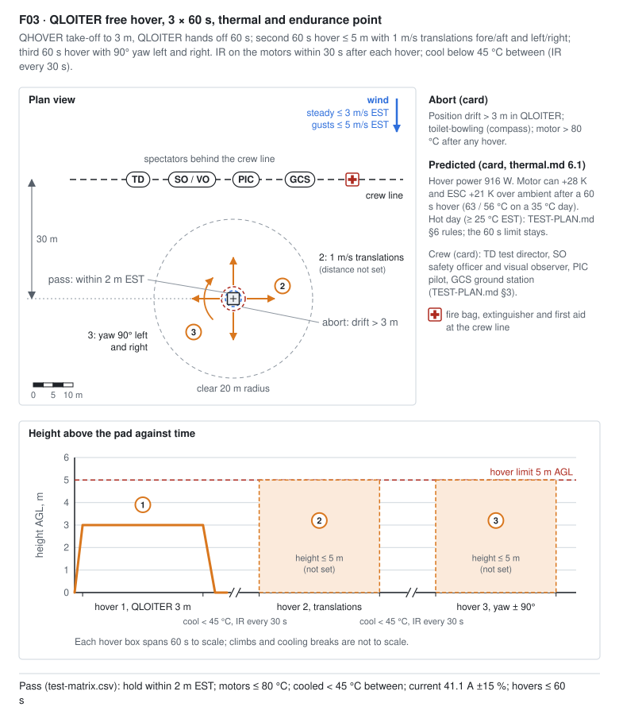

#### F04 — Q-mode handling at low forward speed

See the F04 row in the table above and its card in docs/test/cards/ for the full procedure.

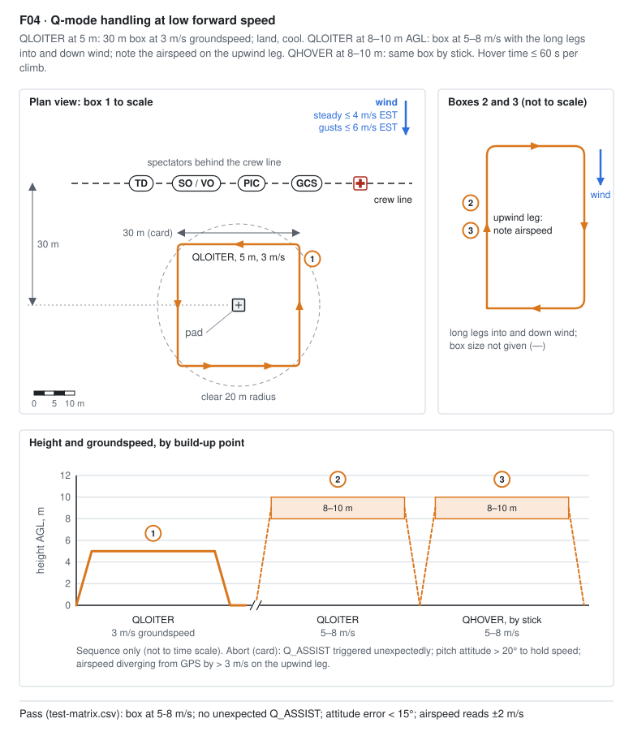

#### F05 — Hover failsafes and R20 demonstration

See the F05 row in the table above and its card in docs/test/cards/ for the full procedure.

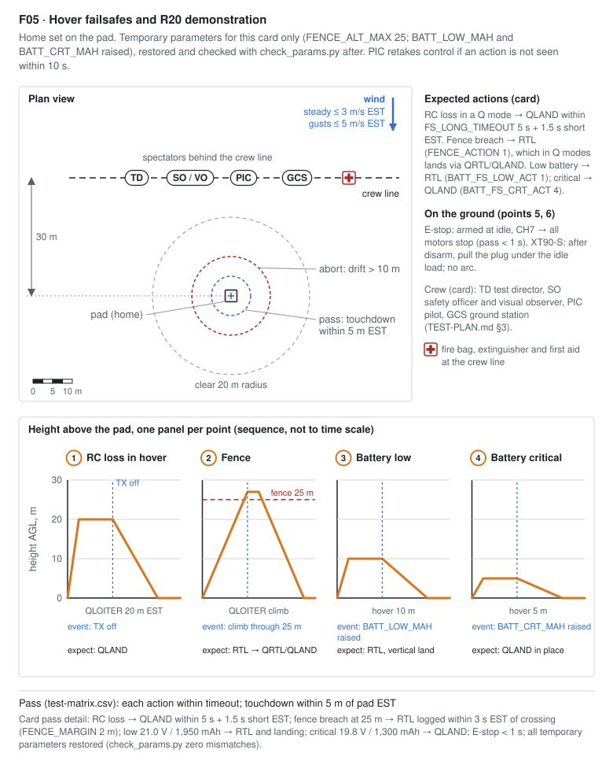

#### F06 — Partial transitions (Q_ASSIST on)

See the F06 row in the table above and its card in docs/test/cards/ for the full procedure.

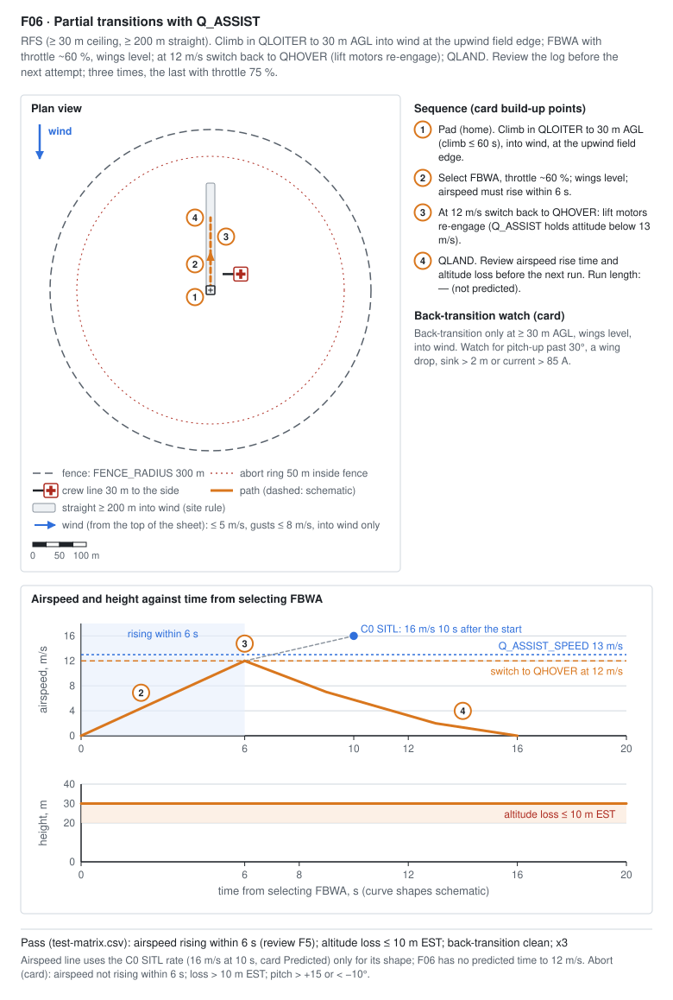

#### F07 — Full transition, circuit, back-transition, QLAND

See the F07 row in the table above and its card in docs/test/cards/ for the full procedure.

#### F08 — Airspeed calibration and cruise performance

See the F08 row in the table above and its card in docs/test/cards/ for the full procedure.

#### F13 — Gear-fairing A/B at 18 m/s

See the F13 row in the table above and its card in docs/test/cards/ for the full procedure.

#### F10 — Fixed-wing failsafes: pusher-out (R15), RC loss in cruise (R20)

See the F10 row in the table above and its card in docs/test/cards/ for the full procedure.

#### F11 — Mission dress rehearsal (half duration)

See the F11 row in the table above and its card in docs/test/cards/ for the full procedure.

#### F12 — Full mission (R8, R9, R10)

See the F12 row in the table above and its card in docs/test/cards/ for the full procedure.

### 9.6 Series I — documentary inspections

| ID | Title | Req | Procedure | Pass |
|---|---|---|---|---|
| I01 | Budget ledger audit | R6, R7 | Every receipt (goods, tax, shipping) logged against `docs/purchasing/C0_BOM.csv` "Actual USD"; sum; spares (motor, 3 ESCs, prop pair) and second pack checked in; note that no spare servo or pushrods are held | Total ≤ $2,000.00; reserve ≥ $100 target (BOM: $1,896.79 committed, $103.21 reserve); spares on the shelf |
| I02 | Legal and site compliance | R18, R19 | Checklist from review §[schedule] "Compliance checklist": legal path chosen (by 2026-11-06), TRUST per pilot, registration + marking, BeeID serial (E12), AMA per pilot, flight request ≥ 7 business days, post-flight report ≤ 3 business days, site ceiling in `FENCE_ALT_MAX` (≤ 110) | All items "done" before the first flight; a request on file for each flight date |
| I03 | Configuration inspection | R1, R3, R14 | Built aircraft against `cad/drawings/DBF-DRW-001.PDF` rev E sheet 1: 4 lift rotors, pusher, wing, tail with rudders; span 2.40 m; disc clearance pusher-to-rear-lift ≥ 20 mm (`cad/verification.txt` 79.0 mm); pusher ground clearance ≥ 40 mm (41.9 mm); ballast note 5 and hover limits printed on hover cards | Matches drawing; span 2.40 ± 0.02 m; clearances met; cards carry the limits |

## 10. Data management

**Log naming.** `YYYY-MM-DD_<TestID>_<run>_<article>.<ext>`, e.g. `2027-03-13_F01_r2_C0.bin`. Flight logs: copy the `.bin` from the FC SD card after every flight (`LOG_BITMASK,65535`, `firmware/vtol_c0.param`), never fly on a card you have not copied. Bench data: CSV from the watt-meter video transcription or the Nano serial log. Store under `docs/test/data/<series>/` (not created at rev B; add to git LFS or an external drive if > 100 MB). SITL evidence stays in `firmware/sitl/results/` (generic model) and `firmware/sitl/results_c0/` (C0 airframe model).

**ArduPilot log extraction** (`docs/test/analysis/log_summary.py`, pymavlink if installed, else the text export from Mission Planner):

| Message | Fields | Used for |
|---|---|---|
| `VIBE` | VibeX/Y/Z, Clip0–2 | abort criteria; < 30 m/s², clipping 0 |
| `BAT` | Volt, VoltR, Curr, CurrTot, EnrgTot, Temp | sag, current per phase, energy for R10, cruise power for F08/F13 |
| `RCOU` | C1–C12 | lift outputs (C5–C8) for hover throttle, front/rear split, "stopped in cruise" (R1); pusher C9 |
| `CTUN` | NavPitch, Pitch, ThrOut, As (airspeed), E2T | cruise throttle and airspeed |
| `QTUN` | ThrOut, ThO, DAlt, Alt, DCRt, CRt, TrnMs (transition) | hover throttle, climb rate, transition timing |
| `ARSP` | Airspeed, DiffPress, Temp, RawPress, Ratio | calibration (F08), stall speed (F09) |
| `MODE` | Mode, ModeNum, Rsn | phase timing, failsafe actions |
| `GPS` | Spd, HDop, NSats | ground speed for airspeed calibration |
| `ATT` | Roll, Pitch, DesRoll, DesPitch | attitude error; pitch break in F09 |
| `ISBH/ISBD` | batch IMU samples | notch filter FFT (F02) |
| `MSG`, `EV`, `ERR` | text | failsafe and arming events |

**Reduction scripts** (each ships with a sample dataset and has been run on it):
- `thrust_stand.py` — fits thrust vs throttle (power law), thrust vs electrical power, reports throttle and power at the hover point (1,634 g), FM·η against the sizing 0.516, max thrust vs the 2.62 kgf pass, and a `Q_M_THST_EXPO` estimate.
- `battery_test.py` — integrates Wh and Ah from a discharge log, finds the sag at the 41 A and 76 A step loads, estimates per-cell internal resistance, applies the C11 pass criteria and flags the hot-day limit (> 5 mΩ/cell).
- `log_summary.py` — parses a `.bin` (pymavlink) or a Mission Planner text export (`.log`) and prints hover throttle, VIBE max/clip, current and voltage min/mean per mode, airspeed stats, mode timeline and the R10 phase durations; cruise current pass 18.6 A.

**Test report template** (`docs/test/cards/REPORT-TEMPLATE.md`): header (test ID, rev, date, site, crew, article serials, firmware hash, weather), configuration and deviations from the card, run table (run, time, condition, result), measured vs predicted table with pass/fail, anomalies, log file names, decision (pass / pass with limits / fail), sign-off (TD, SO).

## 11. Schedule

Dates come from the review schedule (`review/src/app.js drawGantt` rows, §11) and the order-by table (§11 "Order-by dates"). Dates are the review's plan (EST).

| Window | Review milestone | Tests |
|---|---|---|
| 2026-10-21 | SITL scripted scenarios | E05 (SITL part), E06 (scripted part) — done |
| 2026-10-25 | SITL on the C0 airframe model | E05, E06 scripted parts repeated 7/7 — done (`firmware/sitl/results_c0.json`) |
| 2026-11-02 → 11-09 | Order A (2 motors, props, 1 ESC pack, test kit, packs, charger) | — |
| 2026-11-16 → 12-04 | Thrust stand T1–T5 | C06, C07 (2 motors), C08, C09, C10, C11, C15 |
| 2026-12-07 → 12-14 | Order B (airframe, propulsion, avionics) | — |
| 2026-12-15 → 2027-01-03 | before build | C01, C02, C03, C04, C16 (coupons and first articles must precede printing the real parts), C05, C14, E11 (first flash), E12 (serial lookup) |
| 2027-01-04 → 02-19 | Airframe build | C07 (remaining 3 motors + spare), C12, C17, S09 (ongoing), S02, S03, S04, S05, S10 as sub-assemblies finish |
| 2027-01-11 → 02-19 | SITL rehearsal | E06 (every pilot, hand-flown) |
| 2027-02-19 → 02-26 | Proof load, drop test, CG | S01, S06, S07, S08, G01, G09 |
| 2027-02-22 | integration milestone (former R17 go/no-go, closed) | E11 (final firmware) |
| 2027-02-22 → 03-12 | Avionics integration + bench | E01–E05 (hardware), E07–E10, G02, G03 (+ C13, E09), G04, G06, G07, G08, I01, I03 |
| 2027-03-03 | first flight request filed (≥ 7 business days) | I02 |
| 2027-03-13 → 03-31 | Hover tests | G05, F01–F05 |
| 2027-04-03 → 04-17 | Transition tests (RFS) | F06–F11, F13 |
| 2027-04-17 → 04-18 | Full mission | F12 |
| 2027-04-18 → 04-30 | Buffer: repair, weather, re-fly | re-runs |

Critical dependencies: any Order B item arriving after 2027-02-15 pushes first hover past 2027-03-13 (review M[schedule].2); the RFS approval decides whether F06–F13 can happen at all (review risk register).

## 12. Inconsistencies: rev A list and their rev B status

| # | Rev A item | Rev B status |
|---|---|---|
| 1 | Thrust-stand accuracy "2 % FS" | **Resolved:** C06 passes at 2 % of reading (0.5–5 kg). |
| 2 | 2-minute notch hover vs 60 s hover limit | **Resolved by the firmware:** two 60 s batch-logged hovers (`INS_LOG_BAT_OPT,4`; `docs/research/firmware.md` D13); F02 card. |
| 3 | 5 m hover limit vs 30 m transition / 20 m failsafe altitudes | **Open** (team acceptance at sign-off, §14). |
| 4 | T2 pass 2.4 kgf vs R13 | **Resolved:** 2.57 kgf at 6.43 kg (C07). Note the coordinator's figure of 2.48 kgf corresponds to the former 6.18 kg MTOW (1.6 × 6.18 / 4 = 2.47); at 6.43 kg it is 2.57. |
| 5 | 17 × 5.8 maker data vs 17 × 5.5 BOM prop | **Open:** C07 measures the real combination. |
| 6 | Low battery QLAND (review) vs RTL (param) | **Resolved:** low → RTL at 21.0 V / 1,950 mAh, critical → QLAND at 19.8 V / 1,300 mAh (`firmware/vtol_c0.param` §9; SITL E); E05/F05 test this. |
| 7 | Fence 120 m vs 110 m | **Resolved:** 110 m, SITL breach peak 113.1 m (< 121.9 m). |
| 8 | Drop test expected to fail on bare legs | **Open:** compliant feet still not in the BOM (zero-cost foam offcuts); rev B adds leg fairings (S06 checks they survive). |
| 9 | MS5525DSO I²C address conflict | **Resolved:** sensor strapped to 0x77, `ARSPD_TYPE,5` (E08 checks both sensors are detected). |
| 10 | No telemetry radio | **Resolved:** CRSF telemetry to the handset or ELRS MAVLink overlay; SiK radio removed from the Gaps list (E04/E10). |
| 11 | 4 vs 5 servos | **Resolved:** 5 servos everywhere (`results.json cg.items` "Servos (5)", BOM, param S4/S11); no spare servo (BOM change). |
| 12 (new) | Stall speed | Predicted Vs 12.05 m/s (`aero_results.json stall.V_stall_mps`, CL_max,3D 1.122) vs R11 ≤ 12: at the limit; the sizing's CL_max 1.132 gives 12.00. **F09 decides**; the pass band and the team-decision band are stated there. |
| 13 (new) | Static margin without payload | 5.3 % (aero) / 4.3 % (sizing) at the empty-bay CG → mandatory 0.5 kg ballast (§4 rule 7, G09). |
| 14 (new) | Cruise power | Two predictions: 323 W (sizing) and 297 W (aero build-up); F08/F13 measure; the R10 threshold 421 W uses the sizing hover power. Bare legs: 477 W → R10 fails (8.8 min), so the fairings are flight-critical for R10 (F13). |
| 15 (new) | Param file header still says MTOW 6.18 kg and hover throttle 0.49 | Cosmetic; expected learned hover throttle at 6.43 kg is 0.51 (C07, F02). |
| 16 (new, 2026-10-25) | Thermal margins (`docs/research/thermal.md`) | **Open:** on a 35 °C day a pack at 7.5 mΩ/cell ends the mission at 59 °C, 1 K under the 60 °C limit with a sealed bay (2026-10-25 run at 20 m/s cruise: 64 °C), the lift motor/ESC end the take-off hover + transition 4–5 K under their EST limits, and the pusher can reaches 80 °C after 600 s in the closed cup, at its 80 °C EST limit (estimated loss; 2026-10-25: 90 °C). Mitigated by the hot-day pack limit (C11, §6), bay and canopy vents, ESC placement and cup slots (BUILD-MANUAL 2.7, 7.8, 8.2a, 8.3, 10.1); measured by C08, C11, C13, G03, F03, F08. |
| 17 (new, 2026-10-25) | Back-transition pitch-up in the C0 SITL model | **Open:** the airbrake phase pitches to the 30° VTOL limit and briefly stalls the wing (−17°/+33° swing, ≤ 2 m loss, `firmware/sitl/README.md` Gains item 1). Watch item on F06–F13; first remedy lower `Q_TRANS_DECEL`. |

*2026-10-25 (R11 wing re-size): item 12 is now Vs 12.00 m/s predicted (CL_max,3D 1.121 used by both the aero build-up and the sizing, margin to R11 0.0 %; F09 still decides); item 13 is 5.2 % (aero) / 4.9 % (sizing); item 14 is 325 W (sizing) / 298 W (aero) against the R10 threshold 420 W, bare legs 478 W (8.8 min); item 15: expected hover throttle at 6.45 kg is 0.52. The rev B wording above is kept as written.*

*2026-10-25 (11.75 m/s design stall target re-base): item 4 is 2.62 kgf at 6.55 kg; item 12 is Vs 11.75 m/s predicted with CL_max 1.114 (`aero_results.json stall`; 2.1 % speed / 4.1 % CL_max margin to R11, `docs/research/stall-margin.md`; F09 still decides); item 13 is 5.1 % (aero) / 4.9 % (sizing); item 14 is 337 W (sizing) / 302 W (aero) against the R10 threshold 414 W, bare legs 482 W (8.6 min); item 15: the param file now quotes ~0.52 (1,612.6 g at 6.45 kg); expected at 6.55 kg is 0.52 (1,638 / 3,130).*

*2026-10-27 (cruise 18 m/s): item 14 is 262 W (sizing) / 239 W (aero) against the unchanged R10 threshold 414 W, bare legs 371 W (11.2 min, `aero_results.json mission.round_legs`).*

## 13. Gaps — equipment not in the BOM

Zero-cost substitutes are used wherever possible; items below are only needed if the substitute fails. Prices are live reads with the date; none is in the $1,896.79 committed spend (R6 cannot be raised; these would come from the $103.21 reserve, BOM).

| Need | Zero-cost substitute used in this plan | If the substitute fails | Price, URL (date checked) |
|---|---|---|---|
| Masses for proof load and calibration | Water jugs (1 L = 1 kg) and sandbags weighed on a kitchen scale | — | $0 |
| Kitchen scale (5 kg, 1 g) and bathroom scale | Borrow; most households have one | Amazon kitchen scale | — (not priced; typical $10–15 EST) |
| Luggage/spring scale (pusher pull, hinge moment, stopped-rotor drag) | HX711 load cell from the thrust stand in line | Hanging luggage scale 50 kg | — (not priced; typical $8–12 EST) |
| Calipers, multimeter, hex keys | Hand tools on hand (R6 "hand tools") | — | $0 if on hand; otherwise — |
| Torque wrench 0.1–1 N·m | Hanging-mass method on the hex key (hardware-spec §2d) | — | $0 |
| Phone accelerometer / spectrum app | phyphox (free, phyphox.org) or similar | — | $0 |
| Anemometer | Phone app + nearest METAR/NWS; improvised wind sock | Hand-held anemometer | — (typical $12–20 EST) |
| Telemetry during transitions | CRSF telemetry on the handset; ELRS MAVLink overlay for a GCS (`docs/research/firmware.md` §4) | — (no radio needed) | $0 |
| Field power for the charger | Charge at home between sessions; two packs = 2 flights per session | Car 12 V (the HTRC C150 is AC/DC, `docs/research/budget-energy-test.md` §2) with a 12 V lead | — |
| Compliant landing feet (S06) | FOAMULAR offcuts under the dome feet; TPU print if a spool is on hand | TPU filament | — |
| Spare servo / pushrods (removed from the BOM) | None: a failure ends the session; buy from the reserve | EMAX ES3005HV $19.99 (shop.emax-usa.com, checked 2026-10-13 in `docs/research/budget-avionics.md` §6); Du-Bro 2-56 pushrods $12.48 (BOM line) | from the $103.21 reserve |
| Ballast block | Sand or lead shot in a taped block, 0.500 kg on the kitchen scale | — | $0 |
| Tether lines and stakes | Rope and tent stakes on hand | — | $0 |
| Hardened nozzle for PA6-CF | Check the team printer (review §[build]) | Hardened steel nozzle | — |
| Remote ID receiver app | OpenDroneID OSM (free Android app) | — | $0 |
| pymavlink for log reduction | Mission Planner text export + `log_summary.py` text mode | `pip install pymavlink` (free; already used for SITL, `firmware/sitl/README.md`) | $0 |

## 14. Open items for team sign-off

1. Accept the exposure of hovering to 30 m for transitions, 20 m for failsafe tests and 80 m for the stall determination, given the R14 limitation (§12 item 3).
2. Decide the R11 stall-speed acceptance band before F09 (design target 11.75 m/s, `docs/research/stall-margin.md` §5 measured-stall rule): pass ≤ 12.0 m/s; 12.0–12.5 m/s accept or add 5 % wing area (`docs/research/aerodynamics.md` §9 item 3).
3. Confirm the compliant-foot design before S06, and the ballast block design before S10.
4. Assign names to the roles and the matrix "Crew" column.
5. Confirm the test site(s) and file the first flight request by 2027-03-03.
6. Decide whether a spare servo is bought from the reserve before the flight phase (no spare in the BOM).
